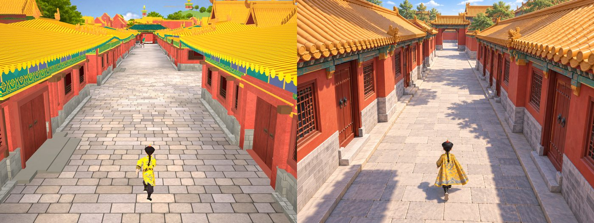
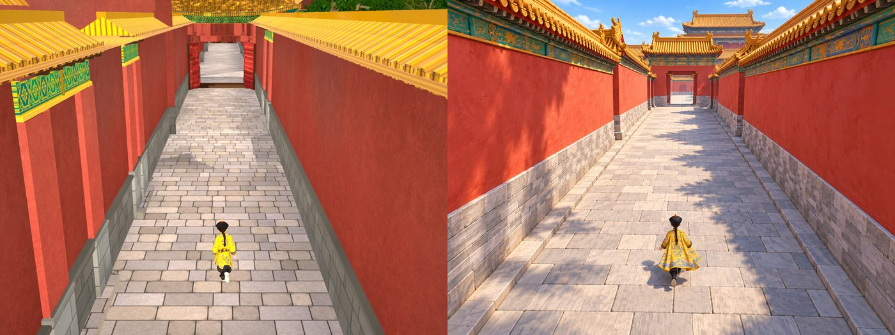
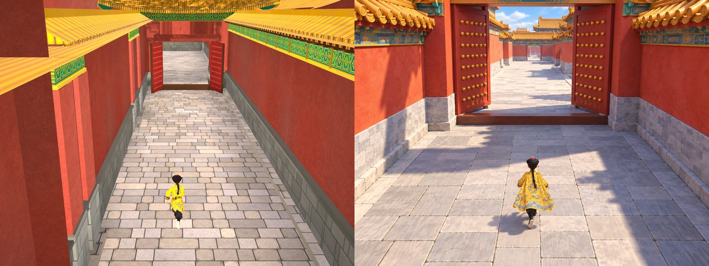
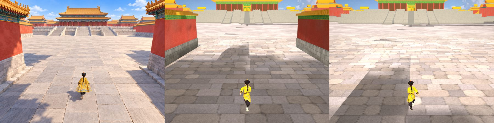
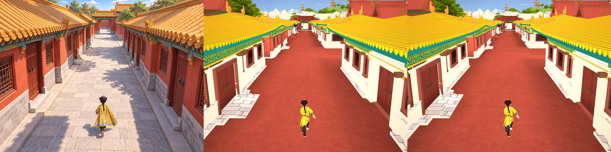
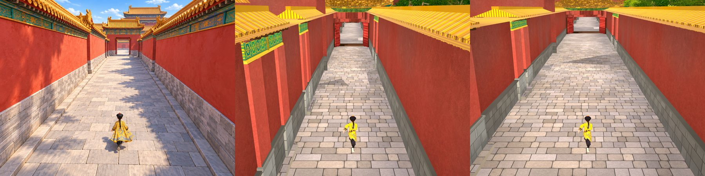
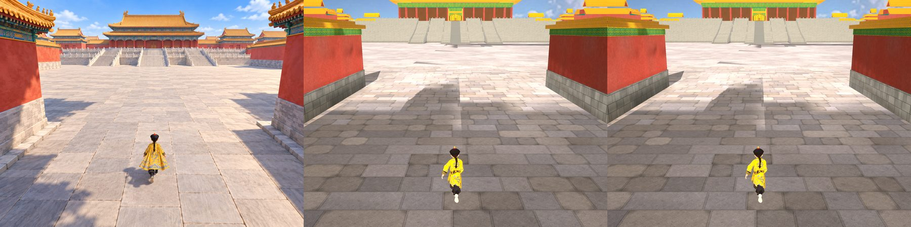
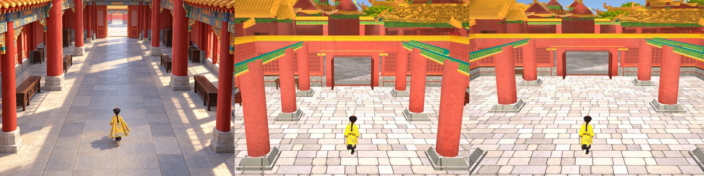
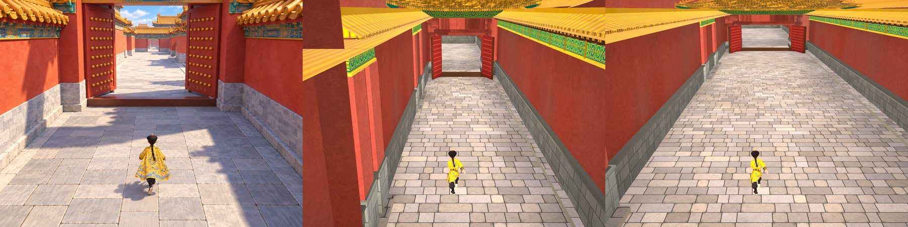

# Havainnemittaus 810/01–07 ja yksi palatsin mittakaava (Natiivi-UI 25.10.2026 klo 10.38)

PT:n tilaukset 25.10. (omistaja 09.54 "autetaan Valoseppää" ja 10.09 "voidaan joustaa totuudesta kunhan pelaaja tunnistaa
todellisuuden rakennukset silti" → "Kyllä, yksi mittakaava"). Varjostimiin ja paketteihin ei koskettu.

- Kuvattu: runko a28be3c7e + Valosepän omistajapari-11 b608eb98c (proto `natiivi-ui/havainne-mittaus-210` 054a90c10, merge ilman
  ristiriitoja) ja vertailuksi pelkkä a28be3c7e. Havainne-editori (`tyokalut/havainne/editori.sh kaikki`), pelikamera 810,
  käsivaran huojunta pois, kuva 4:3. Mittari: Lavastajan `tools/havainne-mittari.py`; räystään alapinta omana mittarina
  (sinivihreän alueen kirkkauden hajonta; tasainen laatta = alle 0,6 × havainteen hajonta) ja silmämääräisesti.
- Ajot: `proto-3d/lokit/havainne-editori-20261025-100926` (a28+b608), `-101544` (a28), `-101930` (SKAALA=1.25).
- ok/vika-rajat ovat Natiivi-UI:n arvio (keisari ±0,04, horisontti ±0,05, räystäs ±0,06, lattia ±15, mustat ±1 %-yks.,
  kylläisyys ±0,05, varjo ±10 %-yks., punainen ±0,08). Geometrian ero on "ero (mitta?)" eikä vika, koska paikat ja mitat ovat
  todelliset (omistaja 20.10. 07.30), ellei omistaja lukitse mittakaavaa alla.
- Työkalukorjaus (proto `natiivi-ui/havainne-skaala-210` f0a0d5053, a28be3c7e:n päällä, junaan): ensimmäisessä ajossa botti juoksi
  maaliin (952 m / 141 s) kesken odotuksen ja 04–07 kuvattiin maalin näköalasta → reitti pysäytetään sääntökortilla
  (`ui juoksupeli saannot`), piirto ja kamera jatkuvat. Lisäksi `SKAALA=<k>`: Esikatselu skaalaa juoksumaailman juuren lapset
  k-kertaisiksi keisarin ympäri vain kuvan piirron ajaksi (keisari, takaa-ajaja, vartijat ja kamera ennallaan; peli ei muutu).

## 0. UUSINTA 25.10. klo 11.11 (PT 11.2x): editorin piirtovika korjattu, väri- ja valomittarit 01–05 uudelleen

**Syy 01:n punaiseen lattiaan:** ei pintojen sidonta eikä pelin vika. Diagnoosi (`Esikatselu.Sidonta`, ajo 11.06): samasta
jäädytetystä hetkestä otetuissa kahdessa kuvassa globaalit pintakuvat (`_JuoksuRappaus` … `_JuoksuLaattaKivi`) ja keisarin
ympäristön materiaalilajit olivat täsmälleen samat, mutta ensimmäinen `Render()` kuvan kokoon piirsi kivilattian (laji 2) pois ja
sen alla olevan rappauksen (laji 10) näkyviin, toinen oikein. Laitteella lattia on kiveä (VS raaka-v9-01). Korjaus
havainne-editoriin (proto `natiivi-ui/havainne-skaala-210`): ensimmäinen piirto hylätään (lämmitysruutu), ja
`tyokalut/havainne/pinnat.py` hylkää ajon, jos lattia keisarin jalkojen ympäriltä on rappauksen punaista (yli 35 %); lisäksi
`VIKA sidonta`, jos jokin globaali pintakuva on väärä. Uusinta `proto-3d/lokit/havainne-editori-20261025-111118`: kaikki kohdat
OK (punaista 0–9 %).

Paikat ovat Lavastajan havainnekameran mukaiset (osa 1). Mittakaavaluvut (metrit, osa 1) eivät muutu.

| kohta | mittari | havainne | nyt (a28+b608) | tila nyt | aiempi (raportti 10.38) | tila aiemmin | muutos |
|---|---|---:|---:|---|---:|---|---|
| 01 | lattia mediaani | 205 | 194 | ok | 103 | VIKA | KUMOUTUU |
| 01 | kylläisyys keskim. | 0.38 | 0.43 | ok | 0.67 | VIKA | KUMOUTUU |
| 01 | punainen kylläisyys | 0.67 | 0.67 | ok | 0.68 | ok | ennallaan |
| 01 | punainen kirkkaus | 0.54 | 0.72 | VIKA | 0.73 | VIKA | ennallaan |
| 01 | varjo-osuus lattiasta % | 36.3 | 7.0 | VIKA | 1.0 | VIKA | ennallaan |
| 02 | lattia mediaani | 200 | 177 | VIKA | 146 | VIKA | muuttui, tila sama |
| 02 | kylläisyys keskim. | 0.40 | 0.51 | VIKA | 0.48 | VIKA | ennallaan |
| 02 | punainen kylläisyys | 0.73 | 0.70 | ok | 0.68 | ok | ennallaan |
| 02 | punainen kirkkaus | 0.71 | 0.65 | ok | 0.63 | VIKA | KUMOUTUU |
| 02 | varjo-osuus lattiasta % | 24.2 | 24.3 | ok | 35.7 | VIKA | KUMOUTUU |
| 03 | lattia mediaani | 193 | 124 | VIKA | 125 | VIKA | ennallaan |
| 03 | kylläisyys keskim. | 0.25 | 0.23 | ok | 0.23 | ok | ennallaan |
| 03 | punainen kylläisyys | 0.64 | 0.69 | ok | 0.69 | ok | ennallaan |
| 03 | punainen kirkkaus | 0.65 | 0.66 | ok | 0.67 | ok | ennallaan |
| 03 | varjo-osuus lattiasta % | 4.9 | 1.1 | ok | 1.1 | ok | ennallaan |
| 03b | lattia mediaani | 193 | 127 | VIKA | – | – | uusi paikka |
| 03b | kylläisyys keskim. | 0.25 | 0.18 | VIKA | – | – | uusi paikka |
| 03b | punainen kylläisyys | 0.64 | 0.63 | ok | – | – | uusi paikka |
| 03b | punainen kirkkaus | 0.65 | 0.87 | VIKA | – | – | uusi paikka |
| 03b | varjo-osuus lattiasta % | 4.9 | 47.6 | VIKA | – | – | uusi paikka |
| 04 | lattia mediaani | 176 | 233 | VIKA | 233 | VIKA | ennallaan |
| 04 | kylläisyys keskim. | 0.33 | 0.43 | VIKA | 0.43 | VIKA | ennallaan |
| 04 | punainen kylläisyys | 0.73 | 0.65 | ok | 0.65 | ok | ennallaan |
| 04 | punainen kirkkaus | 0.53 | 0.82 | VIKA | 0.82 | VIKA | ennallaan |
| 04 | varjo-osuus lattiasta % | 1.6 | 7.0 | ok | 7.0 | ok | ennallaan |
| 05 | lattia mediaani | 204 | 188 | VIKA | – | – | uusi paikka |
| 05 | kylläisyys keskim. | 0.36 | 0.48 | VIKA | – | – | uusi paikka |
| 05 | punainen kylläisyys | 0.71 | 0.69 | ok | – | – | uusi paikka |
| 05 | punainen kirkkaus | 0.60 | 0.61 | ok | – | – | uusi paikka |
| 05 | varjo-osuus lattiasta % | 14.8 | 17.3 | ok | – | – | uusi paikka |

Kumoutuvat aiemmat luvut: **01 lattia ja kylläisyys** (punainen lattia oli editorin piirtovika; nyt 194 / 0,43 vs havainne
205 / 0,38 = ok), **02 punaisen kirkkaus ja varjo-osuus** (paikka oli eri; nyt ok). Osan 2 rivi "kujan lattia näkyy ajoittain
punaisena" kumoutuu: ei pelin eikä mallin vika. Voimassa (VS): 02 lattia tummempi (177 vs 200) ja kylläisempi; 03 lattia
tummempi (124 vs 193); 04 sali vaaleampi (233 vs 176), kylläisempi ja punaiset kirkkaampia; 05 lattia hieman tummempi (188 vs
204) ja kylläisempi; 01 punaiset kirkkaampia ja varjoa vähemmän (7 vs 36 %).

**03 havainteen etäisyydeltä (03b, PT 11.3x):** keisari 11 m pohjoisempana (6,43, −179,7), jolloin porttimuurit ovat havainteen
tapaan ~13 m:n päässä. Taihedian ei silti mahdu kuvaan kuten havainteessa: terassi ja halli jatkuvat kuvan yläreunan yli, koska
havainteessa terassin juuri on ~28 m:n päässä ja pelissä todellisessa paikassaan (~42 m 03b:stä). Havainne | 03 | 03b ilman tekstiä:

## 1. MITTAKAAVA (korjattu 25.10. klo 11.1x, PT 10.4x): korkeus 1,0 ja kujien leveys erikseen

> **KORJAUS 25.10. klo 13.1x (PT 13.0x, Lavastajan laskelma): kujien 02 ja 05 havainneleveydet tässä osassa olivat virheellisiä**
> (7,71 ja 10,70 m), ja niiden pohjalta omistaja päätti 11.32 levennyksen (02 → ~7,7 m, 05 → ~10,7 m). Virheen syyt:
> 1. havainnekuvaan sovellettiin pelin kapean kujan nostettua kameraa (5,0 m / 17,9°), vaikka havainteet on piirretty pelikameran
>    perusasennosta (3,8 m / 14,2°): leveydet ja korkeudet +17 %;
> 2. mittauskohta oli muurin juuri sivukäytävien (02) ja portaiden (05) takana, ei kulkuväylä;
> 3. 05:n muurit jatkettiin kuvan ulkopuolelle (x −0,12 / 1,10).
>
> Oikeat luvut (perusasento, `tyokalut/havainne/leveys.py`, keisarin rivi 0,838):
>
> | kohta | piirre | havainne | peli ennen (b2ff2ff99) | peli jälkeen (719cefaaa) |
> |---|---|---:|---:|---:|
> | 02 | kulkuväylä reunakivien välissä (0,18 / 0,81) | 4,7 m | – | – |
> | 02 | muurista muuriin (sokkelin juuret 0,04 / 0,92) | 6,6 m | 4,1 m | 7,3 m |
> | 02 | muuri (räystään alle) | 3,5 m | 4,4 m | – |
> | 05 | portaiden reunat (0,03 / 0,97); muurit kuvan ulkopuolella → alaraja | ≥ 7,0 m | 4,6 m | 6,1 m |
> | 05 | muuri | 3,6 m | 4,2 m | – |
>
> Johtopäätös: 02 on levennyksen jälkeen ~0,7 m havainnetta leveämpi (muurista muuriin), 05 lähellä havainteen alarajaa. Keisarin
> korkeus perusasennolla: havainne/peli 1,15 (01) ja 0,89 (02) → keskimäärin ~1,0 (aiempi jako 1,1:llä poistuu). Korkeuskerroin 1,0
> pysyy. Leveyskerroin 02 ≈ 1,6, 05 ≥ 1,5 (aiemmin 1,73 ja 2,12). Mittari korjattu: `tyokalut/havainne/leveys.py` (havainne aina
> perusasennolla, mittauskohta pakollinen, kuvan ulkopuolinen piste hylätään) + `leveys_testi.py`, proto `natiivi-ui/havainne-skaala-210`
> 00e40f06a. Alla olevan taulukon 02- ja 05-rivit ovat kumottuja.

Ensimmäinen ehdotus (1,25) mitattiin vain leveydestä, ja osa kuvista oli otettu väärästä paikasta (editorin 05 oli
Meridiaaniportin tunnelissa eikä kujaportilla; 01, 02 ja 06 poikkesivat Lavastajan havainnekameran paikoista). Nyt paikat ovat
Lavastajan raportin mukaiset (`docs/raportit/havainne-810-kohdittain-20261025.md`, Lavastajan checkout) ja mitat on laskettu
metreinä kunkin kohdan omasta pelikamerasta (lokin kamerarivi: 01, 03, 04 korkeus 3,8 m ja katse 14,2° alas; 02 ja 05 kujalla
5,0 m ja 17,9°; pystykenttä 38,8°): rivistä maan etäisyys, pystypiirteen ala- ja yläpäästä korkeus. Keisari mitattiin
havainteessa 1,07–1,15 × pelin keisari, joten suhteet on jaettu 1,1:llä (suhde keisariin). Havainnekuvat ovat tekoälyn
kuvia, joiden syvyys ei ole kaikkialla johdonmukainen; pisteiden poiminnan virhe ±10–15 %. Ajo
`proto-3d/lokit/havainne-editori-20261025-105354` (a28be3c7e + b608eb98c), 06 jätetty pois (PT).

| kohta | piirre | havainne (m) | peli (m) | havainne/peli | suhde keisariin |
|---|---|---:|---:|---:|---:|
| 01 | ovi (oikea) (korkeus) | 2.52 | 2.13 | 1.19 | 1.08 |
| 01 | ovi (vasen) (korkeus) | 2.81 | 2.26 | 1.24 | 1.13 |
| 01 | kulkuväylä keisarin kohdalla (leveys) | 4.55 | 6.06 | 0.75 | 0.68 |
| 02 | muuri (räystään alle) (korkeus) | 3.83 | 4.41 | 0.87 | 0.79 |
| 02 | kuja muurista muuriin keisarin kohdalla (leveys) | 7.71 | 4.07 | 1.90 | 1.73 |
| 03 | porttimuuri (vas) (korkeus) | 3.57 | 3.57 | 1.00 | 0.91 |
| 03 | porttimuuri (oik) (korkeus) | 3.72 | 3.56 | 1.04 | 0.95 |
| 03 | käytävän suu (leveys) | 9.71 | 13.78 | 0.70 | 0.64 |
| 04 | ovi (pohjoinen) (korkeus) | 9.43 | 1.95 | 4.84 | ei käytetty (havainteessa ovi 81 m:n päässä: syvyys epäjohdonmukainen) |
| 04 | pylväsväli lähellä (leveys) | 8.28 | 5.97 | 1.39 | 1.26 |
| 04 | pylväsväli keskellä (leveys) | 9.90 | 5.84 | 1.70 | 1.55 |
| 04 | pylvään paksuus (leveys) | 0.56 | 0.92 | 0.61 | 0.55 |
| 05 | portin ovilehti (korkeus) | 5.29 | 3.21 | 1.65 | 1.50 |
| 05 | porttiaukko (leveys) | 4.23 | 3.20 | 1.32 | 1.20 |
| 05 | muuri (korkeus) | 3.80 | 4.23 | 0.90 | 0.82 |
| 05 | kuja keisarin kohdalla (leveys) | 10.70 | 4.58 | 2.33 | 2.12 |

Kohdittain (suhde keisariin; yli 15 %:n ero leveys- ja korkeuskertoimen välillä = ei yhdellä kertoimella):

| kohta | leveyskerroin | korkeuskerroin | ero | johtopäätös |
|---|---:|---:|---|---|
| 01 lähtökuja | 0,68 (kulkuväylä) | 1,08–1,13 (ovet) | > 15 % | pelin kuja jo havainnetta leveämpi; ovet havainteessa 10 % korkeampia |
| 02 punamuurikuja | 1,73 (muurista muuriin) | 0,79 (muuri) | > 15 % | kuja liian kapea (4,1 m vs havainteen ~7 m); muuri ei ole liian korkea |
| 03 aukio | 0,64 (käytävän suu, eri syvyys 13 / 24 m) | 0,91–0,95 (porttimuurit) | – | korkeus vastaa; leveysluku ei vertailukelpoinen (havainteessa aukio lähempänä) |
| 04 sali | 1,26–1,55 (pylväsväli) | – (pylväät kuvan yli) | – | pylväsväli kapea, pylväät paksuja (0,92 vs 0,56 m) |
| 05 kujaportti | 2,12 (kuja), 1,20 (porttiaukko) | 0,82 (muuri), 1,50 (portin ovilehti) | > 15 % | kuja portin edessä liian kapea; muuri ei liian korkea |

EHDOTUS PT:lle (yksi asia kerrallaan omistajalle):
1. **Korkeuskerroin 1,0 (ei muutosta).** Muurit ovat havainteeseen nähden 0,79–0,95 ja ovet 1,08–1,13: pelin muurit hieman
   korkeampia ja ovet hieman matalampia, mutta pienempi kerroin madaltaisi myös ovia ja portaita (Raamattu 2.177: ihmisen
   kokoisina keisariin ja eunukkeihin nähden). Yksi yhteinen kerroin ei siis paranna korkeuksia.
2. **Kujien leveys erikseen (asettelu, ei rakennusten skaalaus; Lavastaja: rakennuskohtaiset kertoimet kielletty):** kapeat
   kujat 02 (×~1,7: 4,1 → ~7 m) ja 05 portin edustalla (×~2) levennetään siirtämällä muureja; salin 04 pylväsväli ×~1,4 ja
   pylväät ohuemmiksi (~0,6 m, Lavastajan oma mitta). 01 ja 03 ennallaan. Tämä poistaa PT:n huomion "02:ssa räystäs ja
   horisontti kuvan ulkopuolella": kapealla kujalla kamera nousee (5,0 m, 17,9°) ja muuri täyttää kuvan.

Kolmikot ilman tekstiä kuvan päällä (havainne | nykyinen | leveyskorjaus havainnollistettuna vaakavenytyksenä keisarin
ympäri: 02 ×1,7, 04 ×1,4, 05 ×2,0; 01 ja 03 ei muutosta, kolmas kuva = nykyinen). Venytys levittää myös rakennuksia, joten
kuva näyttää kujan leveyden vaikutuksen, ei lopullista asettelua:

Huom. kohdan 01 lattia näkyy samassa ajossa joko punaisena tai kivenä (z-taistelu / rappauskuva, Lavastajan mukaan
V4_lattia piirtyy lajilla 10: VS/PK); kolmikoissa se ei liity mittakaavaan.

## 2. Löydökset vastuittain

| löydös | kohdat | vastuu |
|---|---|---|
| ~~Kujan lattia näkyy ajoittain tasaisen punaisena~~ KUMOTTU 11.11: editorin ensimmäisen piirron vika (osa 0), ei pelissä. (punainen pinta samalla korkeudella kuin Lattia, z-taistelu): 01447dbed, 0d60380af ja a28be3c7e punainen, d2f94a515 kivi; samassa ajossa kerroin 1,25 näytti kiven | 01 | LR (taustan/pohjan pinta) + VS (Lattia) |
| Räystään alapinta tasaisen sinivihreä laatta (havainteessa maalatut parrut ja konsolit); hajonta 8–16 vs havainne 18–42 | 01, 04, 07 | LR (malli) + VS (alapinnan sävytys) |
| Kattotiilien päät isoina keltaisina puolikiekkoina räystään reunassa (havainteessa pienet pyöreät päätytiilet); myös PK:n kuva `proto-3d/lokit/lautaspoyta-04-pari-20261025/lp-lahestyy3.png` | 01 (ja lähikujat) | LR (malli) |
| Lattia tummempi kuin havainteessa 02:ssa (146 vs 200) ja 03:ssa (125 vs 193), sali 04 vaaleampi (233 vs 176); 05 ja 06 ok (07:n lattialuku ei ole vertailukelpoinen yleiskuvassa) | 02, 03, 04 | VS (varjostin, valo) |
| Varjo-osuus: 02 suurempi (36 vs 24 %), 03, 05 ja 06 pienempi (1–6 vs 5–15 %) kuin havainteessa; 01:n luku vääristyy punaisesta lattiasta | 02, 03, 05, 06 | VS (valo) |
| Punaiset pinnat kirkkaampia kuin havainteessa (+0,12…+0,30) | 01, 04, 05, 06, 07 | VS (varjostin) |
| Horisontti ja räystäslinja alempana (pelin muurit korkeampia kuin havainteessa) | 02, 05, 06 | LR (mitat) – mittakaavapäätös |
| b608eb98c (omistajapari-11) vs pelkkä a28: lattia −15…+8, kylläisyys +0,01…+0,07, varjo ±1,3 %-yks., 02:n punainen −0,09; ei muuta ok/vika-tilaa | kaikki | VS |

Räystäät ja tiilenpäät havainnetta vasten:

Kohdan 01 lattia eri runkoversioilla (01447dbed, 406d88bb6 [botti maalissa, ei vertailukelpoinen], 0d60380af, d2f94a515):

## 3. Kohdittain (havainne | a28+b608 | ero | a28)

Huom. tämän osan kuvat ja luvut ovat ajosta 10.09, jossa 05 ja 06 oli kuvattu väärästä paikasta (ks. osa 1); 01–04:n luvut pätevät.

### 01 lähtökuja

| mittari | havainne | a28+b608 | ero | a28 | tila | vastuu |
|---|---:|---:|---:|---:|---|---|
| keisari yläreuna | 0.69 | 0.70 | +0.01 | 0.70 | ok | PK (kamera) |
| keisari korkeus | 0.14 | 0.14 | -0.01 | 0.14 | ok | PK (kamera) |
| keisari keskikohta x | 0.52 | 0.50 | -0.02 | 0.50 | ok | PK (kamera) |
| horisontti (taivaan alaraja) | 0.04 | 0.06 | +0.02 | 0.06 | ok | LR (malli, mitat) |
| räystäs vasen | 0.33 | 0.37 | +0.04 | 0.39 | ok | LR (malli, mitat) |
| räystäs oikea | 0.31 | 0.36 | +0.04 | 0.36 | ok | LR (malli, mitat) |
| lattia mediaani | 205 | 103 | -101.51 | 102 | VIKA | VS (varjostin, valo) |
| mustat (<25) % | 0.4 | 0.3 | -0.15 | 0.3 | ok | VS (varjostin, valo) |
| kylläisyys keskim. | 0.38 | 0.67 | +0.30 | 0.60 | VIKA | VS (varjostin, valo) |
| varjo-osuus lattiasta % | 36.3 | 1.0 | -35.30 | 1.1 | VIKA | VS (varjostin, valo) |
| punainen kylläisyys | 0.67 | 0.68 | +0.01 | 0.68 | ok | VS (varjostin) |
| punainen kirkkaus | 0.54 | 0.73 | +0.19 | 0.70 | VIKA | VS (varjostin) |
| räystään alapinta: osuus % | 0.2 | 2.0 | +1.8 | 2.0 | (kuvasta) | LR (malli) |
| räystään alapinta: kirkkauden hajonta | 19 | 8 | -11 | 8 | tasainen | LR (malli: parrut, konsolit) + VS (alapinnan sävytys) |
| räystään alapinta (silmämääräinen) | maalatut parrut ja konsolit | tasainen sinivihreä laatta | | sama | VIKA | LR (malli) + VS (sävytys) |
| kattotiilien päät (silmämääräinen) | pienet pyöreät päätytiilet | isot keltaiset puolikiekot räystäässä | | sama | VIKA | LR (malli) |
| lattia (silmämääräinen) | harmaa kivetys | tasaisen punainen pinta (z-taistelu, satunnainen) | | sama | VIKA | LR (tausta/pohja) + VS (Lattia) |
| kirkkaus p5/p50/p95 | 48 / 129 / 225 | 71 / 109 / 219 | | 70 / 109 / 204 | | |

### 02 punamuurikuja

| mittari | havainne | a28+b608 | ero | a28 | tila | vastuu |
|---|---:|---:|---:|---:|---|---|
| keisari yläreuna | 0.69 | 0.69 | +0.01 | 0.69 | ok | PK (kamera) |
| keisari korkeus | 0.12 | 0.13 | +0.01 | 0.13 | ok | PK (kamera) |
| keisari keskikohta x | 0.52 | 0.50 | -0.02 | 0.50 | ok | PK (kamera) |
| horisontti (taivaan alaraja) | 0.10 | 0.00 | -0.10 | 0.00 | ero (mitta?) | LR (malli, mitat) |
| räystäs vasen | 0.16 | 0.07 | -0.09 | 0.07 | ero (mitta?) | LR (malli, mitat) |
| räystäs oikea | 0.19 | 0.00 | -0.19 | 0.00 | ero (mitta?) | LR (malli, mitat) |
| lattia mediaani | 200 | 146 | -53.97 | 161 | VIKA | VS (varjostin, valo) |
| mustat (<25) % | 0.2 | 0.0 | -0.22 | 0.0 | ok | VS (varjostin, valo) |
| kylläisyys keskim. | 0.40 | 0.48 | +0.08 | 0.46 | VIKA | VS (varjostin, valo) |
| varjo-osuus lattiasta % | 24.2 | 35.7 | +11.53 | 34.4 | VIKA | VS (varjostin, valo) |
| punainen kylläisyys | 0.73 | 0.68 | -0.06 | 0.66 | ok | VS (varjostin) |
| punainen kirkkaus | 0.71 | 0.63 | -0.09 | 0.72 | VIKA | VS (varjostin) |
| räystään alapinta: osuus % | 0.6 | 0.2 | -0.5 | 0.2 | (kuvasta) | LR (malli) |
| räystään alapinta: kirkkauden hajonta | 18 | 20 | +2 | 19 | ok | LR (malli: parrut, konsolit) + VS (alapinnan sävytys) |
| räystään alapinta / tiilenpäät (silmämääräinen) | muurin harjan tiilenpäät pieninä | harja yläreunan yli, ei näkyvissä | | sama | – | – |
| kirkkaus p5/p50/p95 | 66 / 124 / 221 | 74 / 90 / 207 | | 66 / 111 / 204 | | |

### 03 aukio

| mittari | havainne | a28+b608 | ero | a28 | tila | vastuu |
|---|---:|---:|---:|---:|---|---|
| keisari yläreuna | 0.63 | 0.70 | +0.07 | 0.70 | ero (mitta?) | PK (kamera) |
| keisari korkeus | 0.12 | 0.14 | +0.02 | 0.13 | ok | PK (kamera) |
| keisari keskikohta x | 0.51 | 0.50 | -0.01 | 0.50 | ok | PK (kamera) |
| horisontti (taivaan alaraja) | 0.06 | 0.00 | -0.06 | 0.00 | ero (mitta?) | LR (malli, mitat) |
| räystäs vasen | 0.11 | 0.12 | +0.01 | 0.12 | ok | LR (malli, mitat) |
| räystäs oikea | 0.08 | 0.12 | +0.04 | 0.12 | ok | LR (malli, mitat) |
| lattia mediaani | 193 | 125 | -68.41 | 122 | VIKA | VS (varjostin, valo) |
| mustat (<25) % | 0.1 | 0.0 | -0.08 | 0.0 | ok | VS (varjostin, valo) |
| kylläisyys keskim. | 0.25 | 0.23 | -0.03 | 0.20 | ok | VS (varjostin, valo) |
| varjo-osuus lattiasta % | 4.9 | 1.1 | -3.82 | 1.0 | ok | VS (varjostin, valo) |
| punainen kylläisyys | 0.64 | 0.69 | +0.05 | 0.68 | ok | VS (varjostin) |
| punainen kirkkaus | 0.65 | 0.67 | +0.01 | 0.66 | ok | VS (varjostin) |
| räystään alapinta: osuus % | 0.1 | 0.0 | -0.1 | 0.0 | (kuvasta) | LR (malli) |
| räystään alapinta: kirkkauden hajonta | 16 | nan | +nan | nan | ei näkyvissä | LR (malli: parrut, konsolit) + VS (alapinnan sävytys) |
| kirkkaus p5/p50/p95 | 80 / 188 / 225 | 87 / 132 / 239 | | 86 / 128 / 237 | | |

### 04 sali (katto avattu)

| mittari | havainne | a28+b608 | ero | a28 | tila | vastuu |
|---|---:|---:|---:|---:|---|---|
| keisari yläreuna | 0.66 | 0.69 | +0.03 | 0.70 | ok | PK (kamera) |
| keisari korkeus | 0.12 | 0.13 | +0.01 | 0.14 | ok | PK (kamera) |
| keisari keskikohta x | 0.50 | 0.50 | -0.00 | 0.50 | ok | PK (kamera) |
| horisontti (taivaan alaraja) | 0.00 | 0.00 | +0.00 | 0.00 | ok | LR (malli, mitat) |
| räystäs vasen | 0.15 | 0.14 | -0.01 | 0.14 | ok | LR (malli, mitat) |
| räystäs oikea | 0.04 | 0.15 | +0.11 | 0.15 | ero (mitta?) | LR (malli, mitat) |
| lattia mediaani | 176 | 233 | +57.28 | 225 | VIKA | VS (varjostin, valo) |
| mustat (<25) % | 1.2 | 0.0 | -1.19 | 0.0 | VIKA | VS (varjostin, valo) |
| kylläisyys keskim. | 0.33 | 0.43 | +0.11 | 0.42 | VIKA | VS (varjostin, valo) |
| varjo-osuus lattiasta % | 1.6 | 7.0 | +5.44 | 7.5 | ok | VS (varjostin, valo) |
| punainen kylläisyys | 0.73 | 0.65 | -0.08 | 0.65 | ok | VS (varjostin) |
| punainen kirkkaus | 0.53 | 0.82 | +0.30 | 0.81 | VIKA | VS (varjostin) |
| räystään alapinta: osuus % | 0.2 | 1.0 | +0.8 | 1.0 | (kuvasta) | LR (malli) |
| räystään alapinta: kirkkauden hajonta | 42 | 16 | -26 | 15 | tasainen | LR (malli: parrut, konsolit) + VS (alapinnan sävytys) |
| räystään alapinta (silmämääräinen) | maalattu palkisto | tasaiset sinivihreät nauhat pihan räystäissä | | sama | VIKA | LR (malli) + VS (sävytys) |
| kattotiilien päät (silmämääräinen) | – | keltainen nauha, ei kiekkoja | | sama | ok | – |
| kirkkaus p5/p50/p95 | 37 / 134 / 228 | 76 / 150 / 252 | | 74 / 148 / 246 | | |

### 05 porttikäytävä

| mittari | havainne | a28+b608 | ero | a28 | tila | vastuu |
|---|---:|---:|---:|---:|---|---|
| keisari yläreuna | 0.64 | 0.69 | +0.05 | 0.70 | ero (mitta?) | PK (kamera) |
| keisari korkeus | 0.15 | 0.13 | -0.02 | 0.13 | ok | PK (kamera) |
| keisari keskikohta x | 0.51 | 0.50 | -0.01 | 0.50 | ok | PK (kamera) |
| horisontti (taivaan alaraja) | 0.08 | 0.00 | -0.08 | 0.00 | ero (mitta?) | LR (malli, mitat) |
| räystäs vasen | 0.17 | 0.00 | -0.17 | 0.00 | ero (mitta?) | LR (malli, mitat) |
| räystäs oikea | 0.17 | 0.00 | -0.17 | 0.00 | ero (mitta?) | LR (malli, mitat) |
| lattia mediaani | 204 | 222 | +18.01 | 220 | VIKA | VS (varjostin, valo) |
| mustat (<25) % | 0.1 | 0.0 | -0.12 | 0.0 | ok | VS (varjostin, valo) |
| kylläisyys keskim. | 0.36 | 0.42 | +0.06 | 0.41 | VIKA | VS (varjostin, valo) |
| varjo-osuus lattiasta % | 14.8 | 5.8 | -8.95 | 6.1 | ok | VS (varjostin, valo) |
| punainen kylläisyys | 0.71 | 0.66 | -0.06 | 0.66 | ok | VS (varjostin) |
| punainen kirkkaus | 0.60 | 0.84 | +0.24 | 0.84 | VIKA | VS (varjostin) |
| räystään alapinta: osuus % | 0.2 | 0.0 | -0.2 | 0.0 | (kuvasta) | LR (malli) |
| räystään alapinta: kirkkauden hajonta | 27 | nan | +nan | nan | ei näkyvissä | LR (malli: parrut, konsolit) + VS (alapinnan sävytys) |
| kirkkaus p5/p50/p95 | 52 / 123 / 227 | 104 / 128 / 247 | | 103 / 127 / 246 | | |

### 06 Meridiaaniportti

| mittari | havainne | a28+b608 | ero | a28 | tila | vastuu |
|---|---:|---:|---:|---:|---|---|
| keisari yläreuna | 0.71 | 0.70 | -0.01 | 0.69 | ok | PK (kamera) |
| keisari korkeus | 0.12 | 0.14 | +0.02 | 0.13 | ok | PK (kamera) |
| keisari keskikohta x | 0.51 | 0.50 | -0.01 | 0.50 | ok | PK (kamera) |
| horisontti (taivaan alaraja) | 0.07 | 0.00 | -0.07 | 0.00 | ero (mitta?) | LR (malli, mitat) |
| räystäs vasen | 0.27 | 0.00 | -0.27 | 0.00 | ero (mitta?) | LR (malli, mitat) |
| räystäs oikea | 0.27 | 0.00 | -0.27 | 0.00 | ero (mitta?) | LR (malli, mitat) |
| lattia mediaani | 200 | 203 | +2.93 | 201 | ok | VS (varjostin, valo) |
| mustat (<25) % | 0.1 | 0.0 | -0.06 | 0.0 | ok | VS (varjostin, valo) |
| kylläisyys keskim. | 0.34 | 0.23 | -0.11 | 0.22 | VIKA | VS (varjostin, valo) |
| varjo-osuus lattiasta % | 12.2 | 6.1 | -6.10 | 6.1 | ok | VS (varjostin, valo) |
| punainen kylläisyys | 0.65 | 0.66 | +0.01 | 0.65 | ok | VS (varjostin) |
| punainen kirkkaus | 0.61 | 0.72 | +0.12 | 0.72 | VIKA | VS (varjostin) |
| räystään alapinta: osuus % | 0.1 | 0.0 | -0.1 | 0.0 | (kuvasta) | LR (malli) |
| räystään alapinta: kirkkauden hajonta | 21 | nan | +nan | nan | ei näkyvissä | LR (malli: parrut, konsolit) + VS (alapinnan sävytys) |
| kirkkaus p5/p50/p95 | 58 / 163 / 222 | 87 / 200 / 243 | | 87 / 198 / 241 | | |

### 07 yleiskuva ylhäältä

| mittari | havainne | a28+b608 | ero | a28 | tila | vastuu |
|---|---:|---:|---:|---:|---|---|
| horisontti (taivaan alaraja) | 0.19 | 0.00 | -0.19 | 0.00 | ero (mitta?) | LR (malli, mitat) |
| räystäs vasen | 0.34 | 0.37 | +0.04 | 0.37 | ok | LR (malli, mitat) |
| räystäs oikea | 0.59 | 0.29 | -0.31 | 0.29 | ero (mitta?) | LR (malli, mitat) |
| lattia mediaani | 110 | 220 | +110.44 | 214 | VIKA | VS (varjostin, valo) |
| mustat (<25) % | 0.0 | 0.0 | -0.00 | 0.0 | ok | VS (varjostin, valo) |
| kylläisyys keskim. | 0.39 | 0.25 | -0.14 | 0.25 | VIKA | VS (varjostin, valo) |
| varjo-osuus lattiasta % | 67.9 | 12.1 | -55.78 | 11.5 | VIKA | VS (varjostin, valo) |
| punainen kylläisyys | 0.56 | 0.48 | -0.07 | 0.48 | ok | VS (varjostin) |
| punainen kirkkaus | 0.68 | 0.92 | +0.24 | 0.91 | VIKA | VS (varjostin) |
| räystään alapinta: osuus % | 4.2 | 3.7 | -0.5 | 3.7 | (kuvasta) | LR (malli) |
| räystään alapinta: kirkkauden hajonta | 18 | 10 | -7 | 9 | tasainen | LR (malli: parrut, konsolit) + VS (alapinnan sävytys) |
| kirkkaus p5/p50/p95 | 72 / 131 / 219 | 119 / 209 / 247 | | 117 / 206 / 241 | | |

