# Havainnemittaus 810/01–07 ja yksi palatsin mittakaava (Natiivi-UI 25.10.2026 klo 10.38)

PT:n tilaukset 25.10. (omistaja 09.54 "autetaan Valoseppää" ja 10.09 "voidaan joustaa totuudesta kunhan pelaaja tunnistaa
todellisuuden rakennukset silti" → "Kyllä, yksi mittakaava"). Varjostimiin ja paketteihin ei koskettu.

- Kuvattu: runko a28be3c7e + Valosepän omistajapari-11 b608eb98c (proto `natiivi-ui/havainne-mittaus-210` 054a90c10, merge ilman
  ristiriitoja) ja vertailuksi pelkkä a28be3c7e. Havainne-editori (`tyokalut/havainne/editori.sh kaikki`), pelikamera 810,
  käsivaran huojunta pois, kuva 4:3. Mittari: Lavastajan `tools/havainne-mittari.py`; räystään alapinta omana mittarina
  (sinivihreän alueen kirkkauden hajonta; tasainen laatta = alle 0,6 × havainteen hajonta) ja silmämääräisesti.
- Ajot: `proto-3d/lokit/havainne-editori-20261025-100926` (a28+b608), `-101544` (a28), `-101930` (SKAALA=1.25).
- ok/vika-rajat ovat Natiivi-UI:n arvio (keisari ±0,04, horisontti ±0,05, räystäs ±0,06, lattia ±15, mustat ±1 %-yks.,
  kylläisyys ±0,05, varjo ±10 %-yks., punainen ±0,08). Geometrian ero on "ero (mitta?)" eikä vika, koska paikat ja mitat ovat
  todelliset (omistaja 20.10. 07.30), ellei omistaja lukitse mittakaavaa alla.
- Työkalukorjaus (proto `natiivi-ui/havainne-skaala-210` f0a0d5053, a28be3c7e:n päällä, junaan): ensimmäisessä ajossa botti juoksi
  maaliin (952 m / 141 s) kesken odotuksen ja 04–07 kuvattiin maalin näköalasta → reitti pysäytetään sääntökortilla
  (`ui juoksupeli saannot`), piirto ja kamera jatkuvat. Lisäksi `SKAALA=<k>`: Esikatselu skaalaa juoksumaailman juuren lapset
  k-kertaisiksi keisarin ympäri vain kuvan piirron ajaksi (keisari, takaa-ajaja, vartijat ja kamera ennallaan; peli ei muutu).

## 1. YKSI MITTAKAAVA: ehdotus 1,25

Palatsi (rakennukset, muurit, lattia, tausta) 1,25-kertaiseksi keisariin ja pelikameraan nähden. Mitattu keisarin kohdalta kujan tai
salin leveys havainteessa ja pelissä (keisari on molemmissa samankokoinen, 0,12–0,15 kuvan korkeudesta, joten kamera vastaa):

| kohta | havainne / peli (leveys keisarin kohdalla) | 1,25:llä | perustelu |
|---|---:|---|---|
| 01 lähtökuja | ≈ 1,0 | kuja 25 % havainnetta leveämpi | ainoa kohta, jossa nykyinen jo vastaa; leveämpi kuja ei peitä keisaria eikä räystäät kujaa |
| 02 punamuurikuja | ≈ 1,57 | yhä kapeampi kuin havainteessa | kujan muoto: havainteen muuri on kujaan nähden puolet matalampi; tätä yksi kerroin ei muuta (LR: muurin korkeus / kujan leveys) |
| 03 aukio | ≈ 1,2 | vastaa | porttimuurit ja aukio havainteen kokoisia; Taihedian on jo nyt kuvassa havainnetta suurempi, kerroin kasvattaa sitä vähän |
| 04 sali | ≈ 1,14 | vastaa (pylväsväli) | pylväsrivit siirtyvät kuvan reunoille kuten havainteessa; pylväät ovat pelissä paksumpia (LR) |
| 05 porttikäytävä | ≈ 1,5 | lähempänä | käytävä levenee; portti jää yhä kapeammaksi kuin havainteessa |
| 06 Meridiaaniportti | – | – | kuvauspaikka on arvio (eri portti kuvassa), ei luotettavaa mittaa |
| 07 yleiskuva | – | sama kuva, kun kamera siirtyy 1,25 × kauemmas | yleiskuvan kamera ei ole keisariin sidottu, joten mittakaava ei näy siinä |

Mediaani 1,2, keskiarvo 1,28 (01–05). 1,25 on kompromissi: kujat ja salit leviävät havainteen leveyteen (01–05), keisari näkyy kaikissa
kuvissa, eivätkä katot peitä kujia (kujat leviävät enemmän kuin räystäät). Hinta: hallit ovat 25 % isompia, joten iso halli mahtuu
kuvaan hieman heikommin (03), ja ovet ja portaat kasvavat 1,25-kertaisiksi. Ihmisen kokoiset osat (portaan askelma, ovenkahvat,
penkit ja kalusteet) kannattaa pitää ennallaan mallissa (LR), jolloin "ovet ja portaat ihmisen kokoisina" säilyy.

Kuvat ilman tekstiä kuvan päällä (havainne | nykyinen | kertoimella 1,25), KK:lle omistajalle näytettäviksi:

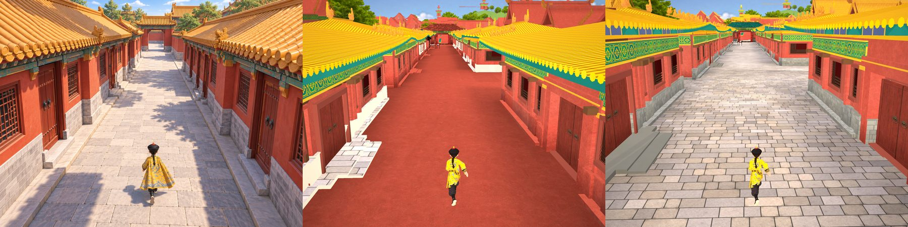
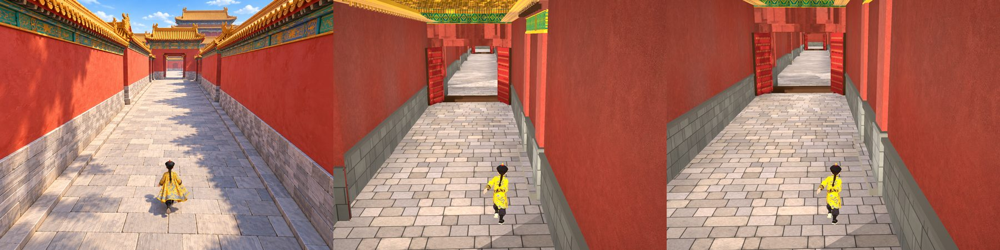
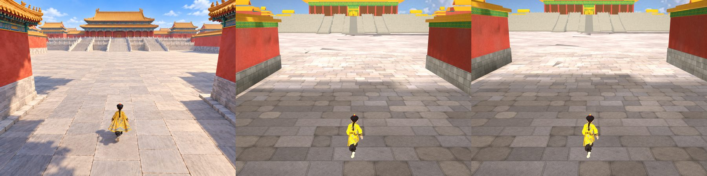
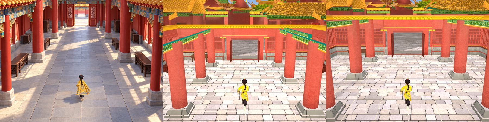
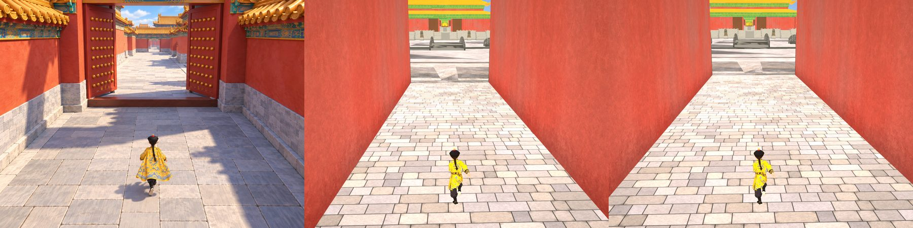
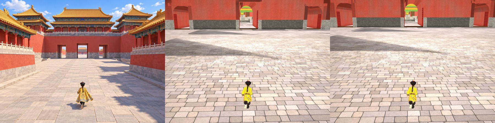
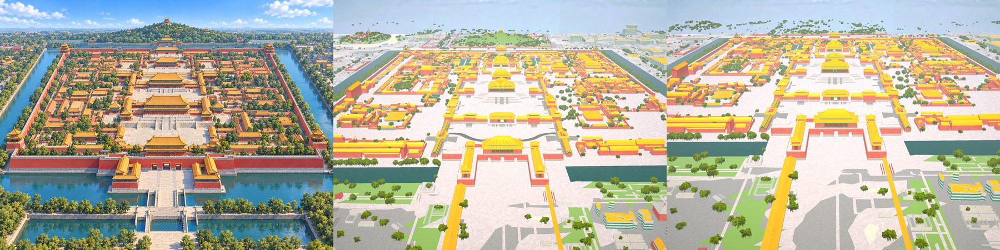

Huom. 07:n kolmas kuva on skaalattu keisarin ympäri, joten palatsi ei mahdu siihen; pelissä yleiskuvan kamera siirtyisi samassa
suhteessa, ja kuva olisi sama kuin keskimmäinen.

## 2. Löydökset vastuittain

| löydös | kohdat | vastuu |
|---|---|---|
| Kujan lattia näkyy ajoittain tasaisen punaisena (punainen pinta samalla korkeudella kuin Lattia, z-taistelu): 01447dbed, 0d60380af ja a28be3c7e punainen, d2f94a515 kivi; samassa ajossa kerroin 1,25 näytti kiven | 01 | LR (taustan/pohjan pinta) + VS (Lattia) |
| Räystään alapinta tasaisen sinivihreä laatta (havainteessa maalatut parrut ja konsolit); hajonta 8–16 vs havainne 18–42 | 01, 04, 07 | LR (malli) + VS (alapinnan sävytys) |
| Kattotiilien päät isoina keltaisina puolikiekkoina räystään reunassa (havainteessa pienet pyöreät päätytiilet); myös PK:n kuva `proto-3d/lokit/lautaspoyta-04-pari-20261025/lp-lahestyy3.png` | 01 (ja lähikujat) | LR (malli) |
| Lattia tummempi kuin havainteessa 02:ssa (146 vs 200) ja 03:ssa (125 vs 193), sali 04 vaaleampi (233 vs 176); 05 ja 06 ok (07:n lattialuku ei ole vertailukelpoinen yleiskuvassa) | 02, 03, 04 | VS (varjostin, valo) |
| Varjo-osuus: 02 suurempi (36 vs 24 %), 03, 05 ja 06 pienempi (1–6 vs 5–15 %) kuin havainteessa; 01:n luku vääristyy punaisesta lattiasta | 02, 03, 05, 06 | VS (valo) |
| Punaiset pinnat kirkkaampia kuin havainteessa (+0,12…+0,30) | 01, 04, 05, 06, 07 | VS (varjostin) |
| Horisontti ja räystäslinja alempana (pelin muurit korkeampia kuin havainteessa) | 02, 05, 06 | LR (mitat) – mittakaavapäätös |
| b608eb98c (omistajapari-11) vs pelkkä a28: lattia −15…+8, kylläisyys +0,01…+0,07, varjo ±1,3 %-yks., 02:n punainen −0,09; ei muuta ok/vika-tilaa | kaikki | VS |

Räystäät ja tiilenpäät havainnetta vasten:

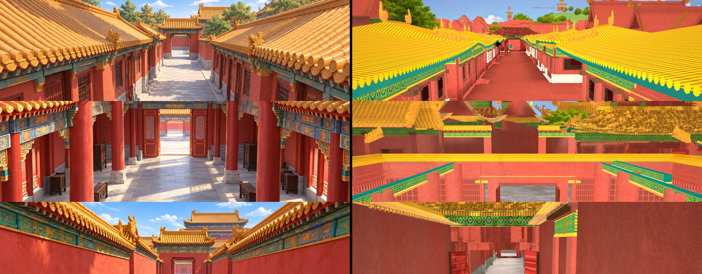

Kohdan 01 lattia eri runkoversioilla (01447dbed, 406d88bb6 [botti maalissa, ei vertailukelpoinen], 0d60380af, d2f94a515):

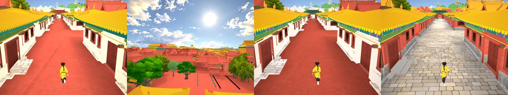

## 3. Kohdittain (havainne | a28+b608 | ero | a28)

### 01 lähtökuja

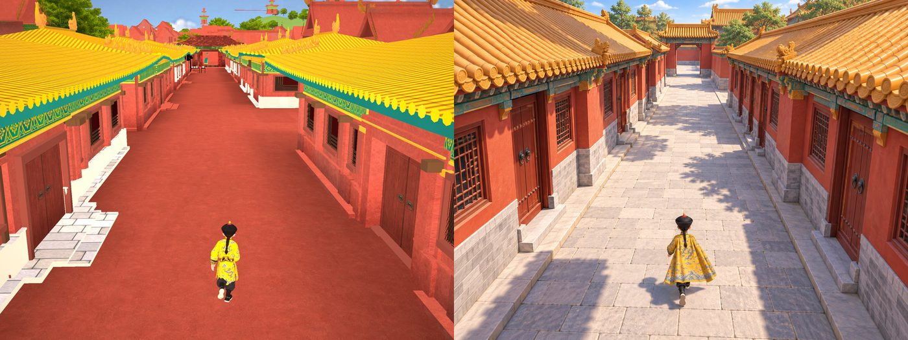

| mittari | havainne | a28+b608 | ero | a28 | tila | vastuu |
|---|---:|---:|---:|---:|---|---|
| keisari yläreuna | 0.69 | 0.70 | +0.01 | 0.70 | ok | PK (kamera) |
| keisari korkeus | 0.14 | 0.14 | -0.01 | 0.14 | ok | PK (kamera) |
| keisari keskikohta x | 0.52 | 0.50 | -0.02 | 0.50 | ok | PK (kamera) |
| horisontti (taivaan alaraja) | 0.04 | 0.06 | +0.02 | 0.06 | ok | LR (malli, mitat) |
| räystäs vasen | 0.33 | 0.37 | +0.04 | 0.39 | ok | LR (malli, mitat) |
| räystäs oikea | 0.31 | 0.36 | +0.04 | 0.36 | ok | LR (malli, mitat) |
| lattia mediaani | 205 | 103 | -101.51 | 102 | VIKA | VS (varjostin, valo) |
| mustat (<25) % | 0.4 | 0.3 | -0.15 | 0.3 | ok | VS (varjostin, valo) |
| kylläisyys keskim. | 0.38 | 0.67 | +0.30 | 0.60 | VIKA | VS (varjostin, valo) |
| varjo-osuus lattiasta % | 36.3 | 1.0 | -35.30 | 1.1 | VIKA | VS (varjostin, valo) |
| punainen kylläisyys | 0.67 | 0.68 | +0.01 | 0.68 | ok | VS (varjostin) |
| punainen kirkkaus | 0.54 | 0.73 | +0.19 | 0.70 | VIKA | VS (varjostin) |
| räystään alapinta: osuus % | 0.2 | 2.0 | +1.8 | 2.0 | (kuvasta) | LR (malli) |
| räystään alapinta: kirkkauden hajonta | 19 | 8 | -11 | 8 | tasainen | LR (malli: parrut, konsolit) + VS (alapinnan sävytys) |
| räystään alapinta (silmämääräinen) | maalatut parrut ja konsolit | tasainen sinivihreä laatta | | sama | VIKA | LR (malli) + VS (sävytys) |
| kattotiilien päät (silmämääräinen) | pienet pyöreät päätytiilet | isot keltaiset puolikiekot räystäässä | | sama | VIKA | LR (malli) |
| lattia (silmämääräinen) | harmaa kivetys | tasaisen punainen pinta (z-taistelu, satunnainen) | | sama | VIKA | LR (tausta/pohja) + VS (Lattia) |
| kirkkaus p5/p50/p95 | 48 / 129 / 225 | 71 / 109 / 219 | | 70 / 109 / 204 | | |

### 02 punamuurikuja

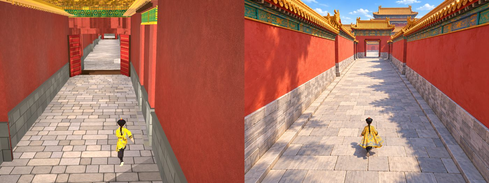

| mittari | havainne | a28+b608 | ero | a28 | tila | vastuu |
|---|---:|---:|---:|---:|---|---|
| keisari yläreuna | 0.69 | 0.69 | +0.01 | 0.69 | ok | PK (kamera) |
| keisari korkeus | 0.12 | 0.13 | +0.01 | 0.13 | ok | PK (kamera) |
| keisari keskikohta x | 0.52 | 0.50 | -0.02 | 0.50 | ok | PK (kamera) |
| horisontti (taivaan alaraja) | 0.10 | 0.00 | -0.10 | 0.00 | ero (mitta?) | LR (malli, mitat) |
| räystäs vasen | 0.16 | 0.07 | -0.09 | 0.07 | ero (mitta?) | LR (malli, mitat) |
| räystäs oikea | 0.19 | 0.00 | -0.19 | 0.00 | ero (mitta?) | LR (malli, mitat) |
| lattia mediaani | 200 | 146 | -53.97 | 161 | VIKA | VS (varjostin, valo) |
| mustat (<25) % | 0.2 | 0.0 | -0.22 | 0.0 | ok | VS (varjostin, valo) |
| kylläisyys keskim. | 0.40 | 0.48 | +0.08 | 0.46 | VIKA | VS (varjostin, valo) |
| varjo-osuus lattiasta % | 24.2 | 35.7 | +11.53 | 34.4 | VIKA | VS (varjostin, valo) |
| punainen kylläisyys | 0.73 | 0.68 | -0.06 | 0.66 | ok | VS (varjostin) |
| punainen kirkkaus | 0.71 | 0.63 | -0.09 | 0.72 | VIKA | VS (varjostin) |
| räystään alapinta: osuus % | 0.6 | 0.2 | -0.5 | 0.2 | (kuvasta) | LR (malli) |
| räystään alapinta: kirkkauden hajonta | 18 | 20 | +2 | 19 | ok | LR (malli: parrut, konsolit) + VS (alapinnan sävytys) |
| räystään alapinta / tiilenpäät (silmämääräinen) | muurin harjan tiilenpäät pieninä | harja yläreunan yli, ei näkyvissä | | sama | – | – |
| kirkkaus p5/p50/p95 | 66 / 124 / 221 | 74 / 90 / 207 | | 66 / 111 / 204 | | |

### 03 aukio

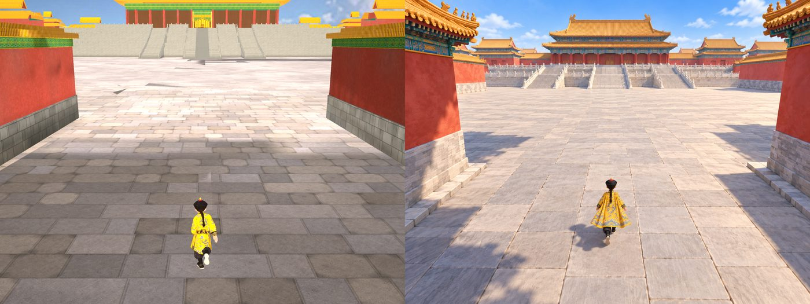

| mittari | havainne | a28+b608 | ero | a28 | tila | vastuu |
|---|---:|---:|---:|---:|---|---|
| keisari yläreuna | 0.63 | 0.70 | +0.07 | 0.70 | ero (mitta?) | PK (kamera) |
| keisari korkeus | 0.12 | 0.14 | +0.02 | 0.13 | ok | PK (kamera) |
| keisari keskikohta x | 0.51 | 0.50 | -0.01 | 0.50 | ok | PK (kamera) |
| horisontti (taivaan alaraja) | 0.06 | 0.00 | -0.06 | 0.00 | ero (mitta?) | LR (malli, mitat) |
| räystäs vasen | 0.11 | 0.12 | +0.01 | 0.12 | ok | LR (malli, mitat) |
| räystäs oikea | 0.08 | 0.12 | +0.04 | 0.12 | ok | LR (malli, mitat) |
| lattia mediaani | 193 | 125 | -68.41 | 122 | VIKA | VS (varjostin, valo) |
| mustat (<25) % | 0.1 | 0.0 | -0.08 | 0.0 | ok | VS (varjostin, valo) |
| kylläisyys keskim. | 0.25 | 0.23 | -0.03 | 0.20 | ok | VS (varjostin, valo) |
| varjo-osuus lattiasta % | 4.9 | 1.1 | -3.82 | 1.0 | ok | VS (varjostin, valo) |
| punainen kylläisyys | 0.64 | 0.69 | +0.05 | 0.68 | ok | VS (varjostin) |
| punainen kirkkaus | 0.65 | 0.67 | +0.01 | 0.66 | ok | VS (varjostin) |
| räystään alapinta: osuus % | 0.1 | 0.0 | -0.1 | 0.0 | (kuvasta) | LR (malli) |
| räystään alapinta: kirkkauden hajonta | 16 | nan | +nan | nan | ei näkyvissä | LR (malli: parrut, konsolit) + VS (alapinnan sävytys) |
| kirkkaus p5/p50/p95 | 80 / 188 / 225 | 87 / 132 / 239 | | 86 / 128 / 237 | | |

### 04 sali (katto avattu)

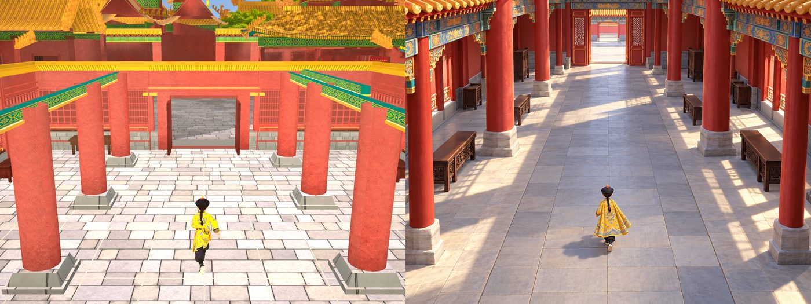

| mittari | havainne | a28+b608 | ero | a28 | tila | vastuu |
|---|---:|---:|---:|---:|---|---|
| keisari yläreuna | 0.66 | 0.69 | +0.03 | 0.70 | ok | PK (kamera) |
| keisari korkeus | 0.12 | 0.13 | +0.01 | 0.14 | ok | PK (kamera) |
| keisari keskikohta x | 0.50 | 0.50 | -0.00 | 0.50 | ok | PK (kamera) |
| horisontti (taivaan alaraja) | 0.00 | 0.00 | +0.00 | 0.00 | ok | LR (malli, mitat) |
| räystäs vasen | 0.15 | 0.14 | -0.01 | 0.14 | ok | LR (malli, mitat) |
| räystäs oikea | 0.04 | 0.15 | +0.11 | 0.15 | ero (mitta?) | LR (malli, mitat) |
| lattia mediaani | 176 | 233 | +57.28 | 225 | VIKA | VS (varjostin, valo) |
| mustat (<25) % | 1.2 | 0.0 | -1.19 | 0.0 | VIKA | VS (varjostin, valo) |
| kylläisyys keskim. | 0.33 | 0.43 | +0.11 | 0.42 | VIKA | VS (varjostin, valo) |
| varjo-osuus lattiasta % | 1.6 | 7.0 | +5.44 | 7.5 | ok | VS (varjostin, valo) |
| punainen kylläisyys | 0.73 | 0.65 | -0.08 | 0.65 | ok | VS (varjostin) |
| punainen kirkkaus | 0.53 | 0.82 | +0.30 | 0.81 | VIKA | VS (varjostin) |
| räystään alapinta: osuus % | 0.2 | 1.0 | +0.8 | 1.0 | (kuvasta) | LR (malli) |
| räystään alapinta: kirkkauden hajonta | 42 | 16 | -26 | 15 | tasainen | LR (malli: parrut, konsolit) + VS (alapinnan sävytys) |
| räystään alapinta (silmämääräinen) | maalattu palkisto | tasaiset sinivihreät nauhat pihan räystäissä | | sama | VIKA | LR (malli) + VS (sävytys) |
| kattotiilien päät (silmämääräinen) | – | keltainen nauha, ei kiekkoja | | sama | ok | – |
| kirkkaus p5/p50/p95 | 37 / 134 / 228 | 76 / 150 / 252 | | 74 / 148 / 246 | | |

### 05 porttikäytävä

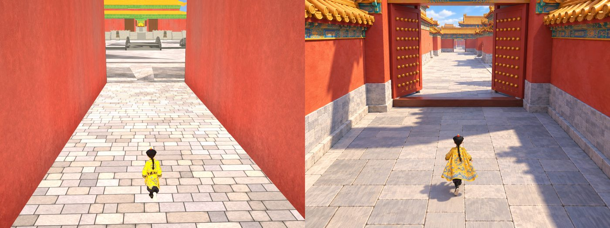

| mittari | havainne | a28+b608 | ero | a28 | tila | vastuu |
|---|---:|---:|---:|---:|---|---|
| keisari yläreuna | 0.64 | 0.69 | +0.05 | 0.70 | ero (mitta?) | PK (kamera) |
| keisari korkeus | 0.15 | 0.13 | -0.02 | 0.13 | ok | PK (kamera) |
| keisari keskikohta x | 0.51 | 0.50 | -0.01 | 0.50 | ok | PK (kamera) |
| horisontti (taivaan alaraja) | 0.08 | 0.00 | -0.08 | 0.00 | ero (mitta?) | LR (malli, mitat) |
| räystäs vasen | 0.17 | 0.00 | -0.17 | 0.00 | ero (mitta?) | LR (malli, mitat) |
| räystäs oikea | 0.17 | 0.00 | -0.17 | 0.00 | ero (mitta?) | LR (malli, mitat) |
| lattia mediaani | 204 | 222 | +18.01 | 220 | VIKA | VS (varjostin, valo) |
| mustat (<25) % | 0.1 | 0.0 | -0.12 | 0.0 | ok | VS (varjostin, valo) |
| kylläisyys keskim. | 0.36 | 0.42 | +0.06 | 0.41 | VIKA | VS (varjostin, valo) |
| varjo-osuus lattiasta % | 14.8 | 5.8 | -8.95 | 6.1 | ok | VS (varjostin, valo) |
| punainen kylläisyys | 0.71 | 0.66 | -0.06 | 0.66 | ok | VS (varjostin) |
| punainen kirkkaus | 0.60 | 0.84 | +0.24 | 0.84 | VIKA | VS (varjostin) |
| räystään alapinta: osuus % | 0.2 | 0.0 | -0.2 | 0.0 | (kuvasta) | LR (malli) |
| räystään alapinta: kirkkauden hajonta | 27 | nan | +nan | nan | ei näkyvissä | LR (malli: parrut, konsolit) + VS (alapinnan sävytys) |
| kirkkaus p5/p50/p95 | 52 / 123 / 227 | 104 / 128 / 247 | | 103 / 127 / 246 | | |

### 06 Meridiaaniportti

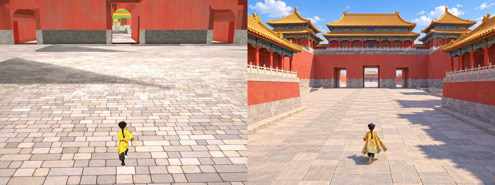

| mittari | havainne | a28+b608 | ero | a28 | tila | vastuu |
|---|---:|---:|---:|---:|---|---|
| keisari yläreuna | 0.71 | 0.70 | -0.01 | 0.69 | ok | PK (kamera) |
| keisari korkeus | 0.12 | 0.14 | +0.02 | 0.13 | ok | PK (kamera) |
| keisari keskikohta x | 0.51 | 0.50 | -0.01 | 0.50 | ok | PK (kamera) |
| horisontti (taivaan alaraja) | 0.07 | 0.00 | -0.07 | 0.00 | ero (mitta?) | LR (malli, mitat) |
| räystäs vasen | 0.27 | 0.00 | -0.27 | 0.00 | ero (mitta?) | LR (malli, mitat) |
| räystäs oikea | 0.27 | 0.00 | -0.27 | 0.00 | ero (mitta?) | LR (malli, mitat) |
| lattia mediaani | 200 | 203 | +2.93 | 201 | ok | VS (varjostin, valo) |
| mustat (<25) % | 0.1 | 0.0 | -0.06 | 0.0 | ok | VS (varjostin, valo) |
| kylläisyys keskim. | 0.34 | 0.23 | -0.11 | 0.22 | VIKA | VS (varjostin, valo) |
| varjo-osuus lattiasta % | 12.2 | 6.1 | -6.10 | 6.1 | ok | VS (varjostin, valo) |
| punainen kylläisyys | 0.65 | 0.66 | +0.01 | 0.65 | ok | VS (varjostin) |
| punainen kirkkaus | 0.61 | 0.72 | +0.12 | 0.72 | VIKA | VS (varjostin) |
| räystään alapinta: osuus % | 0.1 | 0.0 | -0.1 | 0.0 | (kuvasta) | LR (malli) |
| räystään alapinta: kirkkauden hajonta | 21 | nan | +nan | nan | ei näkyvissä | LR (malli: parrut, konsolit) + VS (alapinnan sävytys) |
| kirkkaus p5/p50/p95 | 58 / 163 / 222 | 87 / 200 / 243 | | 87 / 198 / 241 | | |

### 07 yleiskuva ylhäältä

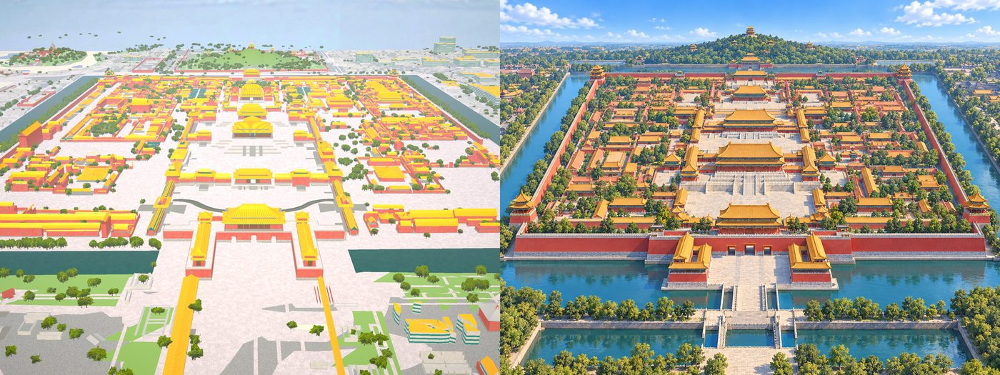

| mittari | havainne | a28+b608 | ero | a28 | tila | vastuu |
|---|---:|---:|---:|---:|---|---|
| horisontti (taivaan alaraja) | 0.19 | 0.00 | -0.19 | 0.00 | ero (mitta?) | LR (malli, mitat) |
| räystäs vasen | 0.34 | 0.37 | +0.04 | 0.37 | ok | LR (malli, mitat) |
| räystäs oikea | 0.59 | 0.29 | -0.31 | 0.29 | ero (mitta?) | LR (malli, mitat) |
| lattia mediaani | 110 | 220 | +110.44 | 214 | VIKA | VS (varjostin, valo) |
| mustat (<25) % | 0.0 | 0.0 | -0.00 | 0.0 | ok | VS (varjostin, valo) |
| kylläisyys keskim. | 0.39 | 0.25 | -0.14 | 0.25 | VIKA | VS (varjostin, valo) |
| varjo-osuus lattiasta % | 67.9 | 12.1 | -55.78 | 11.5 | VIKA | VS (varjostin, valo) |
| punainen kylläisyys | 0.56 | 0.48 | -0.07 | 0.48 | ok | VS (varjostin) |
| punainen kirkkaus | 0.68 | 0.92 | +0.24 | 0.91 | VIKA | VS (varjostin) |
| räystään alapinta: osuus % | 4.2 | 3.7 | -0.5 | 3.7 | (kuvasta) | LR (malli) |
| räystään alapinta: kirkkauden hajonta | 18 | 10 | -7 | 9 | tasainen | LR (malli: parrut, konsolit) + VS (alapinnan sävytys) |
| kirkkaus p5/p50/p95 | 72 / 131 / 219 | 119 / 209 / 247 | | 117 / 206 / 241 | | |

