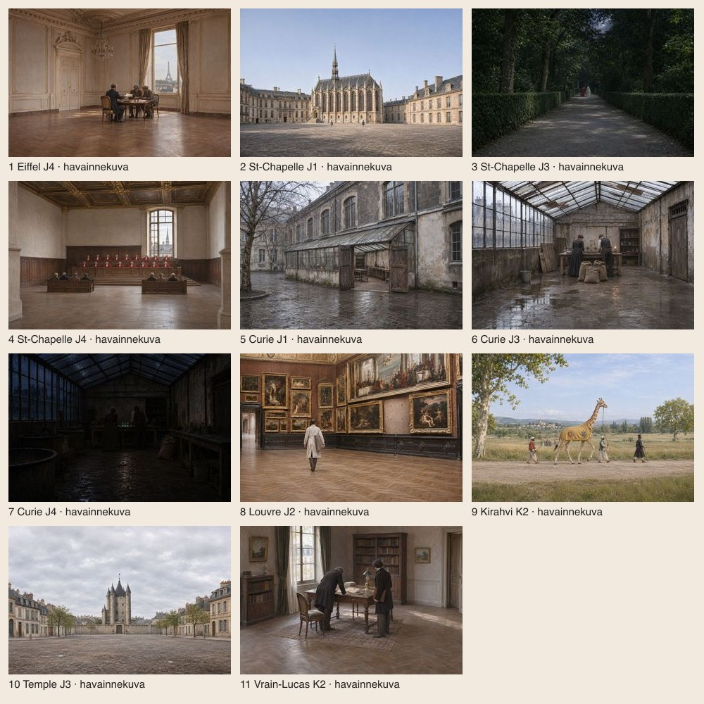

# K-5: Codexin 11 nostokuvaa dataan havainnekuvina (SK 20.11.2026)

Pohja `sk/l5-nostotekstit-era3` b25b1cc54e. Kuvat luetaan ämpäristä `media.matkakirja.app/kuvat/tarina-*.jpg` (korjauskierroksen jälkeen 1200 × 800 -tiedostoina, ks. K-5 korjaus alla); tekstejä, uusia kuvia, vientiä tai Pompidoun kuvaa ei muutettu.

## M1 luvuin
- 11/11 kuvaa datassa manifestin nimeämän noston ja jakson kohdalla (taulukko alla; testi `tests/k5-codex-kuvat.test.mjs` tarkistaa paikan vientipaketin `nostokuvat`-listasta). Kuvat: Eiffel J4, Sainte-Chapelle J1, J3, J4, Curien vaja J1, J3, J4 (`fokuskohteet-fra.js`), Louvre J2, Temple-torni J3 (`monumentit-eurooppa.js`), Kirahvi kappale 2 (`fokusvirta-pariisi.js`, `kuvat`), Vrain-Lucas kappale 2 (`skandaalit.js`, `kuvat`).
- Jokaisella `laji: 'havainnekuva'`, lähderivi alkaa "Tekoälyllä tuotettu havainnekuva; Matkakirjan havainnekuva." ja jatkuu LAHTEET.md:n viitteillä ja rekonstruktiohuomiolla; tekijä "Matkakirja (tekoälyllä tuotettu havainnekuva)", lisenssi "Matkakirjan oma".
- Taulukon sha-sarake = uusien 1200 × 800 -tiedostojen sha256 (luovutuskansio `codex-k5-nostojen-kuvat-1200-20261120/SHA256SUMS`); ämpärin sha-vertailu ajetaan, kun JU on ladannut tiedostot.
- Curien vajan J1: uusi `tarina-curie-1898-1-vaja-1200.jpg` korvaa entisen `curie-1898-vaja.jpg`-havainnekuvan (K-4:n korvaustilaus, LAHTEET viittaa siihen); vanha tiedosto jää palvelimelle.
- Lähtöluettelosta (`docs/raportit/pariisin-nostokuvat-rikkeet-lahto-20261120.json`) poistettu korjatut: sainte-chapelle ja curie-1898 (vajaa); rikkovia 22 → 20. Kaikki A-, B- ja D-nostot ovat nyt 3–4 kuvaa ja viimeinen valokuva.

## M2 silmin: nosto | jakso | kertojan teksti | kuva | selite
| # | Nosto | Jakso | Kertojan teksti siltä jaksolta | Tiedosto (sha256 täsmää) | Selite (lyhyt) | Paikka listassa |
|---|---|---|---|---|---|---|
| 1 | Eiffel-torni (eiffel-torni) | 4 | Vuonna 1925 huijari Victor Lustig luki lehdestä, että tornin kunnossapito on kallista. Väärennetyin virkapaperein hän esiintyi ministeriön apulaisjohtajana ja myi muka tornin romukauppiaalle. Kauppias häpesi eikä ilmoittanut poliisille, joten Lustig palasi ja yritti uudestaan. | `tarina-eiffel-torni-4-lustig-1200.jpg` ✓ 6d89b906 | Hotellin salongissa neuvotellaan tornin kaupasta, ikkunasta näkyy Eiffel-torni (havainnekuva) | 3/4 |
| 2 | Sainte-Chapelle | 1 | Sainte-Chapelle on kappeli Cité-saaren palatsin pihalla. Kuningas Ludvig IX rakennutti sen säilyttämään Kristuksen orjantappurakruunua, ja se vihittiin vuonna 1248. Samassa palatsissa ratkaistiin kuningattaren kaulanauhajuttu. | `tarina-sainte-chapelle-1-piha-1200.jpg` ✓ 64db9b7d | Sainte-Chapelle palatsin pihalla (havainnekuva) | 1/4 |
| 3 | Sainte-Chapelle | 3 | Elokuussa 1784 kardinaali tapasi Versailles'n puistossa naisen, jonka hän luuli kuningattareksi. Alkuvuodesta 1785 hän sai nauhan kauppiailta ja luovutti sen Jeannelle. Kun kauppiaat pyysivät maksua, kuningatar vaati selvitystä, ja kardinaali pidätettiin. | `tarina-sainte-chapelle-2-kaulanauha-1200.jpg` ✓ ca0c2ff2 | Yöllinen kuja Versailles'n puistossa, kaukana kaksi hahmoa (havainnekuva) | 2/4 |
| 4 | Sainte-Chapelle | 4 | Oikeudenkäynti pidettiin Pariisin parlamentissa. Toukokuussa 1786 kardinaali vapautettiin, ja Jeanne leimattiin varkaaksi ja vietiin vankilaan. Kuningattaren maine kärsi. | `tarina-sainte-chapelle-4-parlamentti-1200.jpg` ✓ ad8f1e71 | Pariisin parlamentin istuntosali, ikkunasta näkyy kappelin torni (havainnekuva) | 3/4 |
| 5 | Curien vaja | 1 | Curien vaja oli Pariisin fysiikan ja kemian koulun pihalla seissyt vaja, jossa Marie ja Pierre Curie eristivät radiumin. Se oli ennen ollut ruumiinavaussali. | `tarina-curie-1898-1-vaja-1200.jpg` ✓ cf114862 | Curien työtilana toiminut pihavaja koulun pihalla (havainnekuva) | 1/4 |
| 6 | Curien vaja | 3 | Pelkkä ilmoitus ei riittänyt, vaan alkuaine piti saada puhtaana erilleen malmista. Vaja oli huonosti tuuletettu eikä pitänyt sadetta, ja malmia kului tonneittain. | `tarina-curie-1898-2-radiumtyo-1200.jpg` ✓ 4b1c30f9 | Marie ja Pierre Curie työssä vajassa, jonka katto vuotaa (havainnekuva) | 2/4 |
| 7 | Curien vaja | 4 | Työ vei yli kolme vuotta, ja vuonna 1902 heillä oli kymmenesosagramma puhdasta radiumkloridia. Iltaisin radium hohti pimeässä, ja Curiet ihailivat sitä. Marie sai fysiikan Nobelin vuonna 1903 Pierren ja Henri Becquerelin kanssa ja kemian Nobelin vuonna 1911 yksin. | `tarina-curie-1898-4-hohto-1200.jpg` ✓ faf51a69 | Hämärä vaja, pöydällä pulloja ja putkia, jotka hohtavat himmeästi (havainnekuva) | 3/4 |
| 8 | Louvre | 2 | Maanantaina elokuussa 1911 Louvre oli suljettu. Valkoiseen työtakkiin pukeutunut mies nosti Mona Lisan seinältä, ja lukitun oven avasi hänelle putkimies. | `tarina-louvre-2-varkaus-1200.jpg` ✓ ba20607e | Valkotakkinen mies Salon Carrén seinän edessä, jossa on tyhjä ripustuspaikka (havainnekuva) | 2/4 |
| 9 | Kirahvi 1827 (kappale) | 2 | Kirahvi talvehti Marseillessa, ja matkaan lähdettiin toukokuussa 1827. Eläimellä oli yllään vahattu sadetakki, johon oli kirjailtu vaakunat, ja luonnontieteilijä Étienne Geoffroy Saint-Hilaire käveli mukana. Lyonissa vastassa oli noin 30 000 ihmistä. | `tarina-kirahvi-1827-2-kavely-1200.jpg` ✓ 58d2e955 | Kirahvi vahatussa sadetakissa kävelee maantiellä saattueensa kanssa (havainnekuva) | 2/4 |
| 10 | Temple-torni | 3 | Vuonna 1798 brittiamiraali Sidney Smith pakeni Templen vankilasta väärennetyillä siirtomääräyksillä: häntä oltiin muka viemässä toiseen vankilaan. Huhtikuussa 1804 kenraali Pichegru löydettiin kuolleena Templen vankilan sellistään. | `tarina-hahmotelma-temple-torni-3-kadonnut-1200.jpg` ✓ 88302159 | Temple-torni ja sen kehämuuri, portilla vartijat (havainnekuva) | 3/4 |
| 11 | Vrain-Lucas (kappale) | 2 | Vuonna 1861 hän myi kuuluisalle matemaatikolle ja keräilijälle Michel Chaslesille Boylen, Newtonin ja Pascalin kirjeitä. Yhdessä niistä Pascal ilmoitti keksineensä painovoiman lait ennen Newtonia, ja Chasles maksoi vuosien mittaan kaikkiaan noin 140 000 frangia. | `tarina-vrain-lucas-2-kirjepino-1200.jpg` ✓ da3c4883 | Chasles ja toinen mies tutkivat kirjepinoa työhuoneessa (havainnekuva) | 2/4 |

## M3 luvuin
- Selitteissä (lyhyt) ei sanaa valokuva, kuvaamista eikä vuotta; testi vartioi. Kaulanauhan yökuvan selite ja lähde eivät mainitse viitan väriä (KK 13.31: tiedossa oleva yksinkertaistus).
- Täysi suite haaran työpuussa: 5 994 testiä, 5 979 läpi, 15 ohitettu, 0 kaatuu.

## K-5 korjauskierros (KK:n päätös 20.11.2026 klo 14.00; aiempi: P-261120-10, P-261120-5, P-261120-8, P-261117-119)
- **K1 Sainte-Chapelle:** kaulanauhan yökuva J2 → J3 (yötapaaminen kerrotaan J3:ssa, sääntö 9). Lista: piha J1, kaulanauha J3, parlamentti J4, ikkunat J5.
- **K2 Curie:** radiumtyo J2 → J3 ("Vaja … ei pitänyt sadetta, malmia kului tonneittain") ja hohto J3 → J4 ("Iltaisin radium hohti"). Taulukko yllä datan mukaan; `tests/k5-codex-kuvat.test.mjs` tarkistaa nyt jakson numeron ja jakson tekstin (9 jaksokuvaa), ei vain paikkaa kuvalistassa.
- **K3 Mitat:** kaikki 11 tiedostoa ovat nyt 1200 × 800, ja data kertoo saman. 10 Codexin 1536 × 1024 -kuvaa on ajettu `tools/sisalto/nostokuva.mjs`:llä (koko kuva, ei esirajausta, sama 3:2-rajaus kuin K-4:ssä). Louvre: luovutuskansiossa on vain jo rajattu 1041 × 694 (rajaamatonta Codex-alkuperäistä ei ole), joten se on suurennettu 15 % (lanczos3) 1200 × 800:aan; `nostokuva.mjs` ei suurenna, joten tässä käytettiin sharpia suoraan. Uudet tiedostot: `/Users/Shared/Claude/luovutukset/codex-k5-nostojen-kuvat-1200-20261120/` (11 JPG + SHA256SUMS). Ämpärin tiedostoa ei korvata samalla nimellä (media-ja-ampari 5; KK 14.07): uudet tiedostot ovat nimellä `tarina-<nimi>-1200.jpg`, joten ämpärin vanhat 1536 × 1024 -tiedostot `tarina-<nimi>.jpg` jäävät koskematta eikä niihin viitata. Vain 1200 × 800 -tiedostot lähtevät, 2048-versioita ei tarvita.
- **K4 Sainte-Chapelle "aito ensin":** poikkeus hyväksytty; ikkunat pysyy J5:llä ja on viimeinen aito valokuva.
- Täysi suite ja uusi sha: palautusviestissä.

## Muut huomiot
- Kirahvin ja Vrain-Lucasin jaksot eivät ole jaksot-listoja vaan `kuvat`-järjestystä (nostokuvat: kuva, kuvat…, valokuva): uusi kuva on järjestyksessä kappaleen 2 kohdalla. Natiivi ei siis tiedä kappalenumeroa; muutos on sama malli kuin K-4 erässä 2.
