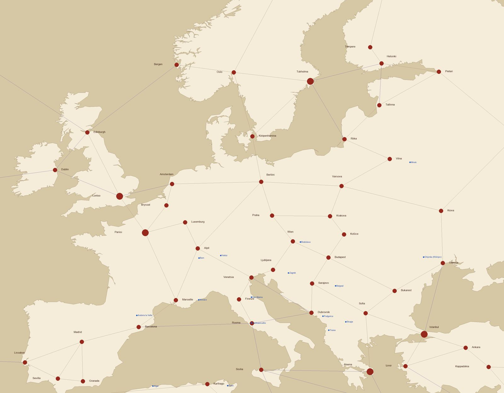
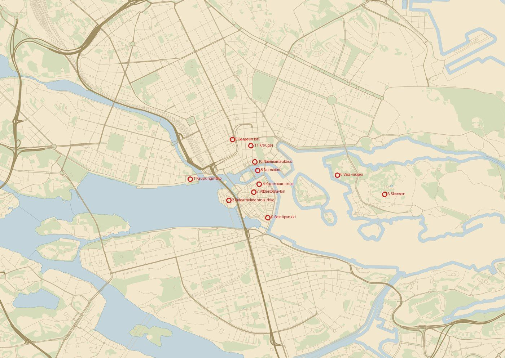
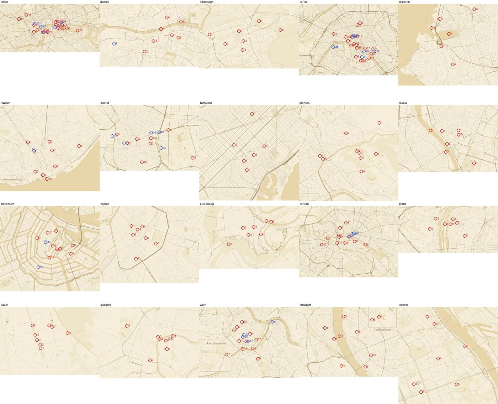
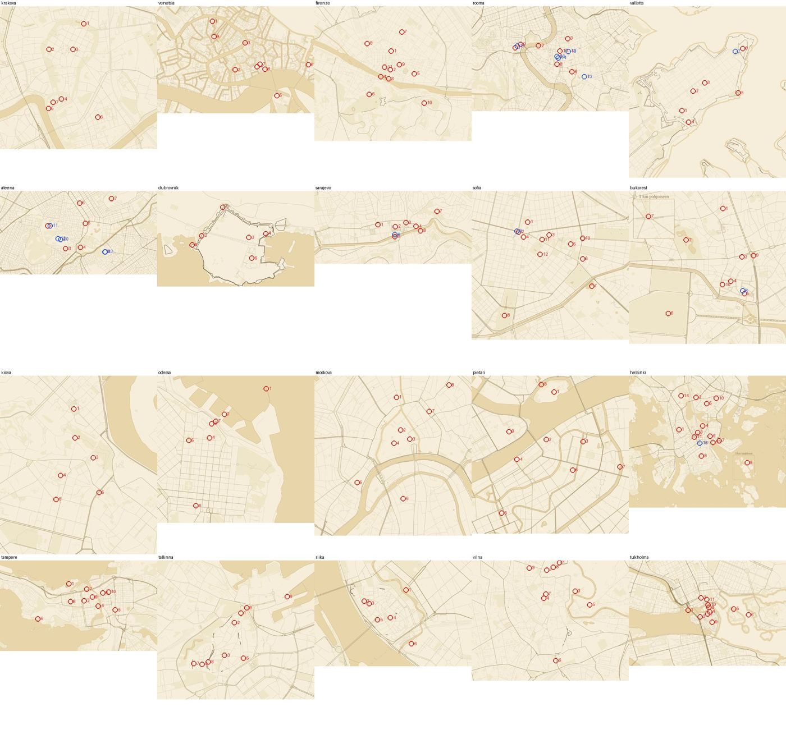
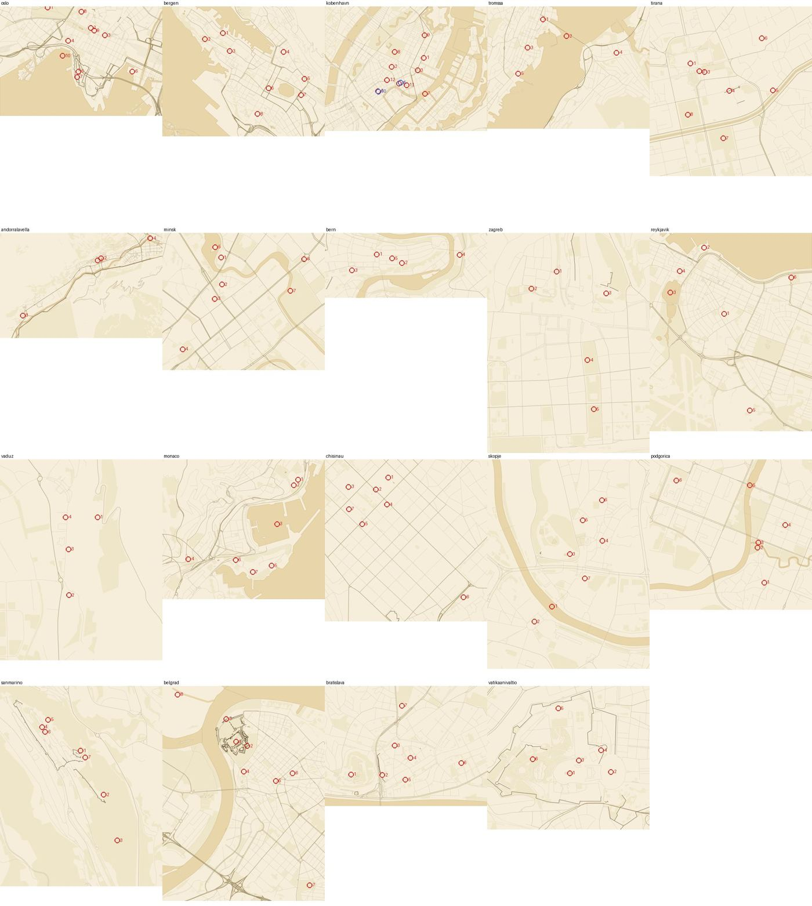

# Euroopan kartan kokonaistarkistus junan 182 sisällöllä (Karttaseppä 11.10.2026)

PT:n tilaus 11.10.2026 (prioriteetti 4, kartta): kaikki Euroopan kaupunkien ja pääkaupunkien pisteet, kohdekartat ja nimiöt, erityisesti e01–e03 ja Vatikaani.
Pohja on origin/main a52588e82 (juna 182 ja Vatikaani #4415).

## Mitä tarkistettiin

**Pisteet:** 49 laudan Euroopan kaupunkia ja 15 Euroopan pääkaupunkipistettä (e01 8, e02 6 ja Vatikaani).
- Pallopiste on oman maan muodon sisällä tai enintään 5 laudan yksikön päässä siitä (`tests/kaupungit-maissa.test.mjs`).
- Laudan nimikyltit eivät mene päällekkäin eivätkä peitä palloja (`tests/rules.test.mjs`).
- Pääkaupunkitestit 24/24 menivät läpi.

**Kohdekartat:** 59 Euroopan karttaa ja e03:n 8 karttaa (Tbilisi, Jerevan, Baku, Amman, Beirut, Abu Dhabi, Manama ja Ramallah).
- `tools/tarkista-karttapisteet.mjs` jokaiselle: piste vedessä, mittakaavajana ja numeroympyröiden päällekkäisyys.
- Lisäksi: kohteet rajojen sisällä, piirtoRajat vastaavat 1,6-kertaista laajennusta, kuvan sivusuhde vastaa rajoja ja pisteet eivät osu kuvan reunaan.
- Pisteet piirrettiin kuviin pelin `karttapiste()`-funktiolla, ja kaikki katsottiin silmin (kuva-arkit alla).

**Koko Euroopan näkymä:** laudan ääriviivat, kaupungit nimiöineen (testin kyltinmitoilla), reitit ja pääkaupunkipisteet yhdessä kuvassa.

Kuvassa pääkaupunkipisteet ovat projektion paikoillaan. Laudan kaupungit ovat käsin sommitelluilla paikoillaan, kuten pelin tasokartalla.

## Virheet ja korjausehdotukset

### VAKAVA

**1. Tukholman kohdekartta: Saltsjön, Strömmen, Nybroviken ja Ladugårdslandsviken on piirretty maaksi.**
- **Mitä näkyy:** vesi näkyy vain rantaviivan levyisinä nauhoina. Skeppsholmen ja Djurgården erottuvat renkaina maan keskellä.
- **Laajuus:** sama virhe on pelin värikartassa (`tukholma-varikartta.png`) ja vanhassa kuvassa. Tukholma on aloituskaupunki, joten kartta näkyy pelaajalle heti.
- **Syy:** Saltsjön on merta, eli OSM:ssä rantaviivaa eikä vesialuetta, mutta piirtotaulun `tukholma`-rivillä ei ole `meri`-täyttöä.
- **Korjaus (Karttaseppä):**
  - Lisätään `meri: true`. Jos koeajo varoittaa väärästä puolesta kuten Kööpenhaminassa, käytetään `meri: 'maa'`.
  - Piirretään uudelleen sekä `node tools/piirra-kaupunkikartta.mjs tukholma` että `--vari`.
  - Ajetaan `tarkista-karttapisteet`. Pisteet osuvat jo nyt oikeisiin paikkoihin: Kaupungintalo rannalla, Vasa-museo Djurgårdenin kärjessä.
- **Juna:** 183.

### PIENET

**2. Barcelona: Roviran aukio on 2,3 % kuvan yläreunasta.** Kartalla ei ole laajennusta, joten ympyrä leikkautuu. Korjaus: `rajat.pohjoinen` +0,002 (41.4085 → 41.4105) ja uusi piirto, tai laajennus 1.6 ja värikartta kuten muissa pääkaupungeissa.

**3. Pietari: Mariinski-teatterin ympyrä peittää mittakaavajanan tekstin.** Korjaus: eteläreunaa siirretään noin 0,002 etelään ja kartta piirretään uudelleen. Kööpenhaminassa tehtiin sama (55.672 → 55.669).

**4. Tukholma: kaksi paria numeroympyröitä menee osittain päällekkäin ilman siirtoa.**
- Kuninkaanlinna ja Vädersolstavlan-nosto ovat 15 px:n päässä toisistaan, Norrström- ja Naamiaislaukaus-nostot 14 px:n.
- Korjaus: toiselle annetaan `siirto` ja `nimiPuoli` kuten muissa nostoissa. Tehdään samalla kertaa kohdan 1 kanssa.

**5. Kaksi nostoa osuu veteen ilman siirtoa:**
- **Pietarin Jänissaari 1703** (100 %, saaren rannan ulkopuolella): siirto saaren puolelle.
- **Lissabonin Kolumbus 1484** (100 %, Tejo-joen päällä): siirto rantaan Praça do Comércion puolelle.
- Oslon Fram 1893 (laiva) ja Lontoon Tunneli 1827 (joen alla) saavat olla vedessä.

### TYÖKALU

**6. `tools/tarkista-karttapisteet.mjs` lukee aina `polku`-kuvan, vaikka peli näyttää `varikartta`n.**
- Peli lukee värikartan, jos se on olemassa (`js/nahtavyydet.js`: `kartta.varikartta ?? kartta.polku`).
- **Ongelma:** kuudella kaupungilla (Amsterdam, Praha, Wien, Tukholma, Rooma ja Kööpenhamina) `polku`-kuva on vanha 1600 px:n laajentamaton piirros, kun taas `piirtoRajat` ja värikartta ovat 1,6-kertaisia.
  - Työkalu katsoo siis väärää kuvaa ja antaa vääriä vesi-ilmoituksia. Esimerkiksi Kööpenhaminan Vapahtajan kirkko on vanhassa kuvassa Inderhavnenissa, värikartassa oikein Christianshavnissa.
  - Kuva-arkeissa (alla) näiden kuuden kaupungin kuva on tämä vanha kuva.
- **Korjaus (Karttaseppä):**
  - Työkalu lukee värikartan, kun se on olemassa, ja tunnistaa värikartan vesisävyn.
  - Kuuden kaupungin vanhat `polku`-kuvat piirretään uudelleen laajennettuina, koska ne ovat varapolkuna, jos värikarttaa ei ladata.

## Hyväksytyt (ei toimenpidettä)

- **Vesiosumat, jotka ovat oikein:** sillat (Ha'penny, Rialto, Ponte Vecchio, Trianan silta, Ketjusilta, Latinalaissilta, Skopjen kivisilta, Tromssan silta), satamat (Marseillen Vanhasatama, Port Hercule), Odessan Vorontsovin majakka, Reykjavíkin Tjörnin-järvi, Thamesin vuorovesi ja Tukholman Norrström.
- **Kohteet, jotka ovat kainaloissa ydinrajauksen ulkopuolella:** Wienin Schönbrunn (4 km lounaaseen), Bukarestin Antipan museo (1 km pohjoiseen), Budapestin Sankarien aukio (3 km koilliseen) ja Helsingin Suomenlinna (3 km kaakkoon).
- **Numeroympyröiden päällekkäisyydet, joissa toisella kohteella on `siirto`:** Pariisi, Lontoo, Rooma, Madrid, Ateena ym. Työkalu ei laske siirtoa mukaan, joten se näyttää ne "HARKITSE"-riveinä.
- **Rannikkokaupunkien pallopisteet karkean rantaviivan ulkopuolella:** Dubrovnik, Marseille, Venetsia, Odessa, Kööpenhamina, Tromssa, Islanti ja Monaco. Kaikki ovat enintään 5 yksikön päässä, ja testi menee läpi.
- **Pääkaupunkipisteet päällekkäin laudan kaupunkien kanssa:** Vatikaani (3 km Roomasta) ja Reykjavík (6 km Islanti-pisteestä).
  - Piste osuu laudan kaupunkimerkin alle. Nimibudjetti karsii pääkaupunkipisteen nimen ensin (`js/pallolauta/paakaupunkipisteet.js`), joten tämä ei ole vika.
- **Laudan aluekaupungit ilman kohdekarttaa:** Alpit, Sisilia, Kreeta, Lappi ja Islanti. Ne ovat alueita, eivät kaupunkeja.

## e01–e03 ja Vatikaani

Kaikki 23 karttaa ovat kunnossa: e01 8, e02 6 (Vaduzin ja Andorran kartoilla 4 kohdetta), e03 8 ja Vatikaani.
- Pisteet ovat maalla, mittakaavajana on vapaa, eikä numeroympyröitä ole päällekkäin.
- Kaikki kohteet ovat rajojen sisällä, ja kuvan sivusuhde vastaa rajoja.

Bakun kartta on pystymallinen (1600 × 2843). Se on toimiva mutta poikkeava; uudelleenpiirto ei ole tarpeen.

## Kuva-arkit (kaikki Euroopan kohdekartat pisteineen)

Punainen ympyrä on kohde ilman siirtoa, sininen kohde, jolla on `siirto` (nosto). Nostojen ympyrät on piirretty kohteen paikalle, eli siirtoa ei ole näytetty.
Kuudesta kaupungista näkyy vanha `polku`-kuva (ks. kohta 6).

