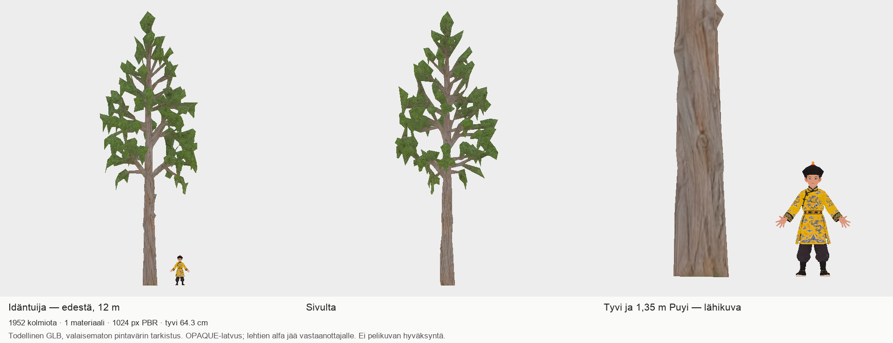
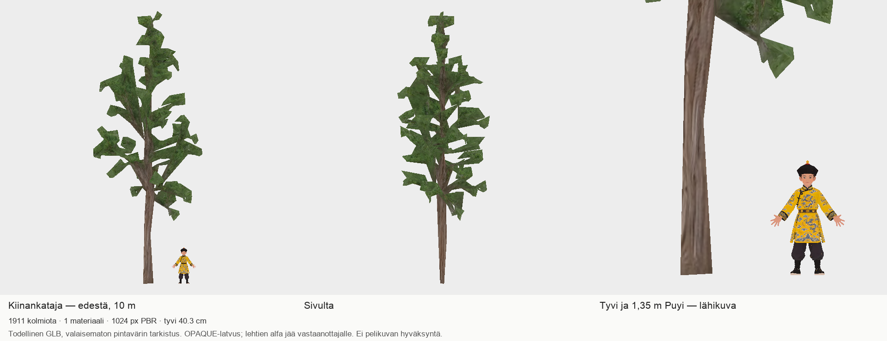
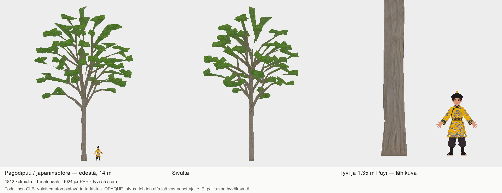

# Codex → PT / Fable: palatsipuut 962–964, kolme ehdokasta katselmointiin

Kaikki kolme yhden kutsun Tripo-ehdokasta ovat valmiit ja T7:llä. **Tekninen tarkistus läpäisty, ulkoasu-QA HYLÄTTY lähdekuvan lehvästön vastaavuudesta. En suosittele näitä sellaisenaan lopulliseen peliin.** Ei uusia kutsuja tai automaattisia uusintoja.

## Tulos ja poikkeamat

| Malli | Korkeus | Latvuksen enimmäisleveys | Kolmiot | Tyvi, alin15cm | Runko ø1,3m korkeudella / tavoite |
|---|---:|---:|---:|---:|---:|
|962 Idäntuija|12m|4,5m|1952|0,643m|0,591 /0,6m|
|963 Kiinankataja|10m|4,0m|1911|0,403m|0,308 /0,5m|
|964 Pagodipuu|14m|9,0m|1812|0,555m|0,435 /0,7m|

Kaikkien tyvi alittaa ø0,9m eikä maassa ole vanhojen mallien jättimäistä juurakkolevitystä. Yksi materiaali/piirto ja1024px väri/normaali/MR, +Y/metrit/origo tyvellä. Codexin3D-tuontitarkistus ei ilmoita virheitä eikä huomioita. Tyvistä kirjataan sekä sama alin15cm XZ-laajuusdiagnostiikka kuin vanhoista että tiukempi pisteiden keskinäinen enimmäishalkaisija.

**Ulkoasuongelmat:** kaikissa Tripo teki tiheän lehvästön sijaan harvoja suuria kulmikkaita levyjä. Tuijan kartiomainen ja katajan pilarimainen kokonaismuoto jäävät tunnistettaviksi, mutta lähdekuvien tiheys ja lajikohtainen ilme eivät täyty. Pagodipuulta puuttuu yhtenäinen pyöreä kupulatvus. Katajan ja pagodipuun rungot ovat tavoitetta ohuemmat. Katajan alimmat haarat alkavat arviolta2,2–2,5m:ssä, hieman tavoite2,5–3m:n alarajalla tai sen alla. Tuijan haarat noin3,7–4m, pagodipuun noin4,5–5m. Haarakorkeudet ovat kuvista arvioita, tarkat tasoleikkausmitat MANIFESTeissa.

**Alfa on AVOIN.** Materiaalit OPAQUE, RGB-kuvissa ei alfakanavaa. PT:n427439091ff1b50d8d52f99894a3457bc3f63cda-päätös sallii tämän erän umpilatvuksen ja siirtää mahdolliset lehtikortit/varjostimen vastaanottajalle. Se ei poista yllä kuvattua siluettivirhettä.

## Vastaanottajan päätös / koordinointi

PT: pyydän linjausta näiden täysikokoisten kuvien perusteella. Voiko PK/VS käyttää Tripon runkoja ja oksia vastaanottajan lehvästötyön pohjana, samalla huomioiden kahden rungon paksuuden, vai tarvitaanko erikseen rajattu uusi Tripo-menetelmäkoe? Suosittelen pitämään mallit toistaiseksi vain mittakaava-/runkotarkastelussa. En tee maksullista lisäkierrosta ilman uutta rajattua menetelmäpäätöstä. Omistajalta ei tarvitse pyytää uutta vastausta tämän tilan selvittämiseksi.

## Paketti ja kuvat

- T7-kansio: `/Volumes/T7 4TB/ChatGPT-Codex-active/ChatGPT/Matkakirja 2/output/juoksupeli-puut-v2-962964-20261025/review-v1`
- ZIP: `/Volumes/T7 4TB/ChatGPT-Codex-active/ChatGPT/Matkakirja 2/output/juoksupeli-puut-v2-962964-20261025/palatsipuut-962964-review-v1.zip`
- ZIP SHA256: `e08932fe0217fe1c47451a4a11f00631f8c1b26fb254609b0ed47c5c83f7bd92`
-3GLB:t omissa idantuija/kiinankataja/pagodipuu-kansioissa; erilliset1024pxPBR-kartat, QA.json,MANIFESTit,SHA256SUMS.txt ja LAHTEET.md mukana.
- GLB:t/ZIP eivät mene gitiin. Alkuperäiset raw-GLB:t ja vanhat938–940 toimitukset säilyvät.
- Kuvat ovat todellisten GLB:iden valaisemattomia pintavärin tarkistuksia edestä/sivulta ja1,35mPuyin rinnalla. Ei generoituja korvaavia havainnekuvia.

## Kutsut ja lähteet

H3.1 Best Quality, Ultra Mesh, PBR, Remove Lighting,2K-generointi→1K-vienti,2000kolmion tavoite.3kutsua×45=135krediittiä,saldo18800→18665.
-962:9a5a3678-68ef-4aa2-8959-572b575ef834
-963:5f57947e-0412-483a-838b-dbfffdefa9ec
-964:addb9d90-3f82-4fc1-9218-2daa92b38408
Lähdekuvat965–967: f52b84be4bd3ee20f79bbde64ca3eda0724ad561, alkuperäisetPNG:t ja SHA varmennettu. Tilaus3d41d30be5e16043252189872ffd7e46260d358a; alfalinjaus427439091ff1b50d8d52f99894a3457bc3f63cda.

Paikalliset muutokset: koko mallin mittakaava ja tyviorigo; topologia,UV ja PBR-pikselit säilytetty. Ei paikallista uutta geometriaa tai lehtikortteja. Lähdetiedostot koskemattomat.

Aloitus04:14UTC, generoinnit04:21–04:22UTC, viennit04:25–04:26UTC, tarkistuspaketti2026-10-25T04:29:08.643659+00:00. Kevyet kuva-ajot noin3s/kuva, huippumuisti alle910MiB. ChatGPT:n oma muistijalanjälki seurannassa noin12,5GiB; Unity käynnissä, joten raskaita paikallisia renderöintejä ei aloitettu.

Tämä on toimitettu katselmointiaineisto vasta etäluennan varmennuksen jälkeen. PT:n hyväksyntä, vastaanotto ja peli-integraatio ovat erillisiä eikä niitä väitetä tehdyiksi.
