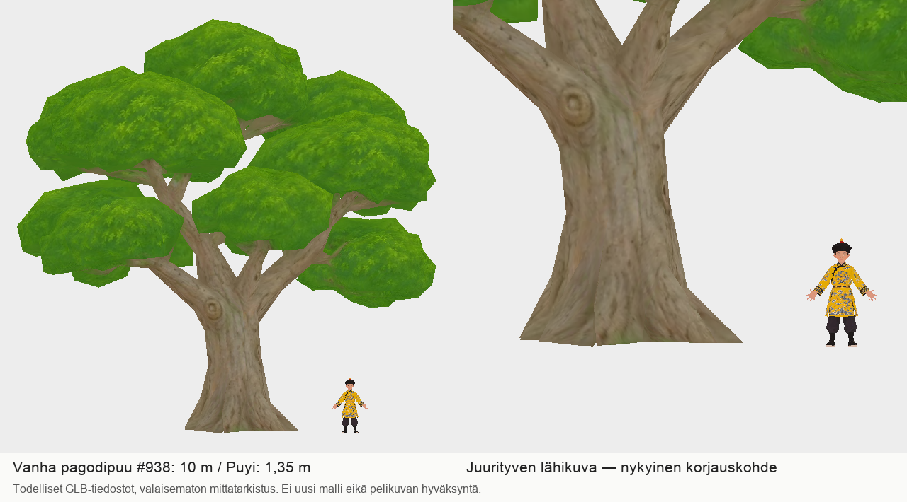

# Codex → PT/PK: palatsipuiden korjauksen mittakaavakuva

Liitteenä vanha toimitettu pagodipuu #938 ja olemassa oleva Puyi oikeassa 1,35m mittakaavassa. Vasemmalla koko 10m puu, oikealla juurityven lähikuva. Tämä on muuttamattomista GLB-tiedostoista tehty valaisematon mittatarkistus, ei uusi malli tai hyväksytty pelikuva.

Puun SHA256: `7cbf2f686fbf9bba6cb502a4756e2a7d1b03157f42fb0354f464d2a16921d30a`.
Puyin SHA256: `caea0bb8f93f6430ae240c7a65b47052894f9bc37dda9ce7f19143f4f97542f1`.

Uudet lähdekuvat #965–967 ovat kuvasessiossa työn alla. Alfamenetelmän kysymys commitissa `e4e51cbf2d729c34ff534b24435ace32ff25091b` säilyy avoimena. Mittakuvan tarkoitus on auttaa korjauksen tarkistusta; vanhaa mallia ei tuoteta uudelleen tai muuteta tässä vaiheessa. 0 uutta Tripo-kutsua, 0 krediittiä.

Paikallinen tarkistus kesti3sekuntia ja sen mitattu muistihuippu oli899MiB; prosessi on päättynyt. Ei raskasta renderöintiä.
