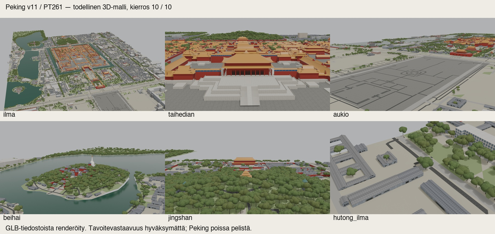

# PT261 — Peking v11: uusi rajattu 3D-välitoimitus

Kymmenen uutta mallikierrosta on tehty. Toimitukseen valittiin **kierros 10**; riippumaton arvio piti kierrosta 8 lähes tasoissa. Malli on tarkistettava välitoimitus: suuria tavoite-eroja jää, muodollinen tavoitehyväksyntä on avoin ja Peking pysyy poissa pelistä.

Lähdetilaus: `posti/fable-codex-petrin-K1-v3-ja-peking-v11-20261014.md`, commit `facff1e7b641bf4aa5f25c6a9d89ecde63c57b6c`, blob `a207122e15532f8738e4ca0d8abde629e408b171`. Tässä vastataan **vain Pekingiin**. Petřín kuuluu toiseen työhön. V11:n edellinen `40c32bd4a618e309a3df66ad14fb9d7c06b6b868` / v2-paketti säilyy muuttumattomana ja PT:n vastaanottamana välitoimituksena.

## Paketti ja kuvat

- Suljettu paketti: `/Users/Shared/Claude/proto-3d/_valmiit/peking-codex-v11-pt261-20261014`
- Manifesti: `toimitusmanifesti.json`, SHA256 `77a928d5b7ea289149ef57565551326f4678e00b97ddaca77ac5d06a386e1d42`
- 641 tiedostoa; 471134245 tavua. Kaikki manifestin tavut ja suhteelliset GLB-kuvaviittaukset on tarkistettu sulkemisen jälkeen.
- Muokattavat mallit: `malli/peking-v11.blend` (toimitus-GLB:istä koottu) ja `malli/native-build-round10.blend`. Kaikki tiedostokuvat on pakattu, niiden tavut vastaavat alkuperäisiä kuvapayload-tunnisteita.
- 84 GLB:tä: 24 alkuperäistä laattaa ja neljä aiempaa pohjoisrannan lisälaattaa, kaikissa 3 LOD-tasoa. Alkuperäiset 24 laattatunnistetta ja ENU-origo säilyvät.
- `esikatselu/tarkistusarkki.jpg` on **todellisten toimitus-GLB:ien renderöinti**, ei uusi havainnekuva tai valokuva. Postilaatikon arkki: `posti/codex-fable-peking-pt261-3d-20261014.jpg`.
- `vertailuarkki.jpg`: hyväksytty havainnekuva | toimitettu 3D | havainnolliset osamaskireunat. Reunat ovat osittaisia värialueita, eivät täydellinen rakennussiluetti tai IoU-tulos.
- `kierrosloki.json`, `kierrokset/`, `qa/`: jokaisen kierroksen kuvat, lähdekoodi, arviot, korkeustarkistus, materiaalien peittotiedot ja riippumattomat tarkistukset.

## Näkyvät muutokset

1. Pinnat: pienempi kivilaatoitus ja saumat, hillitty kosteuden sävy ja karheus, hutong-kattojen metrimittaiset tiilirivit, kattojen arvioidut normaalit sekä veden sävy, karheus ja heijastus. Uutta kivipintaa käyttävä aukion tumma upotuskuvio ja keskusmerkki on säilytetty.
2. Historialliset rakenteet: Taihedianin leveämmät räystäät ja ylemmän katon parametrit, ovien ritilä- ja karmigeometria sekä tyylitelty pilvireliefi kolmessa keskirampissa. Reliefin hyöty on pienempi kuin räystäiden ja ovien muutos näistä kameroista.
3. Puusto: neljä vaihtelevaa latvusmallia, pienosia ja sävyeroja sekä 220 uutta **arvioitua** pohjoisrannan puusijoitusta. Maaston ja veden aiempi rajattu kattavuus säilyy; yksittäisiä puita ei väitetä mitatuiksi.

Yhdeksän uutta PBR-karttaa ovat matemaattisia materiaalikenttiä ja aiemmista muuttumattomista CC0-kattokuvista johdettuja arvioituja normaaleja. Uusia AI-kuvakutsuja **0**. Kuusi hyväksyttyä tavoitekuvaa, niiden kamerat ja valaistuksen vertailuasetukset säilyvät. Tavalliset julkisivut käyttävät edelleen aiemmin hyväksyttyä 16-pintaista atlasvalintaa; lisä48 ei tule mukaan.

## Vientitarkistus ja rajat

Ensimmäinen uudelleenavaus paljasti, että Blenderin vienti jätti osan shader-sävykertoimista pois. Tämä häivytti aukion kuviot. Tallennus korjattiin eksplisiittisiksi glTF-materiaalikertoimiksi; viisi erillistä, tasaisen lineaarisen vahvistuksen PNG:tä toteuttavat kertoimien yli ykkösen olevat osat. Tämä on saman työmallin materiaalien serialisointi, ei 11. mallikierros. Kaikkien 84 geometriabinaarit pysyivät tavutarkasti samoina. Alkuperäisiä lähdekuvia, normaaleja ja tavoitteita ei muokattu.

Korjatut **kaikki 84** tiedostoa on avattu erikseen: vertex-koordinaatit ovat äärelliset, ENU- ja kierrostiedot täsmäävät, kolmioiden lukumäärä täsmää ja kaikki yhteiset kuvat avautuvat. Lisäksi kaikki kuusi koontinäkymää on renderöity uudelleen oikeista GLB-tiedostoista. Vientikuvien keskimääräinen absoluuttinen RGB-ero työmalliin on 0,0213–0,8795 asteikolla 0–255. Tämä mittaa vientiuskollisuutta, ei tavoitekuvan osuvuutta.

| Tarkistus | Tulos | Raja |
|---|---:|---:|
| GLB-tavut | 100296280 | 164326250 |
| Yhteiset kuvat | 11023185 | mukana seuraavassa rivissä |
| GLB + yhteiset kuvat | 111319465 | 164326250 |
| Tallennetun yksilöllisen geometrian kolmiot, kaikki LOD:t | 1327035 | 1397383 |
| Instanssien jälkeen piirrettävät kolmiot, kaikki LOD:t | 10753435 | raportoitu erikseen |
| Tavallinen rakennusluettelo / mallinnettu / korkeudet läpi | 225 / 223 / 223 | max(1 m, 5 %) lähdeluetteloon |
| Täydellisesti varmennetut tavoitesiluettinäkymät | 0 / 6 | ei hyväksyntää |
| Varmennetut tavoitemateriaalien sävyvastaavuudet | 0 / 6 | ei hyväksyntää |
| Muodollinen siluetti-IoU / ΔE00 | null / null | ei varmentamatonta lukua |

Instanssien suurempi piirrettävä määrä on erillinen suorituskykyvaraus: mallin pelikäyttöä ja ajonaikaista suorituskykyä ei ole testattu. Tallennetun geometrian budjetin läpäisy ei todista pelin suorituskykyä.

Luettelossa on 166 arvioitua korkeutta ja 59 suoraa lähdetietoa. Kaksi pois jätettyä tavallista tunnistetta ovat `3dglobfp/9094` ja `way/149216919`. Erillinen historiallinen `way/688124109` jää poikkeukseksi: alkuperäinen epävarma lähde 29,7 m, tavoiteperäinen parametri 7,5 m, valitusta vientilähteestä uudelleen laskettu actual-vertex-korkeus 8,102058112 m; ero 21,597941888 m, toleranssi 1,485 m, **ei läpäise**. Se ei kuulu 223 tavallisen rakennuksen läpäisyyn.

## Todellisen mallin materiaalien näkyvä peitto

Alla näkyvät kuvapisteet koko 1600×900 ruudusta. Luvut ovat peittävien materiaalitunnistepikselien alarajoja; reunan pehmennettyjä pikseleitä ei lasketa. Tämä **ei ole** vastaavuusprosentti tavoitekuvaan.

| Näkymä | Kiveys % | Aukion tummat alueet % | Marmori % | Vesi % | Hutong-katto % | Kultakatto % | Puusto % |
|---|---:|---:|---:|---:|---:|---:|---:|
| ilma | 4.630 | 0.052 | 0.199 | 9.825 | 1.311 | 1.067 | 3.543 |
| taihedian | 18.981 | 0.034 | 20.228 | 0.143 | 0.595 | 17.247 | 4.817 |
| aukio | 27.553 | 2.156 | 0.037 | 1.269 | 1.400 | 0.800 | 3.876 |
| beihai | 0.000 | 0.722 | 0.001 | 31.863 | 2.436 | 0.002 | 13.555 |
| jingshan | 0.000 | 0.506 | 0.024 | 0.013 | 1.567 | 0.725 | 41.748 |
| hutong_ilma | 0.000 | 2.511 | 0.009 | 0.000 | 17.324 | 0.000 | 13.154 |

## Kolme suurinta jäljellä olevaa eroa

1. Historiallinen rakentaminen: Taihedianin terassi, pylväiden ja räystäiden hienorakenne, kaiteet ja keskiramppi ovat edelleen tavoitetta pelkistetympiä. Katon ja julkisivun mittasuhde-eroja jää.
2. Puusto: latvukset ovat yhä toistuvia, peittäviä möhkäleitä; läpinäkyvä lehtirakenne, oksat ja maahan asti jatkuva aluskasvillisuus puuttuvat. Pohjoisrannan täyttö parantaa paljasta pintaa, mutta ei tee siitä valokuvamaista.
3. Pintojen ja maan uskottavuus: vesi on yhä tasaisen harmaanvihreää ja heijastukset pehmeitä; kivipinnoissa, hutong-pihoissa ja maastossa jää suurta sävy-, karheus- ja yksityiskohtaeroa tavoitteen valokuvamaisuuteen.

Riippumaton väliarvio lukittiin kierrokseen 3; tuore loppuarvio valitsi kierroksen 10 ja tarkisti korjatut toimitustiedostot. Raportit ja SHA-pinnit sisältyvät pakettiin. Pysähdysperuste on **kymmenen uuden kierroksen raja**, ei hyväksyntärajojen täyttyminen. Muodolliset ja varmentamattomat kohdevastaavuuden diagnostiset luvut pysyvät nullina.

Peking on edelleen poissa pelistä: ei Unity-integraatiota, R2-vientiä, main-yhdistämistä, peliversion nostoa tai julkaisua. Omistajan/PT:n mallihyväksyntää ei väitetä tapahtuneeksi. Tämä on PT261:n Peking-osuuden paras rajatun kokeilun välitoimitus PT:n tarkistettavaksi.
