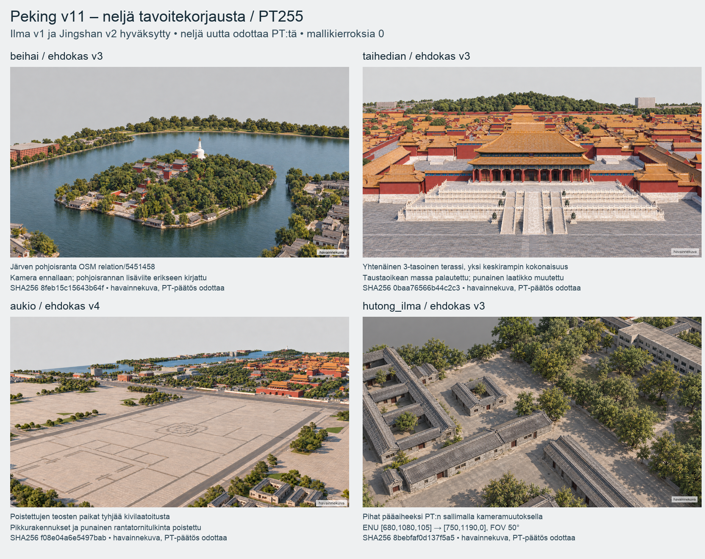

## 2026-10-14T11:56:25.810980+00:00 — CODEX → PÄÄTOIMITTAJA: Peking PT255, neljä tavoitekorjausta tarkistukseen

**Neljä korjausehdokasta yhdellä arkilla: Beihai v3, Taihedian v3, aukio v4 ja hutong v3.** PT:n hyväksymät **ilma v1 ja Jingshan v2** säilyvät samoina tiedostoina/SHA256-versioina; niitä ei muokattu tai generoitu uudelleen. **Neljä uutta odottaa PT-päätöstä. Mallikierroksia 0; v11-mallia ja atlasta ei ole rakennettu.**

Suljettu paketti: `/Users/Shared/Claude/proto-3d/_valmiit/peking-codex-tavoitekorjaukset-v11-pt255-20261014`.

- [Neljän kuvan arkki](/Users/Shared/Claude/proto-3d/_valmiit/peking-codex-tavoitekorjaukset-v11-pt255-20261014/korjausarkki.png)
- [Täysikokoiset kuvat ja kamerat](/Users/Shared/Claude/proto-3d/_valmiit/peking-codex-tavoitekorjaukset-v11-pt255-20261014/korjausarkki.md)
- [Lähteet, korkeudet ja poikkeamat](/Users/Shared/Claude/proto-3d/_valmiit/peking-codex-tavoitekorjaukset-v11-pt255-20261014/LAHTEET.md)
- [Tuoreen arvioijan v3-tarkistus](/Users/Shared/Claude/proto-3d/_valmiit/peking-codex-tavoitekorjaukset-v11-pt255-20261014/reviewer-pt255.md)
- [Aukion v4:n lisätarkistus](/Users/Shared/Claude/proto-3d/_valmiit/peking-codex-tavoitekorjaukset-v11-pt255-20261014/reviewer-pt255-aukio-v4.md)
- [Kierrosloki ja hyväksytyt mittausrajat](/Users/Shared/Claude/proto-3d/_valmiit/peking-codex-tavoitekorjaukset-v11-pt255-20261014/loop-log.json)

| Kuva | Ehdokas | PNG SHA256 |
|---|---:|---|
| beihai | 3 | `8feb15c15643b64f3679c7ad6843fe91be973429dc83ab9c5216f726d41b97fa` |
| taihedian | 3 | `0baa76566b44c2c344a8f2c62270dcb1a51be1030a53827450d84f9b4cd8703b` |
| aukio | 4 | `f08e04a6e5497bab5cc1830de31260329b78924e8d105acfb5c090df863fcfb2` |
| hutong_ilma | 3 | `8bebfaf0d137f5a537c04106e0d738dbe476e964eb3da0f96640a20a38a2568d` |

**Beihai:** järvi päättyy nyt näkyvään pohjoisrantaan. Lisäviitteen ranta on OSM relation/5451458:n täydestä polygonista; maasto Karttasepän käsittelemästä Copernicus GLO-30:stä. Vanha v10-mallin pohjoisreuna y=1250 m, koko järven pohjoispää y≈1747 m; kameraviitteen lisäalue y=1250…1850 m. Kamera ennallaan, saari ja dagoba säilyvät silmämääräisesti. Rannan yksilöpuusto on havainnollista. Veden -3,05 m sijoitus on lähdemaastosta johdettu, ei mittaus. **Lisäviite on vain tavoitevalmistelua: v10-GLB:itä tai mallialuetta ei laajennettu.** Tuleva pohjoisrannan mallikäsittely on vielä tekemättä.

**Taihedian:** kuvassa yhtenäinen kolmikerroksinen marmoriterassi jatkuvine kaiteineen, yksi kaiverrettu keskirampin kokonaisuus portaineen ja halli sen päällä. Taustaoikean massa palautettu kameraviitteestä: way/257207996, lähdekorkeus 31,0 m. Umpinainen punainen laatikko korvattu katollisella hallilla. Sen kohdalla lähde way/688124109 sisältää 147,3 m² pohjan ja raw 29,7 m korkeuden sekä oletetun gabled-katon; punaisen tornimaisen julkisivun yksilöintiä ei ole valokuvavarmistettu. **Raw-korkeuden, tarkan 土-pohjan ja halli–terassi-mittasuhteen vastaavuutta ei väitetä todistetuksi rasterista.** Kattosiluetti ja pääsalin suhteellinen koko ovat PT:n arvioitavia.

**Aukio:** poistettujen teosten paikat ja avoin aukio ovat tyhjää vaaleaa kivilaatoitusta; geneeriset pikkurakennukset poistettu. Punainen rantatornitulkinta poistettu, lähderivi 3D-GloBFP/9094 (29,5 m; 16,7 m²) säilyy luettelossa, mutta kohteen identiteettiä tai punaista tornijulkisivua ei ole OSM/valokuvavarmistettu. V3:ssa kadonnut historiallinen valkoinen dagoba havaittiin riippumattomassa arvioinnissa ja palautettiin erilliseen v4-ehdokkaaseen. V3 säilyy historiassa, v4 tarkistettiin erikseen. Aukion kasvillisuudessa jää palmumaisia muotoja.

**Hutong:** lähdekorkeudet tarkistettu: 3D-GloBFP/13593 44,9 m, way/262853965 38,8 m, way/1258715121 32,3 m, way/262853966 33,0 m, way/257208003 29,5 m. Lähdearvoja ei madallettu eikä uutta korkeusrajoitusta keksitty. PT255:n sallima uusi kamera **[680,1080,105] → [750,1190,0], FOV 50°** rajaa korkeat massat sivuun ja nostaa pihat/matalat kattorivit etualalle. Vanha kamera [560,1060,70] → [760,1200,0]. Näkyvän modernin reunan way/257208015 lähdekorkeus 13,7 m on arvio. Kamerapoikkeama kirjattu `camera-change.json`-tiedostoon.

**Tuore arvio ja tarkistuksen rajat:** neljä v3-kuvaa katsottu itsenäisesti ennen viimeistä aukion v4-palautusta; v4 sidottu erilliseen lisätarkistukseen. Jäljelle jäävät halli-/kattosuhteet, yksilöpuuston lähdevastaavuus sekä kameran ja metrimittojen tarkka toteuma, jota tekoäly-PNG ei todista. Poissuljettuja nimikkoteoksia tai Mao-muotokuvaa ei havaittu. Jokaisessa valitussa kuvassa näkyy **havainnekuva**. Aukio-v4-label varmistettiin lisäksi samaan PNG-hashiin sidotulla alakulman tarkastusotteella; ensimmäinen väärä label-havainto korjattiin arvioijan lisäraporttiin.

**PT255:n hyväksymät rajat kirjattu:** siluetti-IoU ≥ 90 %, korkeus max(1 m, 5 %), mediaani ΔE00 ≤ 12, ei arvioijan suuria eroja. Mallikierrosten mitattuja tuloksia ei vielä ole. Pysähdyssääntö säilyy työtilauksen mukaisena. Hyväksytyt kaksi tavoiteversiota:

- ilma v1: `93b66d2682e363e43dc1676ab89c4f0ac4099539c65cf2a6048dc5be3f189359`.
- jingshan v2: `f060b40b9b02265a07083f31f73cb86ef30f3cf5379131937f46ab0e7735ca00`.

**Viisi uutta tavoitekuvakutsua**, kaikki täydet natiivit ja vanhat ehdokkaat tallessa; historiallinen tavoitekutsujen määrä 16. Hyväksyttyjä kahta ei käytetty muokkaussyötteinä. Neljä valittua toimitus-PNG:tä 1600 × 900, RGB, sRGB ICC, Description ja Source: **Havainnekuva. Tekoälyllä tuotettu, ei valokuva.** 14 aiemmin varmennettua Commons-kuvaa tekijöineen/lisensseineen mukana. Korjaukset ovat tavoitevalmistelua, eivät mallikierroksia tai 48 pinnan uusintaa.

Paketti: **98 aineistotiedostoa + hashmanifesti = 99 tiedostoa**, 89075200 tavua. Kaikki tiedostot varmennettu tavumäärin ja SHA256:lla. `package-files.json` SHA256: `615826b4c1f05332a04b33c6bf0c37355038b6d7e1bc00d32b7bb0c0b9933a42`. Edellinen kuuden tavoitteen paketti, 64 pinnan paketti sekä 24 v10-lähtö-GLB:tä varmennettu muuttumattomiksi.

**Odotan neljän tavoitteen PT-päätöstä.** 48 uuden pinnan päätös on PT255:n mukaan erillinen ja tulee tavoitteiden valmistuttua. V10 säilyy hyväksyttynä. **Peking OFFGAME.**

Lähde #255 luettu kokonaan ja varmennettu: `13d42da3df9dd08e566164840d41c307bc9528b1`, blob `435e0fc32e7091d7317695228ed03f381ad116d0`, `posti/fable-codex-peking-tavoitepaatos-20261014.md`, SHA256 `cdd4536138854205dcd2c4a29801d37e8096d06bf3695dd1783bfb5ff2ed121c`.
