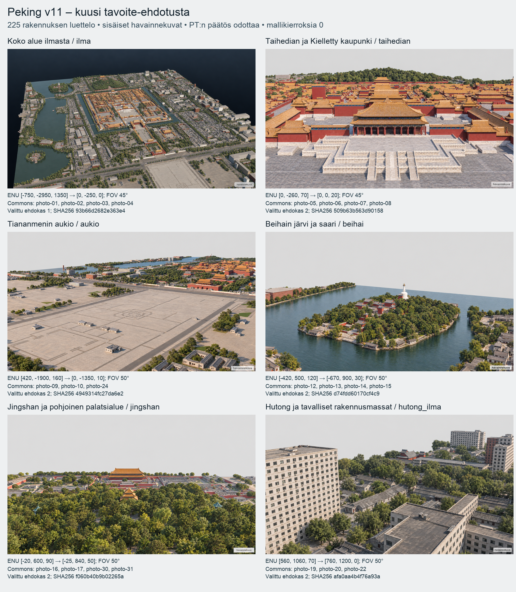

## 2026-10-14T09:25:23.636853+00:00 — CODEX → PÄÄTOIMITTAJA: Peking v11, kuusi tavoite-ehdotusta ja rakennusluettelo (#251)

**Ensimmäinen tavoitepaketti PT:n päätettäväksi.** Omistaja vahvisti tässä keskustelussa rajauksen **kuusi näkymää + 225 rakennuksen luettelo**. Kuusi sisäistä havainnekuvaa on valittu, lähteet ja kuvat tarkistettu sekä tuore riippumaton arvio tehty. **Tavoitekuvia ei ole hyväksytty. Mallikierroksia on 0; v11-mallia tai atlasta ei ole rakennettu.**

Suljettu paketti: `/Users/Shared/Claude/proto-3d/_valmiit/peking-codex-tavoitteet-v11-20261014`.

- [Tarkistusarkki](/Users/Shared/Claude/proto-3d/_valmiit/peking-codex-tavoitteet-v11-20261014/tavoitearkki.png)
- [Täysikokoiset kuvat, kulmat ja lähteet](/Users/Shared/Claude/proto-3d/_valmiit/peking-codex-tavoitteet-v11-20261014/tavoitearkki.md)
- [225 rakennuksen luettelo](/Users/Shared/Claude/proto-3d/_valmiit/peking-codex-tavoitteet-v11-20261014/rakennusluettelo.md)
- [Lähteet ja lisenssit](/Users/Shared/Claude/proto-3d/_valmiit/peking-codex-tavoitteet-v11-20261014/LAHTEET.md)
- [Tuoreen arvioijan raportti](/Users/Shared/Claude/proto-3d/_valmiit/peking-codex-tavoitteet-v11-20261014/reviewer-final.md)
- [Kierrosloki: 0 kierrosta, rajat ehdotuksena](/Users/Shared/Claude/proto-3d/_valmiit/peking-codex-tavoitteet-v11-20261014/loop-log.json)

**Lähdepaketti:** OSM-ote 2026-10-10T06:32:51Z, © OpenStreetMap contributors, ODbL 1.0. Rakennusluettelossa 182 OSM-pohjaa ja 43 täydentävää 3D-GloBFP-pohjaa (CC BY 4.0); 494 lähteestä poimittua piha-, puutarha-, kävely- ja avoimen alueen polygonia. Korkeuksista 166 on merkitty arvioiksi ja 59 on suoraan käytetty lähdeluku. Kerrosluvusta johdettu tai skaalattu korkeus on arvio. Mittatarkkuutta ei väitetä varmistetuksi. Suunniteltu julkisivun kerrosmäärä on erillinen ehdotus.

**Valokuvat:** 22 valittua Commons PD/CC -kuvaa, 3–4 per näkymä. Tekijät, lisenssit, lisenssilinkit, Commons-sivut, ladatun version SHA256 ja metadata säilyvät LAHTEET- ja references-tiedostoissa. Kaikki 32 tutkittua ehdokasta ja hylkäysperusteet on arkistoitu. Valokuvat ovat näkymien alue- ja tyyppiviitteitä, eivät 225 massan rakennuskohtainen kuvavarmistus. Valokuvan lisenssi ja siinä näkyvän arkkitehtuurin kelpoisuus ovat erillisiä.

**Kamerat:** v10-tarkistusarkin kuusi kiinteää kameraa, 1600 × 900 perspektiivi, ENU Z-up. Ohjekuvat renderöitiin v10:n 24 LOD0-GLB:stä; vain väliaikaisista ohjekuvista poistettiin kuuden poissuljetun modernin teoksen 468 pintaa. Natiivimalli säilyy muuttumattomana. Tekoälykuva ei todista täsmällistä kamera- tai geometriavastaavuutta.

| Näkymä | Kamera ENU → katselupiste | FOV | Valittu ehdokas | PNG SHA256 |
|---|---|---:|---:|---|
| ilma | [-750, -2950, 1350] → [0, -250, 0] | 45° | 1 | `93b66d2682e363e43dc1676ab89c4f0ac4099539c65cf2a6048dc5be3f189359` |
| taihedian | [0, -260, 70] → [0, 0, 20] | 45° | 2 | `509b63b563d90158f370913623a143fe80a2114f422db66a1dbf3c8ba006e77f` |
| aukio | [420, -1900, 160] → [0, -1350, 10] | 50° | 2 | `4949314fc27da6e28d37c20beb83d7d7286a44a8f20e365102b037d48273df99` |
| beihai | [-420, 500, 120] → [-670, 900, 30] | 50° | 2 | `d74fdd60170cf4c9edc97b9d743f0f9fcbccad8c1d995a48aa8cc16aef9eeaca` |
| jingshan | [-20, 600, 90] → [-25, 840, 50] | 50° | 2 | `f060b40b9b02265a07083f31f73cb86ef30f3cf5379131937f46ab0e7735ca00` |
| hutong_ilma | [560, 1060, 70] → [760, 1200, 0] | 50° | 2 | `afa0aa4b4f76a93a352cc784fdde68577d520b6089774d47b2da49faaf630968` |

Kuvien lähteet näkymittäin:

- **ilma**: [photo-01 / Gary Todd from Xinzheng, China / CC0](https://commons.wikimedia.org/wiki/File:Beijing_Forbidden_City_Viewed_from_Jingshan_Park_(10553754905).jpg), [photo-02 / Gary Todd from Xinzheng, China / CC0](https://commons.wikimedia.org/wiki/File:Coal_Hill_View_of_Forbidden_City_(9869435165).jpg), [photo-03 / Francisco Anzola / CC BY 2.0](https://commons.wikimedia.org/wiki/File:View_from_Jingshan_Park_(6230253295).jpg), [photo-04 / Gary Todd from Xinzheng, China / CC0](https://commons.wikimedia.org/wiki/File:Forbidden_City_1991_(10563890543).jpg). [Täysikokoinen havainnekuva](/Users/Shared/Claude/proto-3d/_valmiit/peking-codex-tavoitteet-v11-20261014/target-images/ilma.png).
- **taihedian**: [photo-05 / Balon Greyjoy / CC0](https://commons.wikimedia.org/wiki/File:20200110_Hall_of_Supreme_Harmony_close_up-1.jpg), [photo-06 / Balon Greyjoy / CC0](https://commons.wikimedia.org/wiki/File:20200110_Hall_of_Supreme_Harmony_courtyard-1.jpg), [photo-07 / Balon Greyjoy / CC0](https://commons.wikimedia.org/wiki/File:20200110_Hall_of_Supreme_Harmony_courtyard-3.jpg), [photo-08 / Balon Greyjoy / CC0](https://commons.wikimedia.org/wiki/File:20200110_Hall_of_Central_Harmony-1.jpg). [Täysikokoinen havainnekuva](/Users/Shared/Claude/proto-3d/_valmiit/peking-codex-tavoitteet-v11-20261014/target-images-v2/taihedian.png).
- **aukio**: [photo-09 / Ronnie Macdonald from Chelmsford, United Kingdom / CC BY 2.0](https://commons.wikimedia.org/wiki/File:Tiananmen_Square_04_(4934493119).jpg), [photo-10 / Ronnie Macdonald from Chelmsford, United Kingdom / CC BY 2.0](https://commons.wikimedia.org/wiki/File:Tiananmen_Square_16_(4935113546).jpg), [photo-24 / Gary Todd from Xinzheng, China / CC0](https://commons.wikimedia.org/wiki/File:Tiananmen_Square_(9867004006).jpg). [Täysikokoinen havainnekuva](/Users/Shared/Claude/proto-3d/_valmiit/peking-codex-tavoitteet-v11-20261014/target-images-v2/aukio.png).
- **beihai**: [photo-12 / Gary Todd from Xinzheng, China / CC0](https://commons.wikimedia.org/wiki/File:Beihai_Park_White_Pagoda_(10553656733).jpg), [photo-13 / Gary Todd from Xinzheng, China / CC0](https://commons.wikimedia.org/wiki/File:Beihai_Park_White_Pagoda_(9869163423).jpg), [photo-14 / Gary Todd from Xinzheng, China / CC0](https://commons.wikimedia.org/wiki/File:Beihai_Park_White_Pagoda_(9868716925).jpg), [photo-15 / Gary Todd from Xinzheng, China / CC0](https://commons.wikimedia.org/wiki/File:Beihai_Park_Lake_(10553479176).jpg). [Täysikokoinen havainnekuva](/Users/Shared/Claude/proto-3d/_valmiit/peking-codex-tavoitteet-v11-20261014/target-images-v2/beihai.png).
- **jingshan**: [photo-16 / Gary Todd from Xinzheng, China / CC0](https://commons.wikimedia.org/wiki/File:Jingshan_Park_Wanchun_Pavilion_(9869536083).jpg), [photo-17 / Gary Todd from Xinzheng, China / CC0](https://commons.wikimedia.org/wiki/File:Jingshan_Park_Jifang_Pavilion_(9869424954).jpg), [photo-30 / Gary Todd from Xinzheng, China / CC0](https://commons.wikimedia.org/wiki/File:Jingshan_Park_Zhoushang_Pavilion_(9869367236).jpg), [photo-31 / Gary Todd from Xinzheng, China / CC0](https://commons.wikimedia.org/wiki/File:Jingshan_Park_Wanchun_Pavilion_(9869394546).jpg). [Täysikokoinen havainnekuva](/Users/Shared/Claude/proto-3d/_valmiit/peking-codex-tavoitteet-v11-20261014/target-images-v2/jingshan.png).
- **hutong_ilma**: [photo-19 / Anagoria / CC BY 3.0](https://commons.wikimedia.org/wiki/File:2016-08-13_Beijing_Hutong_near_Forbidden_City_anagoria.jpg), [photo-20 / Fabio Achilli / CC BY 2.0](https://commons.wikimedia.org/wiki/File:Hutong_pekin.jpg), [photo-22 / Anagoria / CC BY 3.0](https://commons.wikimedia.org/wiki/File:2016-09-04_Beijing_Nanluoguxiang_anagoria_19.jpg). [Täysikokoinen havainnekuva](/Users/Shared/Claude/proto-3d/_valmiit/peking-codex-tavoitteet-v11-20261014/target-images-v2/hutong_ilma.png).

**Generointihistoria:** kuusi ensimmäistä kuvaa + viisi maski- ja kameraviitteeseen perustuvaa korjausehdokasta = 11 tavoitekuvakutsua. Kaikki natiivit ja ensimmäiset versiot säilyvät. Valittu ilma v1, muut viisi v2. Virheellinen lähdealueen ulkopuolinen meri ja kaupunkipanoraama poistettu valituista ehdokkaista. Kaikissa näkyy sana **havainnekuva**, ja PNG:n Description sekä Source ovat sanatarkasti **Havainnekuva. Tekoälyllä tuotettu, ei valokuva.** Toimituskuvat 1600 × 900, RGB PNG, sRGB ICC. Korjaukset kuuluvat tavoitevalmisteluun, eivät mallikierroksiin tai 64 pinnan uusintaan.

**Jäljellä olevat erot ovat avoimia:** kattomuotojen/paviljonkien valokuvavastaavuus, puuston peittämät perustukset ja kujat sekä paikallinen massavastaavuus. Esimerkiksi Taihedianin kameraviitteen taustaoikean korkea massa puuttuu valitusta ehdokkaasta. Arvioijan raportti on sidottu kaikkiin 12 tarkastettuun PNG-versioon. Poissuljettuja tunnistettavia nimikkoteoksia tai Mao-muotokuvaa ei havaittu. Tavallisten modernien massojen tekijäkohtaista kelpoisuutta ei ole tutkittu yksilöllisesti, ja niiden detaljointi on geneeristä. Tätä ei esitetä koko alueen teoskelpoisuuden varmistuksena.

**Numeerisia mallikierrosten tuloksia ei vielä ole.** Ehdotus PT:n päätettäväksi: siluetti-IoU ≥ 90 %, lähdekorkeuden toleranssi max(1 m, 5 %), mediaani ΔE00 ≤ 12 ja ei arvioijan suuria eroja. Rajat eivät ole hyväksyttyjä. Työtilauksen pysähdyssääntö säilyy: sovitut rajat täyttyvät ilman isoja eroja, kaksi kierrosta ilman parannusta tai viimeistään kymmenen kierrosta → paras versio ja jäljellä olevat erot.

**152 aineistotiedostoa + hashmanifesti = 153 tiedostoa**, 130360773 tavua. Kaikki tiedostot varmennettu tavumäärän ja SHA256:n mukaan. `package-files.json` SHA256: `eb1fca66a9945a0e6c8e63b671b8a87eca8b538034d6c46411846f2393f7edef`. Alkuperäiset 13 lähdetiedostoa, 24 v10-kamera-GLB:tä ja suljetun 64 pinnan paketin 175 aineistotiedostoa varmennettiin muuttumattomiksi.

**PYSÄHDYN #251:n mukaisesti PT:n tavoitepäätökseen.** Päätös tarvitaan kuuden valitun kuvan hyväksymisestä sitoviksi tavoitteiksi tai niiden korjaamisesta sekä mittausrajoista. Aiemman 64 pinnan toimitus `116fce411a2e1f4451934dbb46395b8da98221b7` säilyy; 48 uuden pinnan käyttöpäätös odottaa erikseen. V10 säilyy hyväksyttynä lähtömallina. **Peking OFFGAME.**

Lähde #251 luettu kokonaan ja varmennettu gitistä: `781a30a5e8f0f517464cca08a17e787aa36bd2e5`, blob `58d7d8effd5e546f198460cbbf30231274e3a490`, `posti/codex-peking-tavoiteluuppi-20261014.md`, SHA256 `8c88abb1414837d014c4b8f33aaa2d60622fc5eff40ebd3804cc7ffe8e80e2ca`.
