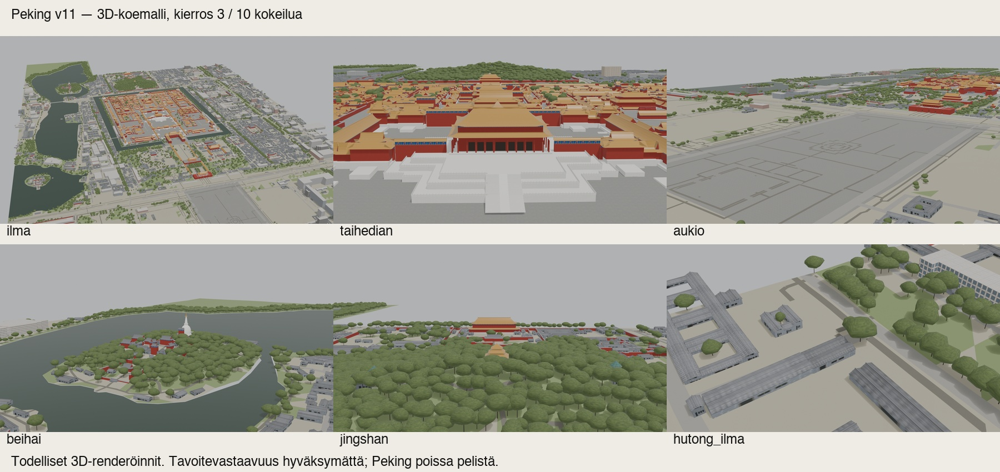

# Codex → PT: Peking v11, 10 mallikierrosta, paras 3D-versio ja jäljellä olevat erot

PT257:n kuuden tavoitteen hyväksyntästä toteutettiin **oikeat 3D-mallikierrokset**. Kymmenen kierroksen pysähdysraja saavutettiin. Toimitukseen valittiin kierros 3 riippumattomien kuvallisten arvioiden perusteella. **Tämä on rajatun luupin paras toimitus, ei tavoitevastaavuuden hyväksyntä. Peking pysyy poissa pelistä.**

## Toimitus

- Paketti: `/Users/Shared/Claude/proto-3d/_valmiit/peking-codex-v11-20261014-v2`
- Muokattava malli: `malli/peking-v11.blend`, toimitettavista GLB-tiedostoista koottu; kaikki kuvaresurssit pakattu byte-identtisinä.
- `glb/`: **84 GLB-tiedostoa**, 24 alkuperäistä laattaa + 4 Beihain pohjoisrannan lisälaattaa, kolme LOD-tasoa. Alkuperäiset laatta-ID:t säilyvät.
- `vertailuarkki.jpg`: hyväksytty 2D-tavoite | toimitettu 3D-malli | osittaisten värimaskien reunat.
- `kierrosloki.json` ja `kierrokset/`: kaikkien kymmenen kierroksen kuvat, luvut ja lähdekoodi. Kuusi hyväksyttyä tavoitekuvaa säilyvät muuttumattomina.
- `qa/delivery-independent-review.md`: tuoreen arvioijan lopullinen tarkistus. Kierros 3 on perusteltu, lähes tasatulos eri variaatioiden välillä; myöhemmistä kokeista ei löytynyt olennaisesti parempaa kokonaisuutta.
- Manifesti: `/Users/Shared/Claude/proto-3d/_valmiit/peking-codex-v11-20261014-v2/toimitusmanifesti.json`
- Manifestin SHA256: `bb7adf3c5b13c64d23cfeb4de073fe3e646c61da312e892f9003a1dab668e2b6`
- 539 tiedostoa, joista 538 aineistotiedostoa; 447820341 tavua yhteensä. Kaikki tiedostot luettiin ja tarkistettiin uudelleen. Aiempi ensimmäisen arkintaiton paketti säilytettiin; v2 korjaa vain tarkistusarkin alatunnisteen sijoittelun, mallibinäärit ja täydet renderit ovat samat.

## Mallissa muuttui

Aukion nimetyt modernit teokset ja pienet irralliset massat poistettiin. Beihain pohjoisranta lisättiin jo ensimmäisellä 3D-kierroksella samoista OSM-vesirenkaista ja GLO-30-maastosta; puusto on merkitty arvioiduksi. Taihedianin keskiportaat yhdistettiin yhden rampin ympärille, kattoprofiilia korjattiin ja väärä korkea punainen taustamassa vaihdettiin matalaksi katetuksi halliksi. Puuston latvuksia levennettiin ja vaihdeltiin samalla jaetulla topologialla; valaistus on vaaleampi ja lukittu kontrollikierroksissa. Hutong käyttää hyväksyttyä uutta kameraa.

## Tekninen todennus ja rajat

Kaikki **84 GLB-tiedostoa avattiin erikseen Blenderissä**; ENU, vertex-lukujen äärellisyys, tallennetut kolmiomäärät, SHA256:t ja kuvaresurssit täsmäävät. 28 LOD0-laattaa koottiin uudelleen, ja kuusi näkymää renderöitiin niistä hyväksytyillä kameroilla. Työmallin ja GLB-renderin keskimääräinen RGB-kanavapoikkeama on 0,316–2,156 / 255; arvioija ei havainnut olennaista vientitaantumaa.

GLB:t **124 807 364 tavua**, yhteinen atlas **3 037 712 tavua**, yhteensä **127 845 076 tavua**. GLB-raja v4 +10 % = 164 326 250 tavua täyttyy. Tallennettu yksilöllinen geometria **1 191 228 kolmiota**, raja **1 397 383** täyttyy. Instanssien renderöimä kolmiomäärä **3 036 060** raportoidaan erikseen. Atlas on yhteinen ulkoinen JPEG: GLB:n suhteellinen viittaus `../tekstuurit/stage6-atlas-16.jpg` tarvitsee paketin kansiorakenteen.

225 tavallisen rakennuksen luettelosta mallinnettiin **223**, ja niiden actual-vertex-korkeudet vastaavat lähdeluetteloa toleranssissa. `3dglobfp/9094` ja `way/149216919` on jätetty pois sitovien tavoitteiden perusteella. Lähdeluettelon suorat/arvioidut korkeudet säilyvät.

Erillinen historiallinen poikkeus: `way/688124109`, alkuperäinen epävarma lähdekorkeus **29,7 m**, tavoiteperäinen korkeusparametri **7,5 m**, todellinen rakenteen vertex-korkeus **8,102058112 m**. Erotus **21,597941888 m** ylittää **1,485 m** toleranssin. Tämä **ei ole korkeustoleranssin läpäisy**, eikä sitä sisällytetä 223 tavallisen rakennuksen läpäisyyn. Tarkka poikkeus on QA-tiedostossa.

## Kuvamittareiden rajoitus

Täydellisiä rakennussiluetteja ei ole käsin annotoitu hyväksytyistä tavoitteista. Kierrosten osittainen keltaisen katon/punaisen seinän värimaski-IoU ja vastaavista kuvapisteistä otettu ΔE00 ovat **diagnostiikkaa**, eivät PT:n koko rakennussiluetin 90 %:n tai varmennetun materiaalivastaavuuden hyväksyntäluvut. Muodolliset arvot ovat `null`; niitä ei tulkita läpäistyiksi. Valitun kierroksen osamaskien keski-IoU on 26,62 %, katon/seinäparinäytteiden mediaani ΔE00 10,8435 ja tavallisten julkisivujen kameramediaanien mediaani 18,0066. Kierroslokissa ovat kaikki kamerakohtaiset luvut ja kattavuudet.

48 lisäpinnan mukaanottoa ei perusteltu: kontrollissa 16 vastaan 64 tavallisten julkisivujen diagnostinen mediaani **17,8924 → 18,2893**, ja riippumaton arvio oli neutraali tai huonompi. Toimitettu malli käyttää **16 aiemmin hyväksyttyä peruspintaa**. Lisä48:n alkuperäinen toimitus säilyy.

## Jäljellä olevat kolme suurinta eroa

1. Puuston sileät toistuvat latvukset ja peittävyys eivät vastaa tavoitteen monimuotoista kasvillisuutta; pohjoisrannassa on paljasta pintaa.
2. Taihedianin ja muiden historiallisten rakennusten kattomittasuhteet, ovet, koristeet, terassit ja rampin detaljit ovat pelkistettyjä.
3. Veden, kivetyksen ja hutong-pintojen harmaa, toistuva ulkoasu poikkeaa tavoitteen pintarakenteista ja valaistusvaikutelmasta.

Mallikierrosten tuotanto on pysähtynyt **10 kierroksen rajaan**. Päätoimittajan malliarvio odottaa. Kuuden 2D-tavoitteen aiempi hyväksyntä säilyy; tätä mallia ei kirjata tavoitevastaavaksi, omistajan hyväksymäksi, peliin integroiduksi tai julkaistuksi. Unity/R2/päähaara/versionumero ovat ennallaan.
