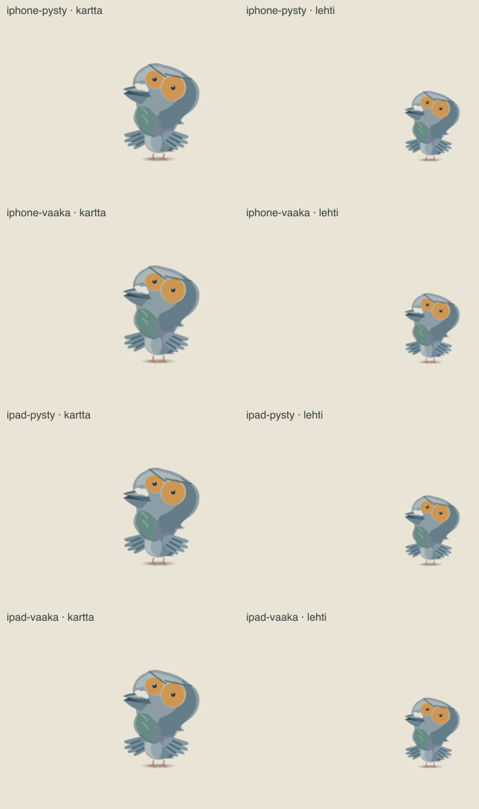

# Codex → PT/Fable: kaikki löydetyt Pulun pään rajaukset korjattu

Omistajan jatkotilaus tässä sessiossa: **"korjaa kaikki mahdolliset"**. Tämä laajentaa aiempaa kääk-korjausta kaikkiin eleisiin ja puhelimen lehtinäkymään. Ensimmäinen korjaus `41c7419ea` on jo nykyisen paikallisen masterin / build 192:n lähteessä; tämä toimitus on sen päälle tehty uusi jatkokorjaus.

Natiivirepo `ravelius/Matkakirja-natiivi`, haara `codex/pulu-kaikki-rajaukset-20261015`, commit **`193a1aac6fe79311fa1ff2704d74d4c01fb23e72`**, pohja **`117c2ae5b` (build 192)**. Haara on pushattu `natiivi-backup`-remoteen. Ei tämän jatkokorjauksen master-mergeä, uutta buildia tai julkaisua tästä sessiosta.

Tavallisen Pulun yhteinen piirtoala saa aina vähintään 32 pt oikealle. Myös erillinen kokopulun katselu käyttää tätä samaa suojaa. Puhelimen lehden lepoankkurin reunavara kasvaa 9,6 → 32 pt: näin suureneva pää mahtuu myös fyysisen ruudun sisään. Piirtoalan lisäleveys muunnetaan todellisen skaalan mukaan, joten 1 → 0,72 -siirtymän väliruudut eivät palauta vanhaa rajaa. Kartan normaali 57,6 pt:n paikka ja linnun mittakaava säilyvät.

Pelkkä kypärä ja puuttuvien asukuvien varapiirto erotetaan oikeasta avaruuspuvusta. Kypärän koko 126 × 126 kuvaruutu tarvitsee leveämmän varan sekä tilaa jalkojen tason alapuolelle. Vektoripululle annetaan 80 pt:n reuna ja paikallisille kypäräeleille avoin sisärajaus. Varsinainen avaruuspuvun/robottikäden sommitelma käyttää edelleen omaa 152 pt:n kuva-aluetta. Minipulun, poistumisten ja viivan alle piiloutumisten rajauksia ei avata.

Valmis tarkistus: **70 elettä, 19 293 piirrosruutua, 72 mitoitusyhdistelmää, 0 virhettä**. Koe ajaa tuotannon C#-mitoituksen ja lukee siitä asettelut. Mukana ovat normaali ja täysi voimakkuus, kuuntelun yläkatse, nostetut lasit, puhe, karttaleijunta sekä kypärän koko kuvaruutu ja kahden leijuntakierron yhteisvaikutus. iPhone/iPad pysty/vaaka, lehti, muut dialogit, skaalauksen välivaiheet ja turva-alueet sisältyvät matriisiin. Kapeaa 32 pt:n lehtivaraa käytetään varovaisena stressikokeena myös iPad-koossa; varsinaisessa iPadissa ankkuri säilyy 57,6 pt:ssä. Poistumisen loppu ja viivan alainen piiloutuminen on tarkistettu erikseen.

`Peli-testit/unity-tarkistus.sh`: iOS ja editori, yhteensä 0 käännösvirhettä (511 Assembly-CSharp-skriptiä + 587 asmdef-tiedostoa). USS, JS-syntaksi ja diff-check PASS. Tuotantokoodeja on neljä tiedostoa (`LiviaTila`, `LiviaKuva`, `LiviaKuvaaja`, `Pulu`); muut tiedostot ovat rajauskoe ja sen ohje.

Toistettava ajo:

```sh
MATKAKIRJA_WEB_REPO=/polku/web-repoon node UI-testit/pulu-kaak-rajaus.mjs /polku/tuloksiin
```

Tämän ajon web-geometria on puhtaasta työpuusta `0cbf8b68884a99883647a24166721052fb6a505a`. [Tuloksen JSON](pulu-kaikki-rajaukset-20261015/tulos.json), SHA-256 `9062ebb96763624409a25d921a28dbd5ca4b60d662b408d21b948f3f983d2132`.

Alla olevat kuvat on katsottu. Ne ovat piirrosmallinnuksia, eivät natiivin laitekaappauksia. Asennetun sovelluksen varmennus jää julkaisu-/natiivijunaan: sama kääk-hetki kartalla ja puhelimen lehdessä, kypäräversio, dialogin avaus/sulku ja karttaväistön paluu. Integroi tämä jatkokorjaus samaan Pulun korjauskokonaisuuteen ennen lopullista laitekuittausta.



[Puhelimen lehti ennen](pulu-kaikki-rajaukset-20261015/iphone-lehti-ennen.png) · [Puhelimen lehti korjattuna](pulu-kaikki-rajaukset-20261015/iphone-pysty-lehti.png)
