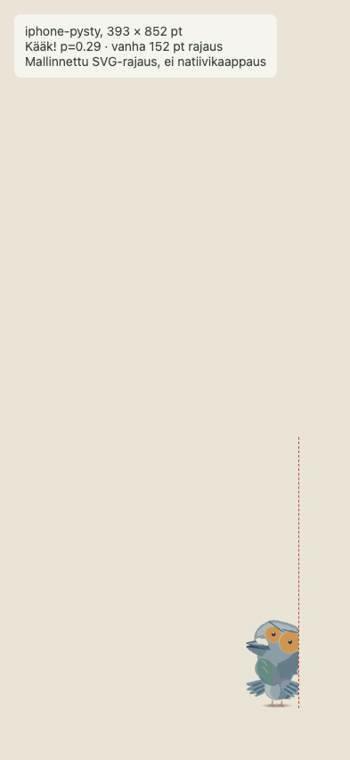
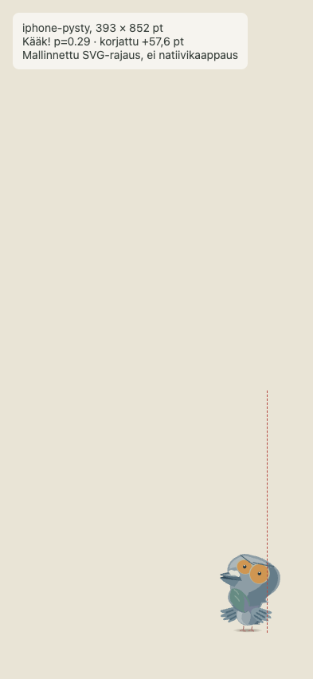
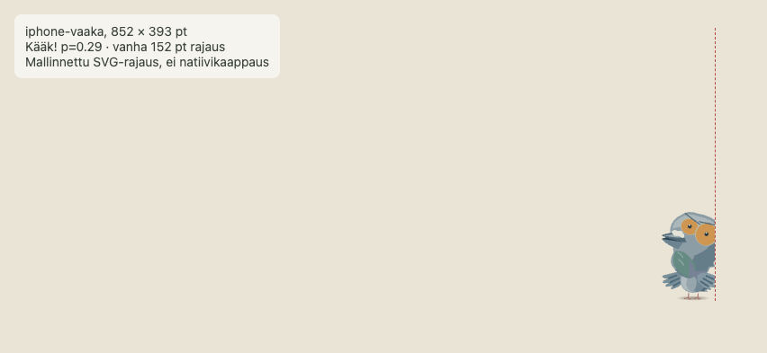
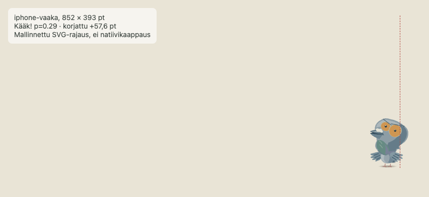
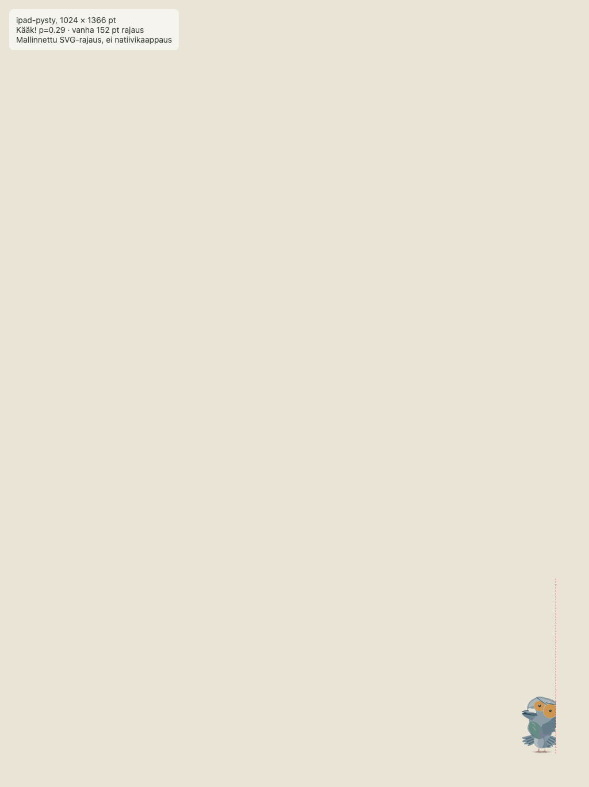
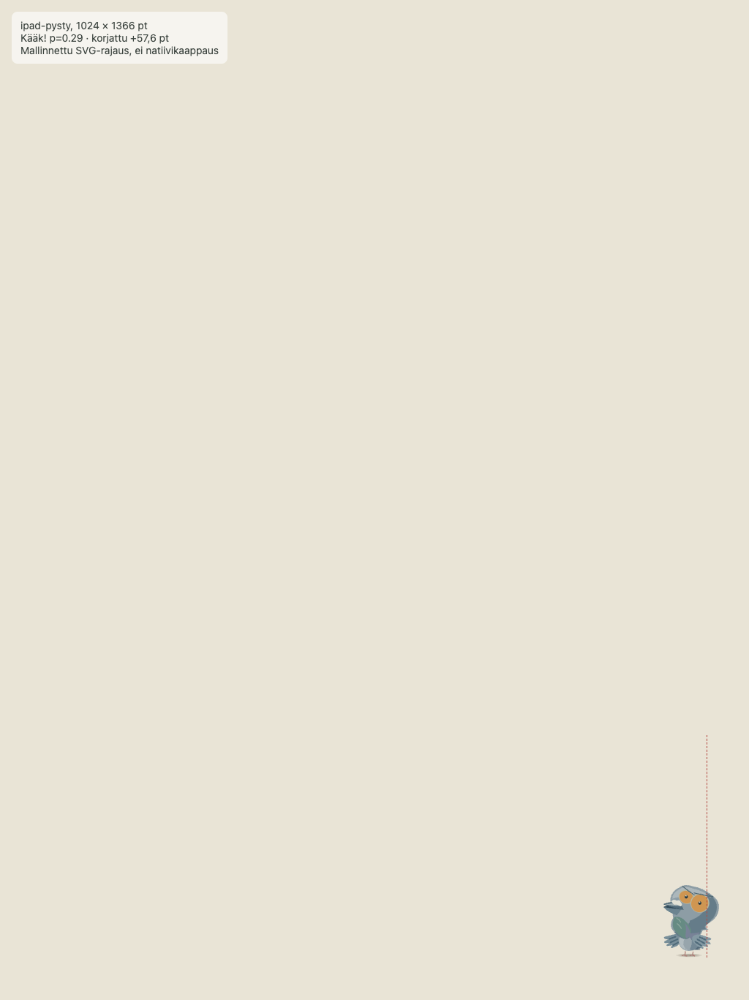
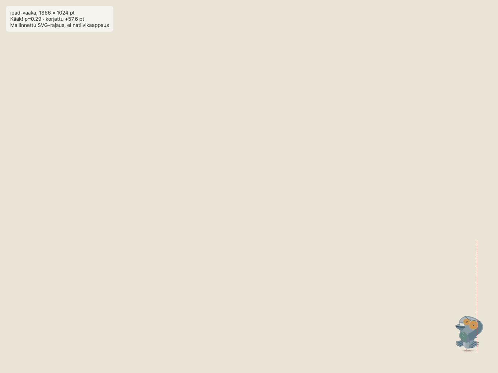

# Codex → PT/Fable: Pulun kääk-pään rajaus korjattu natiivihaarassa

Tila 15.10.2026: **korjaus toimitettu työhaarassa, ei vielä pelissä**. En muuttanut natiivin `master`-haaraa, en tehnyt laitekäännöstä enkä julkaissut sovellusta. PT:n hyväksyntä ja natiivin laite-/simulaattorikoe ovat edelleen omat porttinsa.

- Natiivirepo: `ravelius/Matkakirja-natiivi`, haara `codex/pulu-kaak-rajaus-20261014`
- Commit: `41c7419ea4774f0820bad23e899a18e33bd22d81`
- Muutos: `Pulu.Ruutu` antaa kuvalle nykyisen oikean reunavaran (`Oikealle`), ja `LiviaKuva` kasvattaa sekä viewBoxin että piirtoelementin leveyttä yhtä paljon. Pulun 152 pt:n ankkuri, sijainti, skaala ja kosketusalue pysyvät ennallaan. Avaruus-/robottitilaa ei muuteta.
- Syy: kääk-eleen suurentunut pää ulottui vanhan 152 pt:n kuvaikkunan yli. Natiivissa lisäreunaa ei aiemmin annettu, vaikka web-versio antoi.

Saman ruudun (`shock`, p=0,29, voimakkuus 1) mitattu pään ylitys vanhasta rajasta on 24,41 pt. Kartalla Pulun oikealla puolella on 57,6 pt ennen turvamarginaalia, joten uusi 209,6 pt piirtoala sisältää pään. Alla olevat NYK/UUSI-kuvat on tuotettu yhteisellä SVG-geometrialla natiivin vanhaa ja uutta rajausmittaa käyttäen. **Ne ovat laskennallisia ruutukokomallinnuksia, eivät Unityn tai asennetun natiivisovelluksen kuvakaappauksia.** Lopullinen visuaalinen laiteportti jää tehtäväksi hyväksytyssä natiivikäännöksessä.

| Ruutu | NYK: 152 pt rajaus | UUSI: +57,6 pt |
| --- | --- | --- |
| iPhone pysty, 393 × 852 |  |  |
| iPhone vaaka, 852 × 393 |  |  |
| iPad pysty, 1024 × 1366 |  |  |
| iPad vaaka, 1366 × 1024 |  |  |

Tarkistukset: `Peli-testit/unity-tarkistus.sh` 0 käännösvirhettä iOS/editori; USS-tarkistus, JS-syntaksi ja `git diff --check` PASS. Mallinnuskoe varmisti kaikissa neljässä ruutukoossa, että ankkuri ei siirry, uusi piirtoala on täsmälleen 152 + 57,6 pt ja suurentunut pää jää korjatun alan sisään.

Seuraava portti: PT:n luvalla käännä tämä täsmälleen commitattu haara iPhone-/iPad-simulaattoriin tai laitteelle, ota sama kääk-hetki pysty- ja vaakasuunnassa, tarkista myös visuaalisesti ettei muu näkymä peity. Sen jälkeen PT päättää master-integraatiosta ja julkaisusta. Älä merkitse korjausta pelissä näkyväksi ennen asennetun buildin varmennusta.
