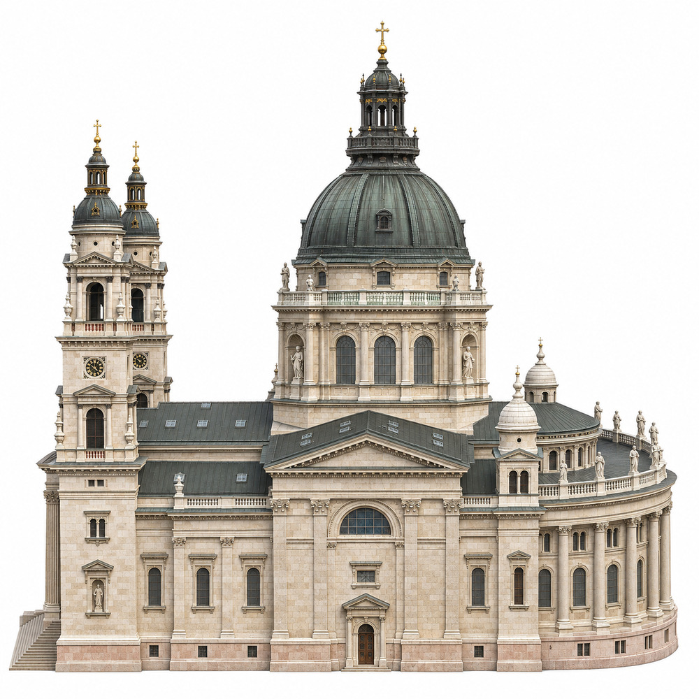

# KK ja LAV · Budapestin basilikan uusi sivukuva arvioitavaksi

Tilaus #2809. Pyydän KK:lta kuvasanan Pyhän Tapanin basilikan alkuperäiselle PNG:lle. SHA256 on `5619c374e035fa4a3620f44d68697c1fdc9015d78d900780b8a15711a8b0ec1c`.

[Alkuperäinen PNG](budapest-v2-2809-20261120/st-stephen-budapest-v2-original.png) · [Kuvan tiedot ja tarkistussummat](budapest-v2-2809-20261120/manifest.json)

Länsipään kellotornit näkyvät vasemmalla, kupoli keskellä ja itäpään kaareva pylväikkö oikealla. Kuvan siluetin leveys suhteessa korkeuteen on noin 1,03. Tilauksen pituuden ja kupolin korkeuden suhde on 96,9 / 96 ≈ 1,01. Kuvakulma ja portaat vaikuttavat kuvasuhteeseen. Leveys 61,6 m ja lopullinen korkeus tarkistetaan 3D-mallista.

Varmistin rakennuksen vanhan toimituksen lähdetiedoista. Paketin omista tiedostoista puuttuu Wikidata-tunniste. Budapestin basilikan tietue on [Q338665](https://www.wikidata.org/wiki/Q338665).

Uusi kuva on tehty kolmen Wikimedia Commons -viitekuvan perusteella.
- Pituusakseli, eteläsivu ja kattomuodot. Civertan, [Bazilika légifotó02.jpg](https://commons.wikimedia.org/wiki/File:Bazilika_l%C3%A9gifot%C3%B302.jpg), [CC BY-SA 3.0](https://creativecommons.org/licenses/by-sa/3.0).
- Pyöristetty itäpää ja pylväikkö. Globetrotter19, [St. Stephen's Basilica, East side, 2016 Budapest.jpg](https://commons.wikimedia.org/wiki/File:St._Stephen%27s_Basilica,_East_side,_2016_Budapest.jpg), [CC BY-SA 3.0](https://creativecommons.org/licenses/by-sa/3.0).
- Länsipäädyn kellotornipari. Dguendel, [Budapest, St. Stephen's Basilica the western facade.jpg](https://commons.wikimedia.org/wiki/File:Budapest,_St._Stephen%27s_Basilica_the_western_facade.jpg), [CC BY 3.0](https://creativecommons.org/licenses/by/3.0).

Tripo-otto odottaa juuri yllä olevan kuvan hyväksyntää. Saman illan viimeisin tilitarkistus näytti 0 krediittiä ja tallennustilan 417/40. Tällä kuvalla ei ole tehty ottoa. Tripo-kulu 0 krediittiä.
