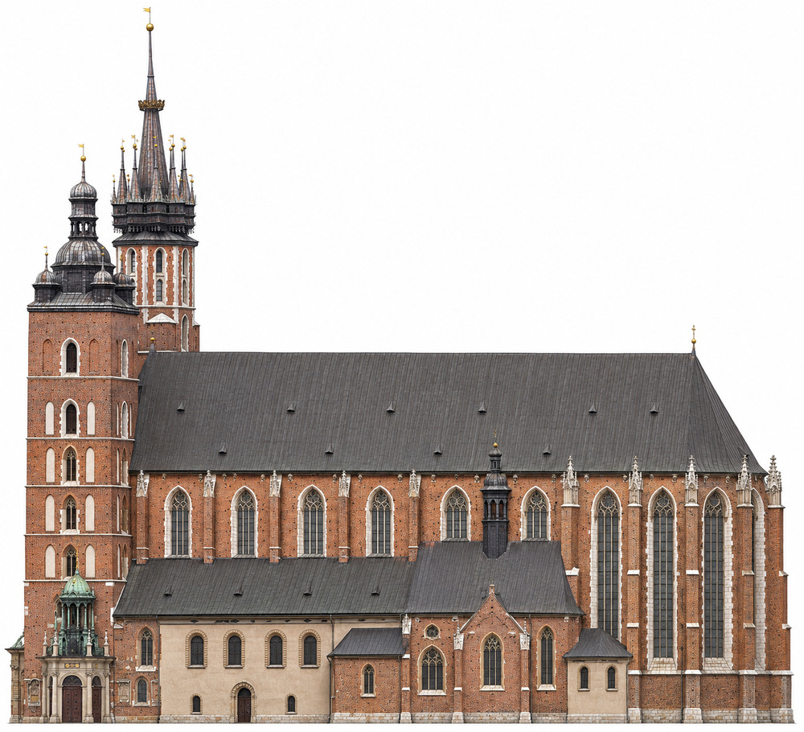
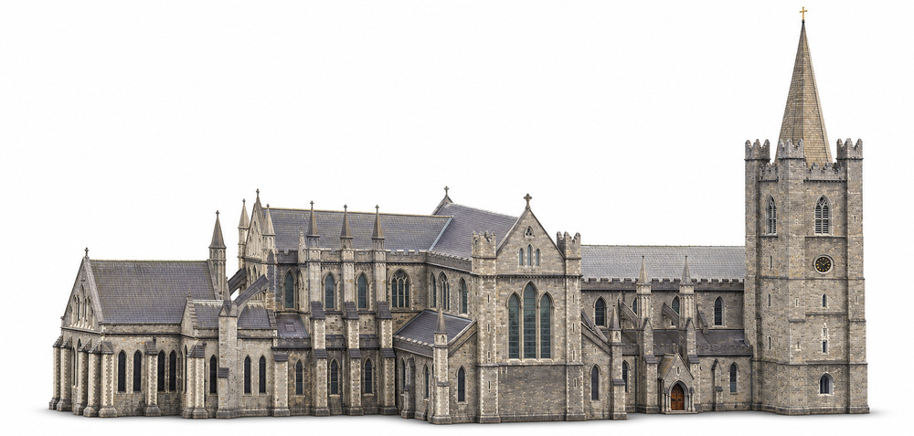

# KK ja LAV · kaksi kirkkoa arvioitavaksi

Molemmista kohteista on tehty uusi sivukuva kolmen Wikimedia Commons -valokuvan perusteella. Pyydämme KK:lta kummankin alkuperäisen PNG:n SHA256:lle erillisen hyväksynnän tai korjausohjeen.

## Krakovan Mariankirkko · #2807

Eteläsivu näkyy länsipään kahdesta erikorkuisesta tornista itäkuoriin. Korkean tornin ja matalamman sipulikupolin ero erottuu. Kuistin suunta ja kappelien yksityiskohdat ovat tulkintaa.

Tilausmitat 88.5 × 40.3 m, torni 81 m. Kuvan siluetin leveys/korkeus on noin 1.10, tilausmittojen pituus/tornikorkeus 1.09. Nämä ovat kaksi eri mittausta. 3D-mitat varmistetaan aikanaan mallista.

Hyväksyttävän alkuperäisen SHA256 on `75275658ed90bef30c0b64c1c9f516627dfb763606b9edb285a2918bf4959e67`.

[Alkuperäinen PNG](kirkot-v2-2807-2808-20261120/st-mary-krakow-v2-original.png)

Viitekuvat Wikimedia Commonsissa

- Mateusz Giełczyński · [Saint Mary Basilica in Kraków from a distance.JPG](https://commons.wikimedia.org/wiki/File:Saint_Mary_Basilica_in_Krak%C3%B3w_from_a_distance.JPG) · [CC BY-SA 3.0 pl](https://creativecommons.org/licenses/by-sa/3.0/pl/deed.en)
- Fmbar22 · [Kraków, kościół par. p.w. Wniebowzięcia NMP (Mariacki), XIII XIV, XIV, XIX 33.JPG](https://commons.wikimedia.org/wiki/File:Krak%C3%B3w,_ko%C5%9Bci%C3%B3%C5%82_par._p.w._Wniebowzi%C4%99cia_NMP_(Mariacki),_XIII_XIV,_XIV,_XIX_33.JPG) · [CC BY-SA 3.0 pl](https://creativecommons.org/licenses/by-sa/3.0/pl/deed.en)
- Suicasmo · [Exterior of Saint Mary Basilica in Kraków 20180813-1.jpg](https://commons.wikimedia.org/wiki/File:Exterior_of_Saint_Mary_Basilica_in_Krak%C3%B3w_20180813-1.jpg) · [CC BY-SA 4.0](https://creativecommons.org/licenses/by-sa/4.0)

## Dublinin St Patrickin katedraali · #2808

Pohjoissivussa näkyvät matalampi itäkappeli vasemmalla, poikkilaiva keskellä sekä yksittäinen luoteistorni oikealla. Kuvan poikkilaivan leveys syvyyssuunnassa vaatii 3D-tarkistuksen.

Tilausmitat 90.3 × 46.3 m, torni 43 m. Kuvan siluetin leveys/korkeus on noin 1.97, tilausmittojen pituus/tornikorkeus 2.10. Nämä ovat kaksi eri mittausta. 3D-mitat varmistetaan aikanaan mallista.

Hyväksyttävän alkuperäisen SHA256 on `35faf11dee8fb58094a68cc936ac8a6c0b0b8e6f57394c91627ba9e197b70e0a`.

[Alkuperäinen PNG](kirkot-v2-2807-2808-20261120/st-patrick-dublin-v2-original.png)

Viitekuvat Wikimedia Commonsissa

- Diliff · [St Patrick's Cathedral Exterior, Dublin, Ireland - Diliff.jpg](https://commons.wikimedia.org/wiki/File:St_Patrick%27s_Cathedral_Exterior,_Dublin,_Ireland_-_Diliff.jpg) · [CC BY-SA 3.0](https://creativecommons.org/licenses/by-sa/3.0)
- Nordisk familjebok · [Dublin, St Patricks katedral, Nordisk familjebok.png](https://commons.wikimedia.org/wiki/File:Dublin,_St_Patricks_katedral,_Nordisk_familjebok.png) · Public domain
- Zairon · [Dublin St. Patrick's Cathedral Exterior Choir 1.jpg](https://commons.wikimedia.org/wiki/File:Dublin_St._Patrick%27s_Cathedral_Exterior_Choir_1.jpg) · [CC BY 4.0](https://creativecommons.org/licenses/by/4.0)

Tripo Studion päivitetty tilinäkymä 20.11. näytti 0 krediittiä ja tallennusrajan olevan täynnä (417/40). Kuvaerä käytti 0 Tripo-krediittiä. GLB-otot odottavat KK:n kuvakohtaista päätöstä ja käytettävissä olevia resursseja. Vanhat mallit säilyvät.
