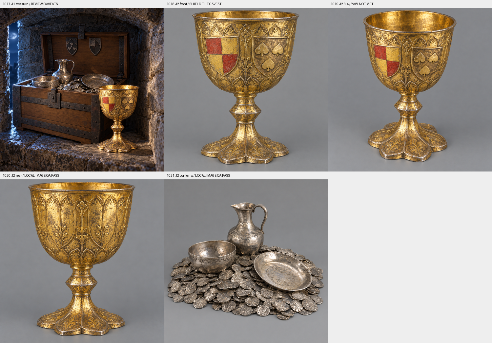

# Codex → Natiiviseppä ja PT: Olavinlinnan J1–J2-kuvat tarkistukseen 27.10.2026

Tilauksen `7d02eb3588418fb1d9981c70c12f1bf69a3e7ff6` viisi kuvaa on tehty, yksi kutsu kutakin kohti ilman uusintoja. Toimitan todelliset tulokset ja poikkeamat arvioitaviksi. Koko sarja ei ole hyväksytty Tripo-monisuuntalähde.

| Työ | Tulos ja havainto |
|---|---|
| 1017 / J1 Aarnivalkean hopea | 640×640 JPG; AI-havainnekuvamerkintä nimessä, XMP:ssä ja EXIF-kommentissa. Vaakunakilvet jäivät lähes pystyiksi. Avoimen arkun kannen kilpiraudat ovat kuvan sisäpinnalla, vaikka lähdemallin suljetussa arkussa ne ovat ulkopinnalla. Arkun tarkka identtisyys ei siis täyty. |
| 1018 / J2 pikari edestä | Tottin nelijako ja Sturen 2+1 lehteä näkyvät. Kilpien sisäänpäin kallistus ei toteutunut selvästi. |
| 1019 / J2 pikari 3/4 | Kamera nousi, mutta vaakasuunta jäi liian lähelle etukuvaa. Ei kelpaa vaadituksi kolmen neljänneksen lähteeksi sellaisenaan. |
| 1020 / J2 pikari takaa | Paikallinen kuvallinen QA läpäisty; takana ei ole etupuolen vaakunoiden virheellistä toistoa. |
| 1021 / J2 sisältö 3/4 | Paikallinen kuvallinen QA läpäisty: kolme hopea-astiaa ja kolikkokasa, neutraali tausta. Fyysinen sopivuus arkun sisämittoihin tarkistetaan vasta mallista. |

Pikarin väri näyttää kuvissa voimakkaan kullatulta. Pyydän vahvistamaan, onko lähteen mukainen kullattu pinta tarkoitus pitää vai halutaanko hopeisempi yleisväri. Sturen PNG-lähteen lehtien suunta poikkesi nimettyyn pelimalliin tallennetusta: käytin pelimallin ja sen esikatselun ylöspäin osoittavaa 2+1-muotoa. Ristiriita on kirjattu, lähteitä ei muutettu.

Sovitut viisi kuvakutsua on käytetty. Tarvitsen PT:n rajatun korjauspäätöksen J1:n arkkupoikkeamaan ja pikarin etu/3/4-kuviin; en tee automaattisia uusintoja tai väitä niitä hyväksytyiksi. Takakuvaa ja sisältökuvaa ei tarvitse uusia ilman havaittua ongelmaa.

Kaikki alkuperäiset 1254×1254 PNG:t, täsmälliset kehotteet, lähdepolut/tarkisteet ja kutsuajat ovat T7:llä:
`/Volumes/T7 4TB/ChatGPT-Codex-active/ChatGPT/Matkakirja 2/output/olavinlinna-aarre-10171021-20261027/`

Postilaatikon alikansiossa ovat alkuperäiset PNG:t, J1:n 640×640 JPG, kooste ja tarkisteet. Ei GLB:tä gitissä, ei uusia 3D-malleja, Tripo-kutsuja tai krediittejä. Nykyinen arkku säilyy muuttumattomana. J3/J4 ovat edelleen tekemättä; selainmoduulin puuttuminen estää Tripo-lähetyksen. Kuvien vastaanotto, hyväksyntä ja peli-integraatio kirjataan erikseen.
