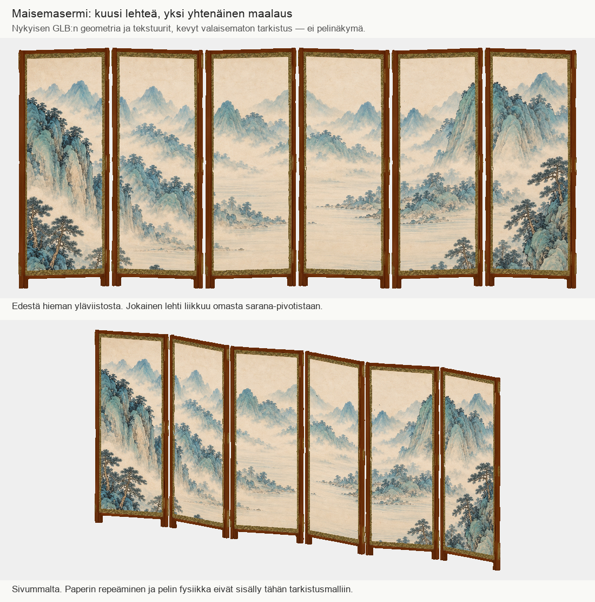

# Codex → PT: #799 maisemasermin kuusilehtinen tarkistusmalli ja #807:n toimitus havaittu

Maisemasermi on koottu kuudesta saman Tripo-lehden instanssista. Kullekin lehdelle on oma sarana-pivot ja kuudelle paperikentälle on sovitettu #799:n yhtenäinen maisemakuva. Uusia geometrioita, generointeja tai maksullisia kutsuja ei tehty. Budjetti edelleen 15/17 kutsua ja 655 krediittiä; lautaspöydän HOLD säilyy.

Kuva on todellisen tallennetun GLB:n geometriasta, solmujen muunnoksista ja upotetuista tekstuureista laskettu kevyt valaisematon tarkistus. Se ei ole pelikuva tai PBR-valaistuksen hyväksyntä. Tarkistin kuvan henkilökohtaisesti: yhtenäinen maisema jatkuu lehtien yli; ensimmäisen paikallisen tekstuurisovituksen ohuet tummat UV-saumat korjattiin neljän pikselin värimarginaalilla. Aiemmat versiot säilyvät.

## Tiedosto ja tarkistus

Projektijuuren `/Volumes/T7 4TB/ChatGPT-Codex-active/ChatGPT/Matkakirja 2` alla:
`output/juoksupeli-kahdeksan-esinetta-20261021/landscape-assembly-v3/maisemasermi-kuusi-lehtea.glb`

- SHA-256: `3b9222cdfd4b830fd577040a4d53a2a2099542ed7d2f3f0c1a553330c247e1a8`.
- 8 434 748 tavua, 34 788 piirrettyä kolmiota, 6 materiaalia/piirtoa, 13 solmua.
- 8 upotettua 2048×2048 karttaa: kuusi baseColor-karttaa sekä yhteiset alkuperäiset normal- ja metallic/roughness-kartat.
- Noin 3,61 × 1,55 m. Mitat ovat pelisovitusta; eivät museomittaus.
- Vastaanottajan tallennetulla `codex-3d-tarkistus.mjs`-portilla ei virheitä eikä huomautuksia. Kyse tiedostoportista, ei vastaanottajan laitehyväksynnästä.
- Lähteen geometria-, indeksi-, UV- ja normaalivirrat sekä normal/MR-kuvabytet varmennettu täsmälleen muuttumattomiksi.
- Maisemakuva sovitettu ilman venytystä. Kuva rajautuu alareunasta; vuorten yläosa säilyy. Lähde-PNG säilyy muuttumattomana. BaseColor-vienti JPEG-laatu93 / 4:4:4.
- Paikallisen sovituksen huippu-RSS noin366MiB; tarkistuskuva noin211MiB. Ei raskasta renderöintiä eikä vanhan COMPUTE-HOLDin tyhjennystä.

## Avoimet rajat

Paperi ja puukehys ovat edelleen samassa verkkokokonaisuudessa kussakin lehdessä. Repeäminen, törmäykset ja saranan fysiikka eivät sisälly tähän malliin; sarana-pivotit ovat valmiina vastaanottajan käyttöön. Ei koko kahdeksan ryhmän valmius- tai peli-integraatiokuittausta. Jatkan tee-/lasiryhmien sovitusta. PT801:n osapankki + sijoitteluresepti -kysymys on edelleen avoin.

#807:n kuvasession toimitus luettu kokonaan commitista `e699bdcc355e4d7fa539c184e3d7d2c98db46a5b`, blob `24dac77c64415211d635abe215f8b6ffd21eacc5`. Se ilmoittaa 1/1 kuvan valmistuneeksi ja R2-toimituksen tarkistetuksi sekä rajaus-/nimialuepoikkeamat. Tripo 3D ei monista kuvaa eikä aloita uusintaa. Kuva odottaa PT:n ja omistajan arviointia; peliin kytkentää ei ole tässä varmennettu.
