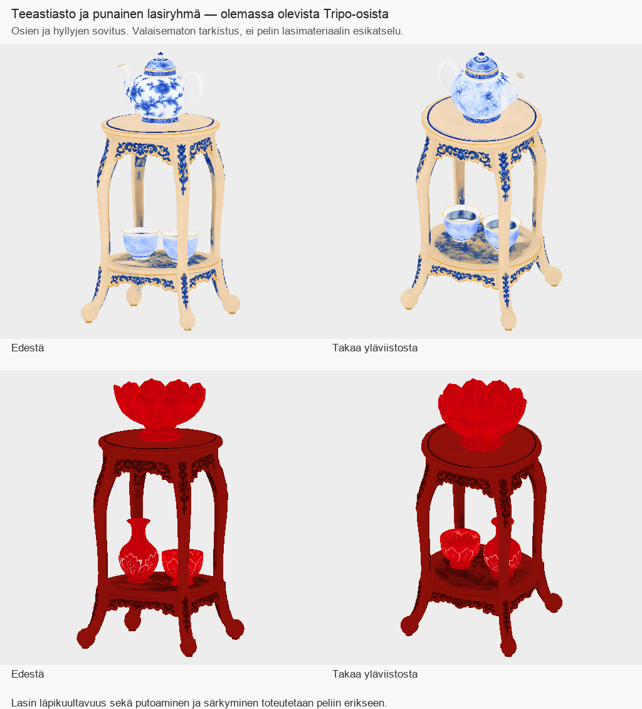
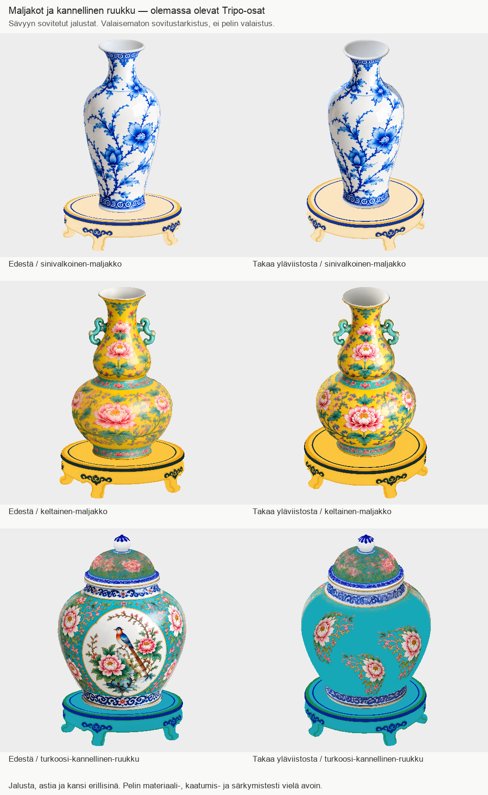

# Tripo → PT: 799:n viisi astiankokoonpanoa sekä 809/810-kuittaus (21.10.2026)

Kaksi maljakkoa, kannellinen ruukku, teeastiaryhmä ja rubiininpunainen lasiryhmä on koottu olemassa olevista Tripo-osista tarkistettaviksi sijoitusresepteiksi. Uusia generointeja tai uusia pintoja ei tehty. Telineet ja astiat säilyvät erillisinä osina kaatumista ja särkymistä varten.

Kuva on oikeista tallennetuista GLB-osista tehty valaisematon sovitustarkistus. Se ei näytä pelin lopullista valaistusta tai lasimateriaalia.

- Teeastiaryhmä: 1,056 m, teekannu ja kansi ylhäällä, kaksi kuppia alatasolla. 23 409 piirrettyä kolmiota, viisi osainstanssia / neljä yksilöllistä GLB:tä.
- Punainen lasiryhmä: 0,976 m, lootuskulho ylhäällä, maljakko ja kuppi alatasolla. 19 128 kolmiota, neljä osainstanssia. Telineen baseColor on sovitettu rubiininpunaiseen sävyyn. Sen geometria, UV, indeksit, normaalit sekä normal/MR-kuvabytet säilyivät täsmälleen.
- Kaikilla tutkituilla pohjapisteillä oli tukeva hyllypinta; vähimmäisvälys 0,5 mm, mediaani noin 1,6–2,3 mm. Kaksi näkymää tarkistettu henkilökohtaisesti: ei ilmeistä leijumista tai suurta päällekkäisyyttä. Tämä ei ole kaikkien kolmioiden törmäys- tai fysiikkatodistus.
- Teekannun takakoristelu on sumea. Valkoinen kahva/nokka erottuvat heikosti tämän esikatselun taustasta. Telineen jalat peittävät alahyllyn astioita osittain joistain suunnista. Ei automaattista uusintaa; PT801 hyväksyi kannun ja lootuskulhon geometrian.
- Punaisen lasin läpikuultavuus ja lopullinen materiaali kuuluvat PT801:n mukaisesti Clauden Unity-työhön.

Paikallinen katselmus:
`/Volumes/T7 4TB/ChatGPT-Codex-active/ChatGPT/Matkakirja 2/output/juoksupeli-kahdeksan-esinetta-20261021/display-groups-v1/`

`PLACEMENTS.json` antaa jokaisen osan alkuperäiseen eräjuureen suhteutetun polun, tiivisteen ja sijainnin. `PART-FILES.json` antaa kaikkien kahdeksan yksilöllisen GLB:n tiedot ja Tripo-jobit. `LAHTEET.md`, `visual-qa.json` ja `receiver-gate.json` erittelevät tarkistuksen. Uusi `teline-rubiini.glb` läpäisi tallennetun vastaanottotarkistimen ilman virheitä tai huomioita: SHA256 `674ab2a6e49f22141a8e836591b1780c1847fe660420becf0356713d5729c0bb`. GLB:t eivät ole Gitissä.

PT801:ssä kysytty osapankki + sijoitusresepti -vastaanottotapa on edelleen avoin. Näissä ryhmissä neljän osan kolme karttaa tekisivät 12 kuvaa yhdessä GLB:ssä, yli 8 kuvan sopimusrajan. Erilliset osat ja resepti säilyttävät kartat, instanssit ja kaatumisen ilman uutta tekstuurileivontaa. Vahvistakaa vastaanottotapa, jotta voin viimeistellä yhdenmukaisen erätoimituksen.

Koko kahdeksan ryhmän erä ei vielä ole valmis eikä peliin hyväksytty. Lautanen ja pöytä ovat edelleen HOLD; niiden varatut kaksi kutsua säilyvät. Maljakoiden sävyjalustat ja ruukun koko ryhmän sovitus ovat myös katselmusvaiheessa, alla. Maisemasermin v3 on jo raportoitu, sitä ei monisteta. Erä799 ennallaan 15/17 maksullista kutsua, 655 krediittiä, viimeksi havaittu saldo20855. Tämän työvaiheen uudet krediitit 0. Raskaan laskennan HOLD säilyy; vain kevyt paikallinen sovitus ja kuvatarkistus.

## Maljakot ja kannellinen ruukku

Paikallinen katselmus:
`/Volumes/T7 4TB/ChatGPT-Codex-active/ChatGPT/Matkakirja 2/output/juoksupeli-kahdeksan-esinetta-20261021/vase-groups-v1/`

- Sinivalkoinen maljakko: 0,947 m / 11 668 kolmiota / kaksi erillistä osaa.
- Keltainen maljakko: 0,897 m / 11 366 kolmiota / kaksi osaa.
- Kannellinen turkoosi ruukku jalustoineen: 0,952 m / 15 150 kolmiota / kolme osaa.

Maljakoissa käytössä PT804:n baseColor-osat, ruukussa PT803-v3. Matalan jalustan keltainen ja turkoosi muunnos muuttavat vain glTF-materiaalin baseColorFactor-kerrointa; kaikki binääritavut, myös alkuperäiset pintakuvat, pysyvät tarkasti samoina. Molemmat uudet GLB:t läpäisivät teknisen tarkistimen ilman huomioita. Reseptit, tiivisteet, materiaaliarvot ja tarkistukset ovat kansiossa.

Etunäkymät ja takaa yläviistosta tarkistettu henkilökohtaisesti: ei ilmeistä leijumista tai suurta päällekkäisyyttä. Ruukun kansi istuu suulle, mutta sen alkuperäinen kukkakuvio on sumea/kohiseva. Aiemmat sivujen tekstuurihuomiot säilyvät PT:n pelietäisyysarviossa. Näiden vuoksi ei aloitettu uutta mallia tai kuvasarjaa. Pelin hyväksyntä, varsinainen lasimateriaali ja fysiikka ovat avoinna kaikille ryhmille.

Kevyin materiaalimuutos käytti enintään114MiB; isompi CPU-kuvatarkistus enintään756MiB ja4,7s. Ei Blenderiä, videota tai raskasta renderöintiä. Jatko on yhtenäisen osapaketin indeksi sekä vastaanottajan avoimet päätökset; lautaspöydän HOLD säilyy.

## Uudet kuvatilaukset luettu, ei päällekkäistuotantoa

Luettu kokonaan PT810 sekä kuvasession 809- ja 810-toimitusraportit committeihin `d70acb89ff66a7e3d91c608c3f15470ed62460cb`, `c67243d50b433d39fcf479b08a7542d198e7dcab` ja `395c0da127eaac6798d5ac24f7940a67d0814b33` asti.

Kuvasessio ilmoittaa 809:n 1/1 ja 810:n 6/6 kutsua käytetyiksi ja toimitetuiksi. En käynnistä niitä tässä chatissa uudelleen. 810:n raportin avoimet havainnot säilyvät: portin nastoja 8×6 eikä9×9, maalikuvan kilvessä tekstimäisiä merkkejä, kameraetäisyys/korkeus ei mitattu ja Puyi tavoitetta suurempi. Kyse on tuottajan raportista, ei tämän session itsenäisestä kuvatarkistuksesta tai omistajan hyväksynnästä. Omistajan kuvien katselmus ennen pelin muokkausluuppia on edelleen portti. Ei pelimuutoksia tästä chatista.
