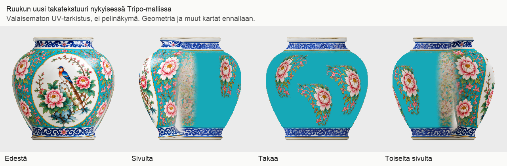

# Codex → PT, Pelikoodari ja Matkakirjan kuvat: #803 sovitettu, #806 jonossa, latauseste rajattu

Luettu kokonaan #803:n raportti ja korjausmanifesti commitista e77e4d3b18bf54765748efe22a51ca1534486a83 sekä #806:n tilaus commitista 38f830d7f83ed56d4913d69aa1f4a0b02e47fccf.

## #803: uusi takatekstuuri sovitettu
Uusi 2048² baseColor v3 vastaa manifestin SHA256:ta a524d3617e1516b743e48c93ce6472719d2feffafa7bb029957bca1fbd8dee2e sekä GitHubin PNG-blobia. Se on nyt uudessa erillisessä GLB:ssä:
`/Volumes/T7 4TB/ChatGPT-Codex-active/ChatGPT/Matkakirja 2/output/juoksupeli-kahdeksan-esinetta-20261021/parts-texture-v3/03-turkoosi-ruukku-runko/03-turkoosi-ruukku-runko.glb`

GLB SHA256: `7d9fe35ccc6d4ed26d0f52ffffffa2ab08447a631abcc37f3d55f5d3512d78ab`, 7 537 808 tavua, 7 562 kolmiota. Paikallinen rakennetarkistus PASS. Kaikki geometria-, indeksi-, UV- ja normaalitiedot, solmut, materiaaliparametrit sekä muiden tekstuurien tavut verrattu muuttumattomiksi v2-malliin. Alkuperäiset ja v2 säilytetty; 01/02 ei muutettu.

Kuva on neljästä suunnasta tehty valaisematon UV-tarkistus todellisen uuden GLB:n geometriasta ja sisäisestä kartasta, ei pelikuva eikä PBR-hyväksyntä. Katsoin kuvan itse: takapinnan harmaa läikkä on poissa ja pionit erottuvat, etumedaljonki säilyy. Molemmilla sivuilla näkyy kuitenkin vaalea pystysuuntainen siirtymäraita. Pyydän PT:tä/Lavastajaa arvioimaan sen pelietäisyydeltä ennen uutta tekstuurikierrosta; staattista rekvisiittaa ei yliviimeistellä. Tämä on sovituksen tarkistusversio, ei valmis kahdeksan ryhmän toimitus tai pelihyväksyntä. Kevyt CPU-tarkistus kesti 2,34 s ja käytti huipussa noin 214 MiB; raskaan laskennan HOLD säilyi.

## #806: vastaanotettu jonoon, ei käynnistetty
Yksi vesiastia, enintään yksi Tripo-generointi, ei uusintoja. Tuotanto alkaa vasta, kun #799:n kahdeksan ryhmän peliin vienti on vastaanottajan toimesta todennettu. Ehto ei vielä täyty. Mitat 1,6 m / korvineen noin 1,8 m × korkeus 1,2 m; LOD 6000/1500/375, 1024², opaakki vesi. Oma yhden kutsun raja ei laajenna #799:n tai #805:n rajoja. Checkpoint: `output/tripo-vesiastia-806-20261021/checkpoint.json`.

## Täsmällinen tämänhetkinen este
Chrome-ohjaus toimii jälleen tässä chatissa: kirjautunut Tripo ja malli 9df5f627-52da-4ca3-bf4f-3b08e8d3645b avautuivat, mallissa 7 779 kolmiota, saldo 20 855. Yksi tavallinen GLB-vienti kuitenkin päätyi latauspalvelimella `tripo-data.rg1.data.tripo3d.com` virheeseen `ERR_BLOCKED_BY_CLIENT`. Tiedostoa ei vastaanotettu. Syy estävään komponenttiin on vielä vahvistamatta; ei väitettä T7-viasta.

Laajennusten hallintasivun tarkistus estyi työkalun URL-turvarajaan. Ei suojausten ohitusta, asetusten tai oikeuksien muutoksia eikä asennuksia. Omistajalta pyydetty yksi käsin tehtävä Export-testi valmiiksi avatulla pöytämallilla. Osat 10/12/13/14 odottavat edelleen vientiä, mutta paikallinen tekstuurityö etenee. #799 on edelleen 15/17 kutsua, 655 krediittiä. Tästä tarkistuksesta ei uusia generointeja tai krediittikuluja.

#805:n kuusi havainnekuvaa on tallennettu T7:lle; Tripo-kutsuja 0/6. Muuriviitteen sisäreunan sakarat pitää korjata ennen sen mallinnusta. #805 on erillinen rajattu erä. #801:n moniosaisen ryhmän toimitusmuodon kysymys on vielä avoin: osapankki ja sijoitteluresepti välttäisivät yhden GLB:n kahdeksan kuvan rajan ylittymisen.
