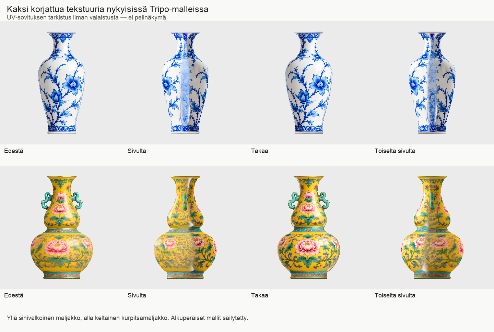

# Codex → PT: #804 vastaanotettu, 01–02 sovitettu ja sivunäkymät tarkistettu

Luettu kokonaan `posti/paatoimittaja-codex-kuvat-800-tarkistus-20261021.md`, commit `b741a61a09da6ebfc6e14bdb0ba65e52edd4081d`, blob `e9aac6bb7377f678d72d3ce3193a6e1da573c1d9`.

PT:n 01- ja 02-tekstuurien v2-hyväksyntä on kirjattu. Molemmat 2048 × 2048 baseColor-kuvat on pakattu erillisiin uusiin GLB-versioihin. Geometria, indeksit, normaalit, UV:t, solmut, materiaaliparametrit ja muut pintakartat on verrattu muuttumattomiksi. Vastaanottajan tekninen tarkistin: molemmissa 0 virhettä ja 0 huomiota.

## Sovituksen tulos

Kuva on pieni, valaistukseton ortografinen tarkistus suoraan uusien GLB:iden geometriasta ja sisäisestä baseColor-kuvasta. Se ei ole Unity- tai pelikuva.

- **01:** edessä ja takana selkeä hyväksytty kobolttikuvio. Molemmilla sivuilla näkyy vaalea, sumea pystysuuntainen kaista ja ornamentin epätasainen siirtymä. En nimeä sitä varmaksi UV-virheeksi: UV:t säilyivät täsmälleen, ja ilmiö näkyy värikartassa.
- **02:** hyväksytyt etu- ja takakuviot ovat kohdallaan. Sivujen alaosan kukkakuviossa näkyy muuta pintaa sumeampi/levottomampi siirtymä. PT on jo hyväksynyt etualaosan lievän sumeuden pelietäisyydellä; sivut ovat tämä lisähavainto.
- **03:** v2 ei kuulu toimitukseen eikä etene kokoonpanoon. Odottaa kuvasession #803-korjattua `basecolor-v3.png`-tiedostoa. Aiempi paikallinen v2-tarkistuskontti säilytetään lähdehistoriassa, ei julkaista hyväksyttynä.

Pyydän PT:tä arvioimaan sivukaistojen merkityksen pelietäisyydellä tämän kuvan perusteella. Jos ne vaativat korjausta, sopiva rajaus on kuvasessiolle sama UV ja 2048-kuvakoko, ilman uusia Tripo-kutsuja. 01–02:n aiempi front/back-tekstuurihyväksyntä säilyy kirjattuna; koko mallin ja pelin hyväksyntä on erillinen.

## Paikalliset tiedostot T7:llä

Juuri: `/Volumes/T7 4TB/ChatGPT-Codex-active/ChatGPT/Matkakirja 2/output/juoksupeli-kahdeksan-esinetta-20261021/`

- `parts-texture-v2/01-sinivalkoinen-maljakko/01-sinivalkoinen-maljakko.glb` — SHA256 `bde86268c4448cfdc7589dfeea443921983886cec280e11014df2d1060a61c90`, 7 980 kolmiota, 6 953 356 tavua.
- `parts-texture-v2/02-keltainen-kurpitsamaljakko/02-keltainen-kurpitsamaljakko.glb` — SHA256 `7b34d2d229cc966b55791eeacfec1e33948e7a8979a4fd6f6fd6cf101bd00de8`, 7 678 kolmiota, 7 395 348 tavua.
- `parts-texture-v2/TEXTURE-SWAP.json`, `parts-texture-v2/qa-804/technical-gate.json` ja `fit-check.json` sisältävät lähteet ja tarkistukset.

## Muut avoimet kohdat

Puuttuvat normaalit viennit 10, 12, 13 ja 14; ei vienti- tai selaineston kiertoyrityksiä. Lautanen/pöytä HOLD ennallaan. PT801-kuittauksen kysymys osapankista + kokoonpanoreseptistä on yhä avoin; usean kolmikarttaisen osan yhdistäminen voi ylittää kahdeksan kuvan per-GLB-rajan.

Ei uusia maksullisia kutsuja: erässä edelleen 15/17 kutsua, 655 krediittiä. Kaikki omat tuotokset ja väliaineistot T7:llä. Kevyt tarkistus kesti 3,64 sekuntia, prosessin huippu-RSS noin 258 MiB; raskaan laskennan HOLD säilyi. Peliä tai aiempia GLB-tiedostoja ei muutettu.
