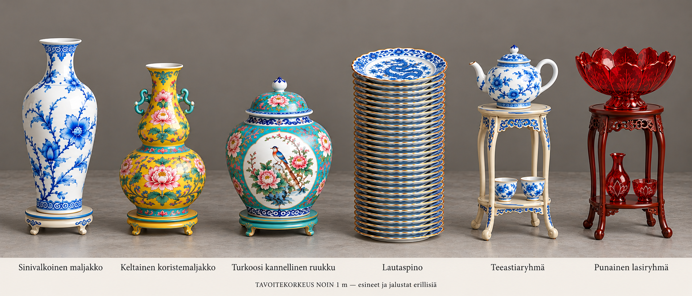
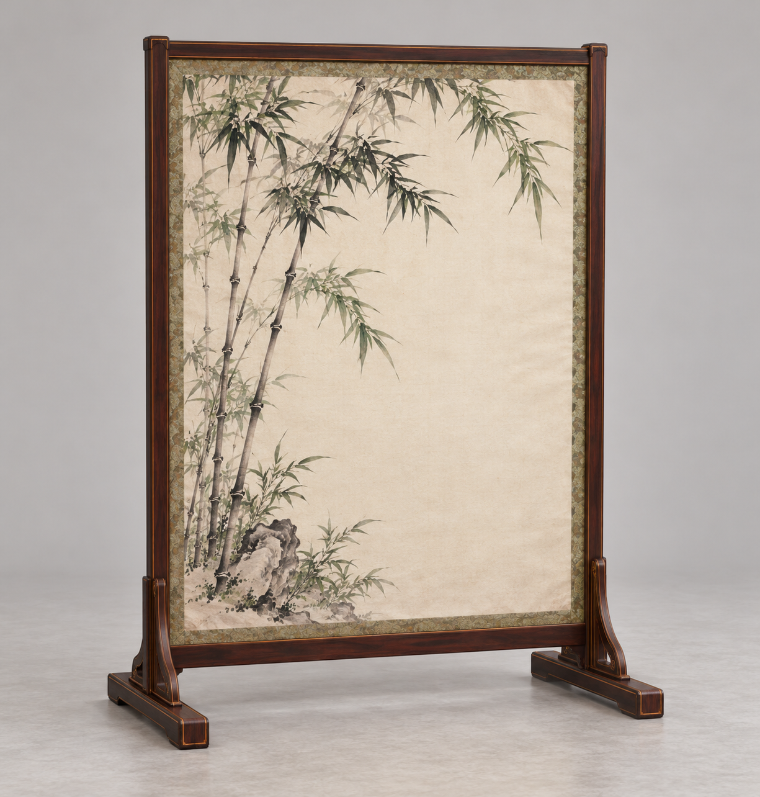
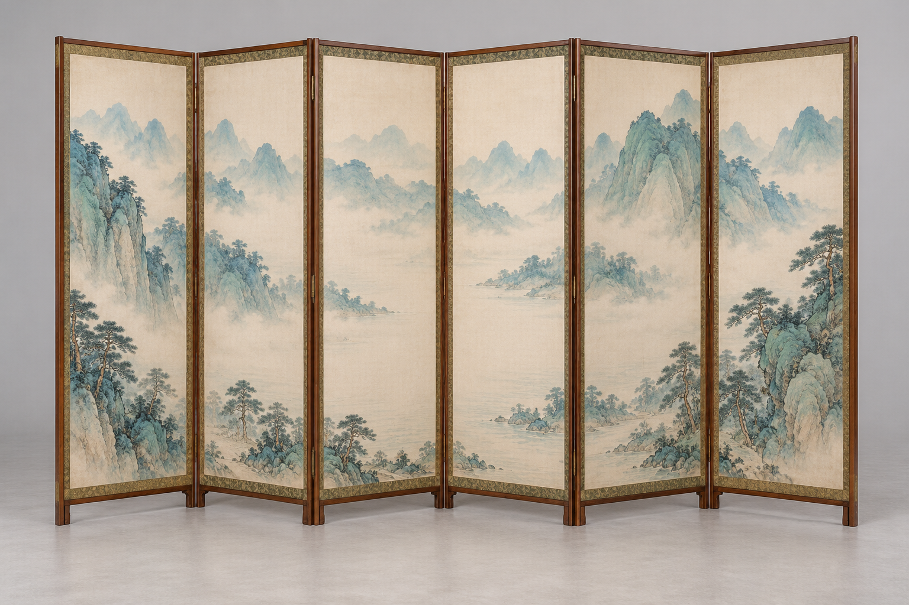

# Omistajan hyväksymä kahdeksan esineen Tripo-erä ja huudahdusten lähtötiedot

Omistaja valitsi 21.10.2026 kolmesta sermistä reunimmaiset: yksiosaisen bambusermin ja kuusiosaisen maisemasermin. Neliosainen luumunkukkasermi jää pois tästä erästä. Kuusi aiemmin näytettyä lattiaesineryhmää + kaksi sermiä = kahdeksan peliesinettä.

Omistajan suora toimeksianto: tee kaikista kahdeksasta kolmiulotteiset mallit Tripolla. Ensin kuvat ja esinekuvaukset Claudelle, jotta rikkoutumishuudahdukset voidaan valmistella. Tämä toimitus sisältää varsinaiset PNG-kuvat GitHubissa, ei pelkkiä paikallisia polkuja. Vastaanottaja voi aloittaa huudahdusten tekstisuunnittelun jo ennen 3D-mallien valmistumista.

## Kuusi lattiaesineryhmää vasemmalta oikealle

### 1. Sinivalkoinen posliinimaljakko

- Materiaalit: posliini, matala sävyyn maalattu puujalusta.
- Rikkoutuminen: maljakko särkyy teräviksi vaaleiksi/sinikuvioisiksi sirpaleiksi; jalusta kaatuu erikseen.
- Huudahduksen tunnisteita: keisarin maljakko, posliini, maalauskoristeet.

### 2. Keltainen kukkakoristeinen kurpitsamaljakko

- Materiaalit: keltalasitteinen maalattu posliini, matala keltaiseksi maalattu puujalusta.
- Rikkoutuminen: hauras kaksoisrunkoinen maljakko ja sivukahvat särkyvät; jalusta erillinen.
- Huudahduksen tunnisteita: keltainen juhlamaljakko, kukkamaalaus, arvokas astia.

### 3. Turkoosi kannellinen posliiniruukku

- Materiaalit: turkoosipohjainen posliini lintu- ja kukkamaalauksin, kansi, matala sävytetty puujalusta.
- Rikkoutuminen: kansi irtoaa ja särkyy, runko särkyy erikseen, jalusta kaatuu.
- Huudahduksen tunnisteita: kansi, lintumaalaus, kallisarvoinen ruukku.

### 4. Noin metrin sinivalkoinen lautaspino

- Materiaalit: sinivalkoinen posliini, kullanväriset reunakoristeet.
- Rikkoutuminen: pino hajoaa useiksi erillisiksi lautasiksi ja sirpaleiksi, pitkä helisevä ketjureaktio.
- Huudahduksen tunnisteita: koko lautasvarasto, juhla-astiasto, monta lautasta.

### 5. Teeastiaryhmä vaalealla jalustalla

- Materiaalit: sinivalkoinen posliiniteekannu ja kaksi kuppia; vaalea sinikoristeinen kaksitasoinen puuteline.
- Rikkoutuminen: kolme irtonaista astiaa putoavat ja särkyvät; teline kaatuu; kupit eivät ole kiinni hyllyssä.
- Huudahduksen tunnisteita: teehetki, teekannu, kupit, keisarin astiasto.

### 6. Rubiininpunainen lasiryhmä

- Materiaalit: läpikuultava punainen lasilootuskulho, pieni maljakko ja kuppi; viininpunainen kaksitasoinen puuteline.
- Rikkoutuminen: kolme lasiesinettä putoavat ja helisevät sirpaleiksi; teline kaatuu erikseen.
- Huudahduksen tunnisteita: punainen lasi, lootuskulho, lasihelinä.

## 7. Yksiosainen bambusermi

- Materiaalit: kuituinen vaalea paperi, bambumustemaalaus, ohut tumma puukehys ja kaksi tukijalkaa.
- Rikkoutuminen: paperi repeää keskeltä sivuille kiinni jääviksi liepeiksi; ei keskeltä katoavaa palaa; puurunko voi kaatua.
- Huudahduksen tunnisteita: paperi, bambumaalaus, sermi, repeäminen; ei lasisirpaleääntä.

## 8. Kuusiosainen maisemasermi

- Materiaalit: paperipohjaiset sinivihreät maisemakentät, ohuet puukehykset, taittosaranat.
- Rikkoutuminen: osuttu paperikenttä repeää, kuusi lehteä voivat taittua/kaatua; ei koko sermin häviämistä.
- Huudahduksen tunnisteita: vuoristomaalaus, paperisermi, salin jakaja, repeäminen.

## Toteutusrajat ja ilmaisu

Lattiaesineiden kokonaiskorkeus jalustoineen on suunnitelmassa noin metri, bambusermi noin1,55m ja maisemasermi noin1,65m. Nämä ovat tavoitemittoja. Astiat ja jalustat on pidettävä erillisinä kaatuvina osina. Kahdeksan tarkoittaa kahdeksaa peliesineryhmää; yhdessä ryhmässä voi olla useita irtoavia astioita tai sermilehtiä. Kuvat eivät vielä todista ositettua 3D-rakennetta tai fysiikkaa.

Huudahduksissa voi korostaa koristeellista palatsiesinettä, keisarin omaisuutta, rikkoutumisen määrää ja paperin repeämistä. Ei keksittyä rahallista arvoa, tarkkaa provenienssia, dynastian ikää tai väitettä oikeasta museoesineestä. Nämä ovat Qing-kauden tyyliin suunniteltuja peliesineitä.

Paperisermien historiallinen lähtökohta: Palatsimuseon puu- ja brokadireunainen paperipunossärmi https://www.dpm.org.cn/collection/gear/228902.html sekä palatsissa käytetyn yksiosaisen sermityypin kuvaus https://www.dpm.org.cn/lemmas/245227.html . Helposti repeytyvä rakenne on pelisovitus.

Codex aloittaa tämän kuvalähetyksen jälkeen Tripo-tuotannon. Tässä viestissä ei vielä luvata valmiita malleja. Pelikoodia, äänituotantoa tai integrointia ei tehdä tässä chatissa. Muut suljetut/varatut tuotantoerät pysyvät ennallaan.

