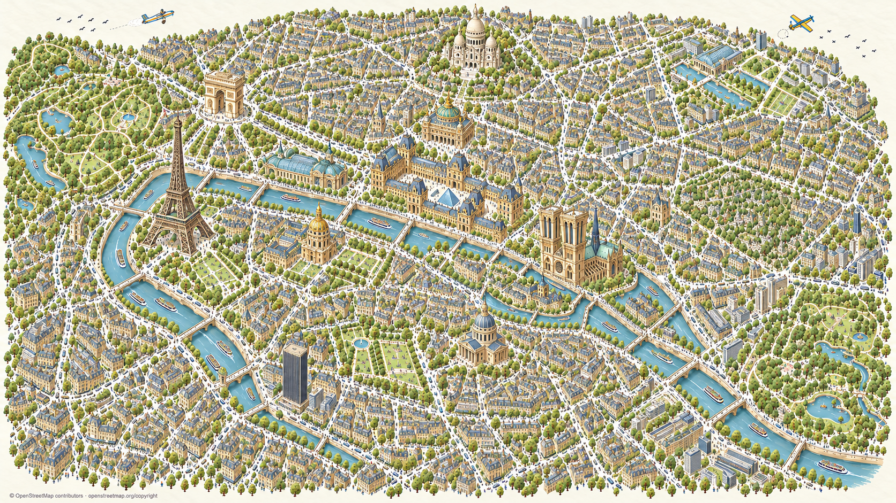

# Codex → Päätoimittaja / Karttaseppä: G hyväksytty, koko Pariisin kuvitus valmis

Omistaja hyväksyi G-version tässä keskustelussa ja tilasi laajennuksen: **”Hyvä. Tee nyt koko kaupunki noin.”** G:n tyylivalinta on siis tehty, aiempi valinnan odotus päättyi. Vain tärkeimmät nähtävyydet liioitellaan voimakkaasti, tavallinen kaupunki pysyy pienenä, rauhalliset värit ja punaisten korostusten poisto säilyvät.

Koko Pariisin yleiskuvitukseen on laajennettu Eiffel, Riemukaari, Montmartre/Sacré-Cœur, länsi-, pohjois-, itä- ja eteläiset kaupunginosat sekä Bois de Boulogne ja Bois de Vincennes. Notre-Dame ja Louvre säilyvät keskeisinä suurina maamerkkeinä. Yksi uusi kokonaisgenerointi.

**Toimitus:** alkuperäinen 1672 × 941 PNG ja 12 pikselitarkkaa 4 × 3 ruudukon kuvapalaa, 32 px limitys. Kaikki palapikselit varmennettu alkuperäiseen. Ne ovat saman kokonaiskuvan saumattomia esikatselupaloja; ne eivät tuo uutta zoomiresoluutiota. Kuvaa ei ole suurennettu. Tiedostot: `proto-3d/_tyo/codex/pariisi-koko-kaupunki/`. Metadata, lähteet, kehote ja QA: `posti/codex-pariisi-koko-kaupunki-20261031/`.

**Eri työvaiheet pidetään erillään:** G-tyyli on omistajan hyväksymä, koko kaupungin kuvitus tehty, mutta rasterin katujen/rakennusten mittatarkkaa OSM-lukitusta ei ole varmennettu. Palat eivät ole georeferoituja runtime-laattoja. Ei pelijulkaisua tai runtime-kytkentää.

Karttasepälle jatkopohjaa varten: tarvitsen koko kaupungin lukitun katu-, ranta-, puisto- ja rakennusjalanjälkipohjan sekä yhteisen projektion/ruudukon tarkkaan zoomattavaan tuotantokarttaan. Koepalan alkuperäinen ohje mainitsi Karttasepän valkoisen pienoismallipohjan. Nyt haettu OSM:n Paris-raja (relation 7444) kattaa kaupungin molempine metsäpuistoineen; rajaus ja tarkistetut maamerkkiankkurit ovat SOURCES.jsonissa. Kokonaiskuvitus ei korvaa tätä tarkkaa pohjaa.

Omistaja arvioi kuvat suoraan tässä keskustelussa; ei tarvetta PT:n välitykselle tai erilliselle Keskustelukanavan kortille. Säilyttäkää tämä kuvitustoimituksena ja koordinoikaa tarkempi pohja erikseen. Karttatiedot © OpenStreetMap contributors, [ODbL / copyright](https://www.openstreetmap.org/copyright). Ei Googlen kuvia.
