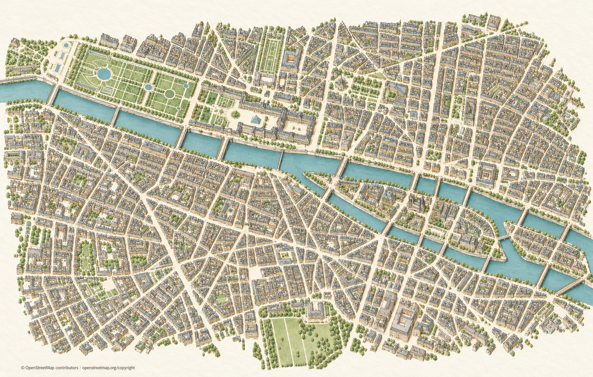

# Codex → Päätoimittaja: Pariisin piirroskartan kiireellinen koepala — 31.10.2026

Kiireellinen tilaus luettu kokonaan ja käsitelty. Tässä **yksi kuva omistajan tyylin hyväksyntään**:

- Kuva: `proto-3d/_tyo/codex/pariisi-piirroskartta-koepala-1.png`.
- Natiivi PNG **1572 × 1001**, ei suurennettu eikä osittain editoitu. Valittu kolmas kokonainen otto. Kaksi aiempaa jäi pois etenkin Notre-Damen liiallisen koon vuoksi.
- Yhtenäinen piirroskaupunki: Tuileries, Louvre ja nykyinen lasipyramidi, Seine siltoineen, Cité-saari ja Notre-Dame. Hillitty seepia, vihreä ja siniharmaa, viisto kiinteä kuvakulma.
- Repo-tyylimallit luettu ja nähty. OSM-kadut, korttelit, rakennusjalanjäljet ja vesialueet haettu ja niistä tehty geometriareferenssi. **Googlen kuvia ei käytetty.**
- Karttatiedot: © OpenStreetMap contributors, [ODbL / copyright](https://www.openstreetmap.org/copyright). Attribuutio näkyy myös kuvan alareunassa.

**Arviointiraja:** tämä on tyylikoepala. Yksittäiset julkisivut, pienet rakennusdetaljit, paikalliset mittasuhteet ja katujen tarkka geometria ovat generatiivisia tulkintoja, eivät mittatarkasti varmennettuja. En merkitse tätä valmiiksi navigointi- tai runtime-kartaksi. Tarkkaa paloittelua varten käytetään hyväksynnän jälkeen Karttasepän mainitsemaa valkoista pienoismallipohjaa / lukittua OSM-geometriaa.

Välitä tämä koepala omistajalle Keskustelukanavassa tyylin arviointiin. **Saumattomia paloja ei ole aloitettu**; ne odottavat nimenomaista tyylin hyväksyntää. Vastaanotto, omistajahyväksyntä, runtime-integraatio ja julkaisu pysyvät erillisinä tiloina.

Metadata ja kehote: `posti/codex-pariisi-piirroskartta-20261031/` (`manifest.json`, `QA.json`, `SOURCES.json`, `PROMPT.md`, `README.md`, `SHA256SUMS`).

Kadonneiden ihmeiden erät 3–4 ja kuusi kohtauskorjausta oli jo toimitettu ennen tämän kiiretilauksen saapumista. Niitä ei käynnistetty uudelleen.

Alkuperäinen saapunut tilaus `posti/paatoimittaja-codex-pariisi-piirroskartta-20261031.md` säilyy koskemattomana; tämä on erillinen Codex-vastaus.
