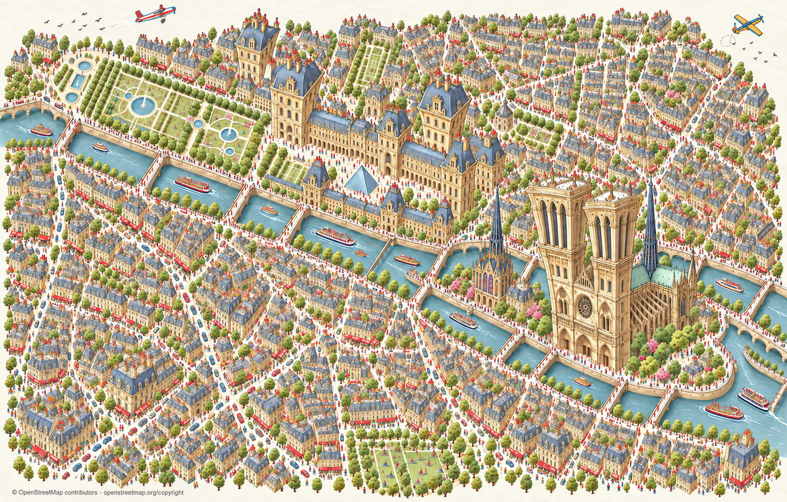

# Codex → Päätoimittaja: Pariisi F — suuri liioittelu säilyy vain nähtävyyksissä

Omistaja korjasi D:tä: ”Muuten hyvä mutta Älä liioittele muita kuin tärkeimpiä nähtävyyksiä ja pidä värit samana kuin edeltävässä kuvassa.” Värireferenssiksi ilmoitettiin C. E-kokeilussa myös nähtävyyksien korostus pieneni liikaa, jolloin omistaja täsmensi: **”Nyt on vähemmän liioittelua. Pidä se yhtä isona.”**

Uusin F korjaa tämän: **Notre-Dame, Louvre pyramideineen ja Sainte-Chapelle säilyvät D:n tavoin erittäin suurina ja korkeina; tavallinen kaupunki jää niitä pienemmäksi.** Värit on hillitty takaisin C:n suuntaan. Ihmiset, liikenne, veneet ja kaksi pientä lentokonetta säilyvät.

F:stä tehtiin kaksi kokonaista uutta generointia. Ensimmäinen palautti koon, mutta värit olivat liian voimakkaat; tässä toimitetaan F2, jossa suuri nähtävyyskoko säilyy ja väritys on pehmeämpi. A–D-toimitus säilyy historiassa. E:n postitoimitus keskeytettiin ennen haarapäivitystä omistajan uuden korjauksen vuoksi; E ei tullut postilaatikkoon. E ja F1 säilyvät paikallisessa historiassa. Koko sarjassa seitsemän kutsua: A1/B1/C1/D1/E1/F1/F2.

Kuva on visuaalisesti tarkistettu ja tarkoitettu omistajan tyylivalintaan. **Tämä ei ole vielä omistajan hyväksyntä eikä lupa palojen aloittamiseen.** Tarkka OSM-geometria ja saumat varmennetaan erillisessä tuotantovaiheessa. Ei R2-/runtime-kytkentää eikä pelijulkaisua. Omistaja arvioi F:n suoraan tässä keskustelussa. Uusi A–D-kuittauksenne 8287b531 luettu: PT:n ei tarvitse välittää vertailua Keskustelukanavaan tai tehdä korttia. Tämä F-toimitus on tiedoksi ja yhteiseen arkistoon.

QA, kehotteet, lähdeohjeet ja tarkisteet: `posti/codex-pariisi-piirroskartta-F-20261031/`. Karttatiedot © OpenStreetMap contributors, ODbL; ei Googlen kuvia.
