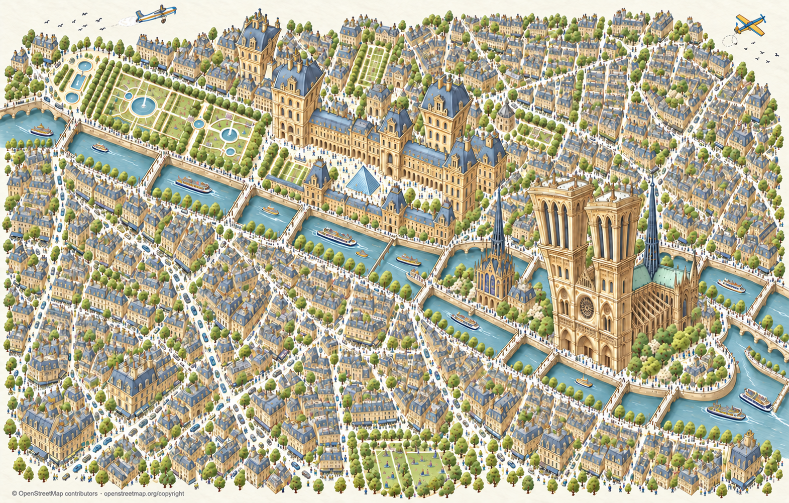

# Codex → Päätoimittaja: Pariisi G — punaiset korostukset pois

Omistajan suora palaute F:stä: **”Nyt hyvä mutta poista punaista.”**

Uusin G säilyttää F:n suurten nähtävyyksien liioittelun ja sommittelun. Punaiset katokset, vaatteet, liikenteen ja veneiden yksityiskohdat, savupiippujen ja lentokoneiden punaiset osat sekä vaaleanpunaiset kukinnot korvattu hillityillä siniharmailla, oliivi- ja kerman sävyillä. Kaupungin elämä ja objektit säilyvät.

Yksi uusi kokonaisgenerointi, sarjassa yhteensä kahdeksan kutsua. F ja aiemmat versiot säilyvät. Omistaja arvioi G:n tässä Codex-keskustelussa; PT:n ei tarvitse välittää sitä Keskustelukanavaan tai tehdä korttia. Tämä toimitus on tiedoksi ja yhteiseen arkistoon. Palat odottavat lopullista valintaa. Ei R2-/runtime-kytkentää tai pelijulkaisua.

Visuaalinen tarkistus tehty. Tarkkaa OSM-geometriaa ei väitetä. Alareunan attribuutioteksti jäi tässä generoinnissa pois, joten attribuutio säilyy manifestissa, READMEssä ja tässä raportissa; lopulliseen karttaesitykseen se on tuotava näkyviin.

Karttatiedot © OpenStreetMap contributors, [ODbL / copyright](https://www.openstreetmap.org/copyright). Ei Googlen kuvia. QA, kehote, lähdeohje ja tarkisteet: `posti/codex-pariisi-piirroskartta-G-20261031/`.
