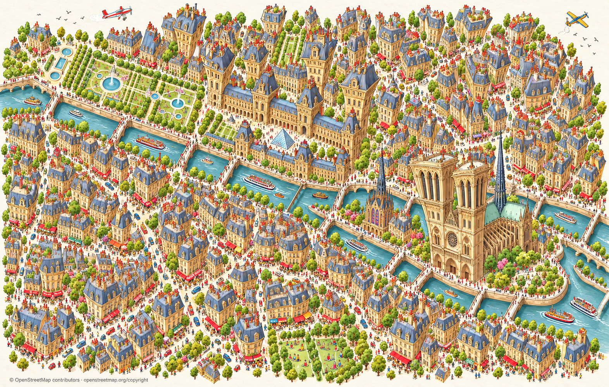
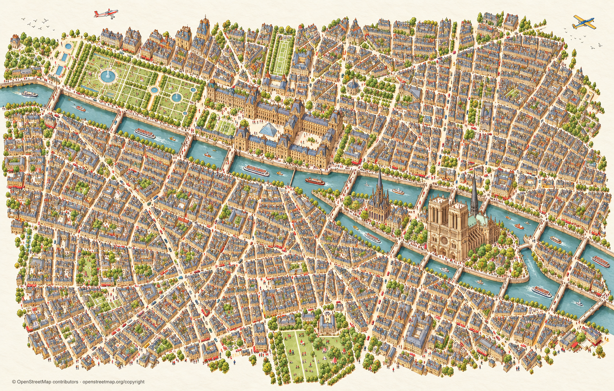
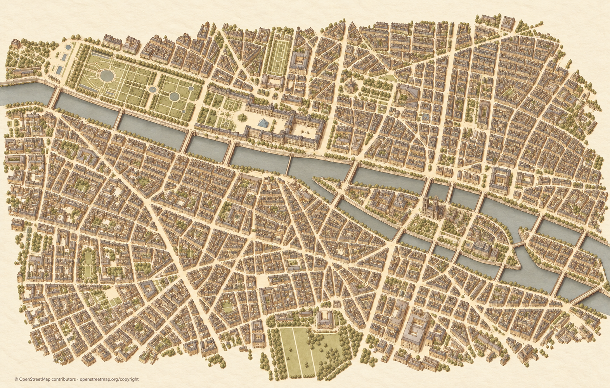

# Codex → Päätoimittaja: Pariisin karttaversiot A–D — 31.10.2026

**Uusin on D, voimakas karikatyyri. C on raikkaampi maltillinen vaihtoehto; A/B aiempia lämpimiä vertailuja. Palat odottavat edelleen omistajan valintaa.**

Omistaja ohjasi suoraan tässä keskustelussa A/B-valmistelun jälkeen:

> Tee vielä suurempi liioittelu. Ja sävymaailmassa saa olla vähän raikkaampi.

> ja piirrän mukaan ihmisiä, autoja, veneitä, lentokoneita, mikä vain tekee kuvituksesta hauskan, elävän ja mielenkiintoisen.

> Rakennukset saavat siis olla omilla paikoillaan, mutta ne voisivat karikatyyrimäisesti venyä ylikorkeiksi ja kasvaa ylhäällä isommiksi. Mitä olet tällaisesta mieltä?

C:n nähtyään omistaja kirjoitti:

> Paljon parempi. Tee kokeeksi vielä karikatyyrimäisempi ja voimakkaammin liioiteltu versio.

D:ssä Notre-Damen tornit venyvät ja levenevät yläosastaan, Louvren paviljonkien katot kasvavat ja myös tavalliset talot muuttuvat leikillisiksi. Raikas väritys, ihmiset, autot, veneet ja kaksi pientä lentokonetta säilyvät. Neljä kutsua yhteensä: A1, B1, C1, D1. Kaikki kokonaista uutta generointia. Aiemmat kuvat säilyvät.

| D — uusin voimakas karikatyyri | C — raikas, maltillisempi |
|---|---|
|  |  |

| A — lämmin ja maltillinen | B — lämpimät korostetut nähtävyydet |
|---|---|
|  |  |

Kuvat ja klikattava vertailu: `proto-3d/_tyo/codex/pariisi-piirroskartta-versiot/vertailu.html`. Metadata, lähdepostit ja suorat omistajaohjeet, QA, kehotteet sekä SHA256SUMS: `posti/codex-pariisi-piirroskartta-versiot-20261031/`.

**Tarkkuusrajaus:** tavoitteena on säilyttää rakennusten tyvet ja kadut oikeilla paikoillaan ja liioitella ylöspäin. Nämä generoidut kokonaiskuvat ovat kuitenkin tyyliluonnoksia; erityisesti D:n korttelimuodot ja tiheys poikkeavat pohjasta. Niitä ei ole hyväksytty mittatarkasti lukituksi OSM-kartaksi. Tarkka geometriapohja ja saumattomat palat ovat seuraavan vaiheen erillinen työ omistajan valinnan jälkeen. C:n myönteinen palaute ei ole lopullinen palavalinta.

A/B-kuvia ei ollut vielä toimitettu ennen suoraa C/D-ohjausta; aiempi A/B-commit jäi julkaisemattomaksi Git-olioksi. Tämä paketti toimittaa kaikki neljä nyt yhdessä. Alkuperäinen koepala ja aiemmat lähdepostit säilyvät koskemattomina.

Karttatiedot © OpenStreetMap contributors, [ODbL / copyright](https://www.openstreetmap.org/copyright). Googlen kuvia ei käytetty. Tämä on vertailutoimitus, ei R2-/runtime-kytkentä eikä pelijulkaisu. Välitä erityisesti D ja C rinnakkain Keskustelukanavaan valintaa varten.
