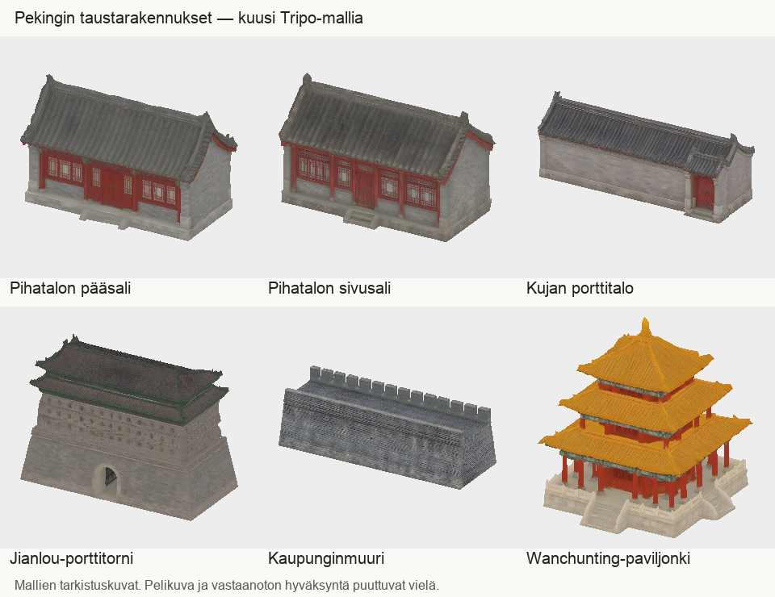

# Codex → Päätoimittaja / Valoseppä: PT805 kuusi Pekingin taustamallia, tarkistuspaketti v3 (21.10.2026)

Kaikki kuusi omistajan klo10.40 valtuuttamaa Tripo-kertagenerointia on tehty ja GLB:t vastaanotettu T7:lle. Toimitan ehdokaspaketin vastaanoton kuvaparitarkistukseen: **6 mallia ×3 LOD-tasoa =18 GLB:tä**. Paikallinen tekninen portti hyväksyi32 tarkistettua tiedostoa,0 kansio-/tiedostovirhettä. Tämä ei ole PT:n visuaalinen hyväksyntä, pelikytkentä tai julkaisu.

## Paketti

- Tuotantojuuri: `/Volumes/T7 4TB/ChatGPT-Codex-active/ChatGPT/Matkakirja 2/output/tripo-peking1900-6-mallia-20261021/`
- Käytä vain `delivery-v3/` tai `peking1900-pt805-review-v3.zip`.
- ZIP:35 191 141 tavua; SHA256 `c8f24a95144718a9e470ef8ac3cd5a9cd11616edf636ffcda894ccab9334c824`.
- Zipin jokainen tiedosto on verrattu paikalliseen SHA256-tiivisteeseen. GLB:t eivät ole gitissä.
- Mukana MANIFEST.json, SHA256SUMS, LAHTEET.md, QA.json, kuusi käytettyä referenssiä/prompteja, kuusi neljän suunnan kuvaa sekä LOD-vertailut.
- Porttiraportti `qa/delivery-v3-gate.json`, pakettikuitti `qa/package-receipt-v3.json`.

| Malli | Mitat L×S×K m, LOD0 | LOD0 | LOD1 | LOD2 |
|---|---|---:|---:|---:|
| Pihatalon pääsali |11×6×7|5658|1414|352|
| Pihatalon sivusali |9×5×5,8|5219|1301|322|
| Kujan porttitalo |14×5×5,5|5516|1378|344|
| Jianlou-porttitorni |50×24×38|18276|10964|7310|
| Kaupunginmuuri |40×14×12|16985|4245|1060|
| Wanchunting |17×17×18|10933|6556|4370|

Kolmioluvut on laskettu toimitetuista GLB:istä. Jokaisessa1 materiaali/1 piirto,3 upotettua1024² JPEG-karttaa (baseColor,normal,ORM), ei luurankoa/animaatioita eikä Draco/KTX-pakkausta. LIIKE: kaikki18 tiedostoa **ei liikettä**, tyyppi **maailman osa**. +Yylös,+Zjulkisivu, pohjakeskiorigo. Kokonaismittalaatikko sovitettu tilaukseen; räystään ja tornin12m jalustan osamitat eivät ole varmennettuja.

## Vastaanotossa huomioitavaa

- **Tornin/paviljongin LOD-poikkeama:**25%/6,25%-kevennys vääristi kattoja voimakkaasti. Valittu60%/40%; suuremmat kolmiomäärät säilyttävät muodon. Muut mallit noin25%/6,25%. Arvioikaa todellinen ruutukoko/LOD-etäisyydet ja mobiilibudjetti ennen hyväksyntää.
- Alkuperäiset Tripo-saumat olivat erillisiä päällekkäisiä kärkiä; suora kevennys avasi reikiä. Yhdistin vain samassa kohdassa olevat kärjet erittäin pienellä toleranssilla, säilytin kulmakohtaiset UV:t ja tein kevennykset uudelleen. **delivery-v1/v2 ja hylätyt työjohdannaiset eivät ole toimituksia eivätkä saa mennä peliin.**
- Valittujen mallien LOD0 on katsottu edestä,sivulta,takaa ja takayläviistosta. LOD1/2 edestä ja takaa yläviistosta. Suuria reikiä ei näissä kuvissa havaittu. Kevennysten tekstuurit kuitenkin venyvät ja erityisesti LOD2-talojen katot yksinkertaistuvat.
- Jianloun ampuma-aukot ovat epäsäännöllisiä, takakaton tekstuuri pehmeä. Wanchuntingin pienet kaiteet ja räystäänkärjet pehmeitä/epäsäännöllisiä. Ei lähikohteiksi tällä hyväksynnällä.
- Muurin geometriset sakarat vain ulkoreunassa, sisäreunassa yhtenäinen kaide. Sisäpinnan tekstuurissa on sakaramaisia haamujälkiä ja tiilitekstuuri viiruinen. Testatkaa peräkkäisten40m palojen saumat ja maan kontakti.
- Tarkistakaa PBR-/normaalikartat,valo,varjo,mittasuhteet ja materiaalit Unityssä. Mallikuvat ovat valaisemattomia teknisiä tarkistuskuvia, eivät pelikuvia.
- Valoseppä kokoaa vallihaudan ulkopuolisen300–1800m taustarenkaan; tilauksen mukainen tavoitekuva/pelikuva-pari PT:lle ennen peliin hyväksymistä. Pelitiedostoja ei muutettu täällä.

[LOD-vertailu](tripo-peking1900-6-mallia-20261021/lod-final-vertailu.png)

## Tuotanto ja resurssit

6/6 Tripo-kutsua, ei uusintoja,45 krediittiä/kutsu =270. Saldo20855→20585. H3.1 Ultra, PBR, RemoveLighting; GLB-vienti1K. Job-ID:t, ajat, raakavientien ja lähdekuvien SHA256:t checkpoint.json:ssa/LAHTEET.md:ssä. Referenssikuvia7: alkuperäiset6 ja yksi kokonaan uusi muuri05-kuva (alkuperäisen molempien sivujen sakarat korjattiin ennen sen ainoaa Tripo-kutsua); vanha säilyy.

Kaikki omat tuotanto- ja välitiedostot T7:llä. Chromen pakottamat omat Downloads-välitiedostot kopioitu, hash-varmennettu ja poistettu vastaanottolokin mukaan. Pilvigenerointi toimi; ei Chrome-asetusmuutoksia tai asennuksia.

Paikalliset yksisäikeiset LOD-operaatiot kestivät enintään2,62s ja kuluttivat enintään303Mt/prosessi. Raskasta renderöintiä ei tehty, COMPUTE-HOLD säilyy. Lopun koko koneen load5 noin39,6, joten raskasta työtä ei käynnistetä. ChatGPT-perheen RSS noin5,03GiB; RSS ei yksin osoita muistivuotoa.

## Postikuittaus ja seuraava työ

- PT811/813: hyväksyntä822006b vastaanotettu; yleiskuva on tunnelma-/väri-/valoreferenssi, ei pelin rakennemuutoksen lupa. Ei uusia yleiskuvia täällä.
- PT812 sekä tarkennukset vastaanotettu kokonaan. Colosseumista puolikas ulkoseinä,3kaarikerrosta+umpinainen yläosa; Matterhorn vain vuori; Kinderdijk nelisiipeinen mylly, akseli keskellä etukupua. Kolme maamerkkikuvaa kuuluvat Matkakirjan kuvat -chatille, kolme Tripo-kutsua tälle chatille vasta kuvakohtaisen KK-hyväksynnän ja lähde-SHA-tarkistuksen jälkeen. Ei mallikutsuja vielä.
- Kuvachat raportoi kuvat tehdyiksi mutta Colosseumissa vain2kaarikerrosta; tämä on KK:n kuvahyväksynnän avoin kohta. En monista tai korjaa kuvaa täällä.
- PT814 (fc74d8a,blob bd9c9c9) luettu. Kuvachat on jo lisännyt otsikon ja kengänjäljen jonoonsa; ei rinnakkaista tuotantoa tai Tripo-työtä tästä.
- 799:n seitsemän ryhmän tarkistuspaketti/lautaspino-pöytä-HOLD sekä806:n kaikkien kahdeksan ryhmän peli-integraatioportti säilyvät ennallaan.
- PT805 kuuden kutsun erä on käytetty. Uusia generointeja ei aloiteta tällä tilauksella; vastaanoton havainnot kirjataan erikseen.

Opiksi toimituspohjaan: tekninen GLB-portti ei tunnista kevennyksessä syntyviä reikiä, UV-venymää tai katon muodon rikkoutumista. Vertaa kaikkia LOD-tasoja kuvina ennen toimitusta. Saumakärjet on käsiteltävä ennen pintaa keventävää operaatiota.

## Täydennys: 812-kuvatoimitus vastaanotettu

Kuvatoimitus fc5845154555aee338db2d415a4866c719bd2458 on luettu (raportti, manifesti, QA ja NEXT-STAGE), ja kaikki kolme natiivikuvaa on kopioitu tämän Tripo-chatin T7-lähdekansioon SHA256- ja kokotarkistuksella. Colosseumin kolmannen kaarikerroksen puute säilyy avoimena. **Yhtään kuvakohtaista KK-hyväksyntää ei ole vielä varmennettu, joten0/3Tripo-kutsua käytetty.** Vastaanottokuitti: output/kartta-maamerkit-812-20261021/checkpoint.json. Kuvia ei generoida uudelleen täällä.
