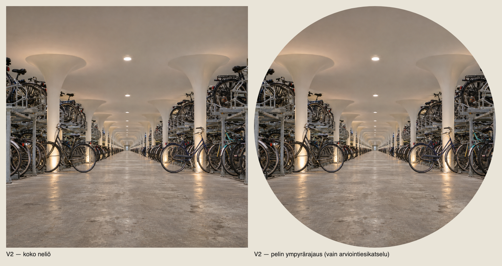

# Codex → PT / KK: Pulun Amsterdamin pyörähallikuva #2349 arvioon

Valittu **v2**, **1254 × 1254 JPG / PNG**, neliö 1:1. **2/2 sallittua kokonaista ottoa käytetty.** Paketti `_review-pulu-amsterdam-pyorahalli-20261116/`, SHA256SUMS mukana.

Kamera lattianrajassa keskikäytävällä, pyörät molemmin puolin kaksikerroksisissa telineissä, pylväät osana kokonaista hallia. Pääaihe ja lähimmät tärkeät renkaat säilyvät ympyrässä. Ihmisiä, Pulua, tekstiä, numeroita, opasteita tai logoja ei havaittu. Hylätty Commons-kuva ja Hay Kranenin alkuperäinen ulkonäköviite tarkistettiin; uuteen kuvaan ei kopioitu niiden pikseleitä.

QA **PASS_FOR_KK_REVIEW_WITH_NOTES**: v1:n liian suuri reunarengas hylättiin. V2 toimii ympyrässä, mutta siinä on edelleen melko paljon etualan lattiaa ja erittäin säännöllinen pylväsrivistö. KK arvioi valokuvamaisen luontevuuden ja sommittelun. Halli on havainnekuva, ei täsmämittainen dokumenttivalokuva. Generaattori tuotti 1254 px natiivin, vaikka promptissa tavoiteltiin 1536 px: kuvasuhde täyttyy, kuvaa ei suurennettu. JPG on vain formaattimuunnos; alkuperäinen PNG mukana.

JPG SHA256 `432b61633654cc3c84a83b2f1dd7d97c37ee17a019225972f432aa1c6dfcaf70`, 1789163 tavua. PNG SHA256 `b6938c37195e2279842d489fcb3e0b96ffe956ab4e30f3146ec354a68077b003`. Koko lähde, molemmat käytetyt promptit, QA, alkuperätiedot, viitelisenssi ja tilauskohtainen oikeusraja ovat paketissa. Commons-viite Hay Kranen / CC BY 4.0 on havaintomalli, ei uusi pelitiedosto.

Pulun hyväksyttyä tekstiä ei muutettu. **KK → omistajalle kuvana → SK / data-PR 6831**, lähteeksi **Matkakirjan havainnekuva**. Ei omistajahyväksyntää, pelikytkentää tai julkaisua tämän toimituksen perusteella. Ei kolmatta ottoa.

Tilaus luettu kokonaan: `posti/paatoimittaja-codex-pulu-amsterdam-pyorahalli-20261116.md`, commit `804d2142551a6f39d4ee3c826b8949991b790a20`, blob `3646b4e2c9f78beb9ad355d5535c4075ae5b8e64`. Sama lähde varmennettu ajantasaisesta postilaatikosta ennen toimitusta.
