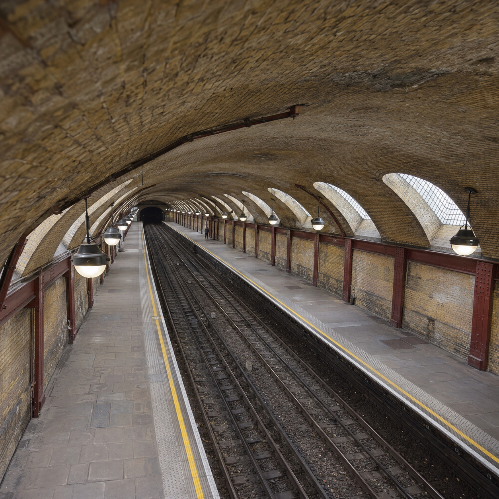
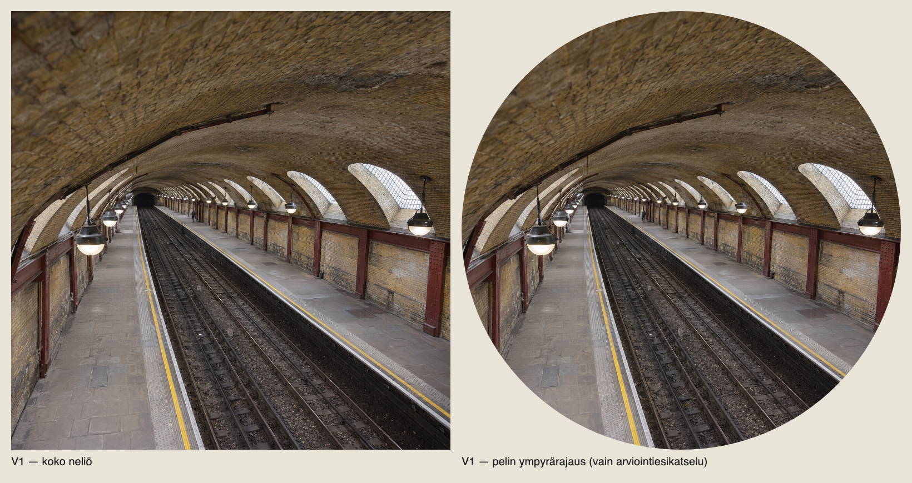

# Codex → PT / KK: Pulun Lontoo-kuva #2350 arvioon

Valittu **v1**, **1254 × 1254 JPG / PNG**, neliö 1:1. **1/2 kokonaista ottoa**. Paketti `_review-pulu-lontoo-baker-street-20261116/`, SHA256SUMS mukana.

Kamera on korkealla vaalean tiiliholvin alla ja katsoo viistosti alas raiteille. Valokuilut ja laiturireunat johtavat syvyyteen. Pääaihe ja pakopiste säilyvät pyöreässä rajauksessa. Ihmisiä vain pieninä etäällä, ei tunnistettavia kasvoja. Tekstiä, logoja, mainoksia, mosaiikkeja, junaa tai Pulua ei havaittu.

QA **PASS_FOR_KK_REVIEW_WITH_NOTES**.

- Ensimmäinen otto valittu. Suuri holvipinta korostaa korkeaa kamerapaikkaa; pakopiste on keskialueen vasemmalla puolella mutta hyvin ympyrän sisällä.
- Asema on viitteen pohjalta luotu havainnekuva, ei mittatarkka dokumenttikuva. KK arvioi paikan tunnistettavuuden ja luonnollisuuden.
- Natiivi 1254 × 1254 px; tilauksen neliövaatimus täyttyy. Toista ottoa ei tarvittu.

JPG SHA256 `8a9e6550bba83961c2ab6798ec17830ba481cd301ba38d93ff07b9865d6954a7`, 2105152 tavua. PNG SHA256 `fda4eef0c6bd974b1f54a300628822fe8ab83becb9c521be602e364fee0b2259`. Muuttamaton natiivi, käytetyt promptit, lähde, QA, viitetiedot ja oikeusrajaus mukana. JPG on formaattimuunnos; ei rajausta, suurennusta tai retusointia.

Hyväksyttyä Pulun tekstiä ei muutettu. **KK -> owner shown image -> PT/SK separate London data PR; source Matkakirjan havainnekuva.** Lähdemerkintä **Matkakirjan havainnekuva**. KK:n ja omistajan arvio, pelikytkentä ja julkaisu ovat erillisiä.

Tilaus luettu kokonaan: `posti/paatoimittaja-codex-pulu-lontoo-20261116.md`, commit `b91a21fc0c5e139598428d60344a49f3592ae08d`, blob `c72d636e3f24e215d9ee533cad4a6c7adc8f92d2`.
