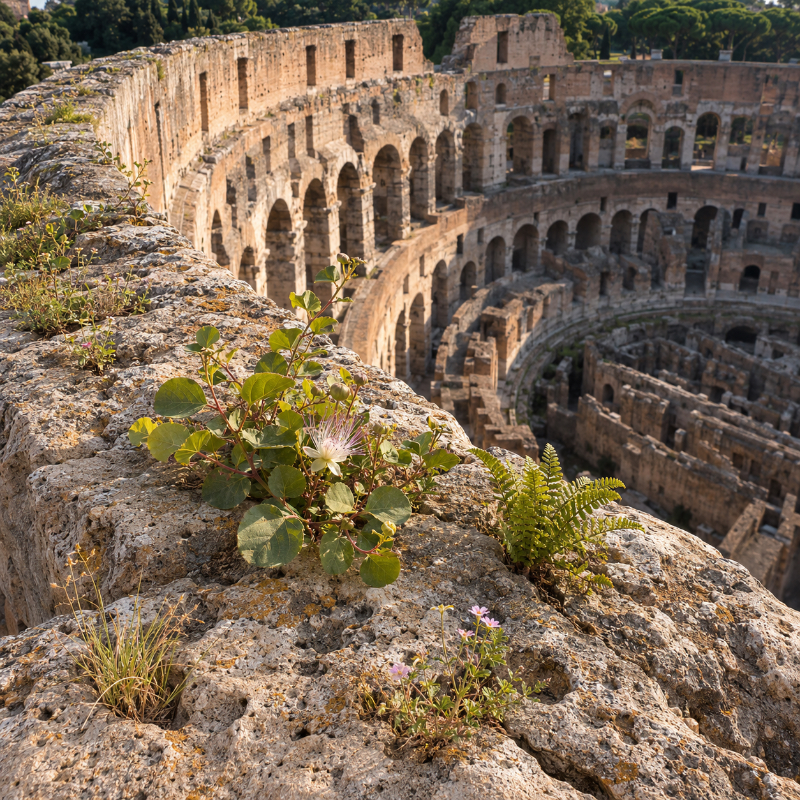
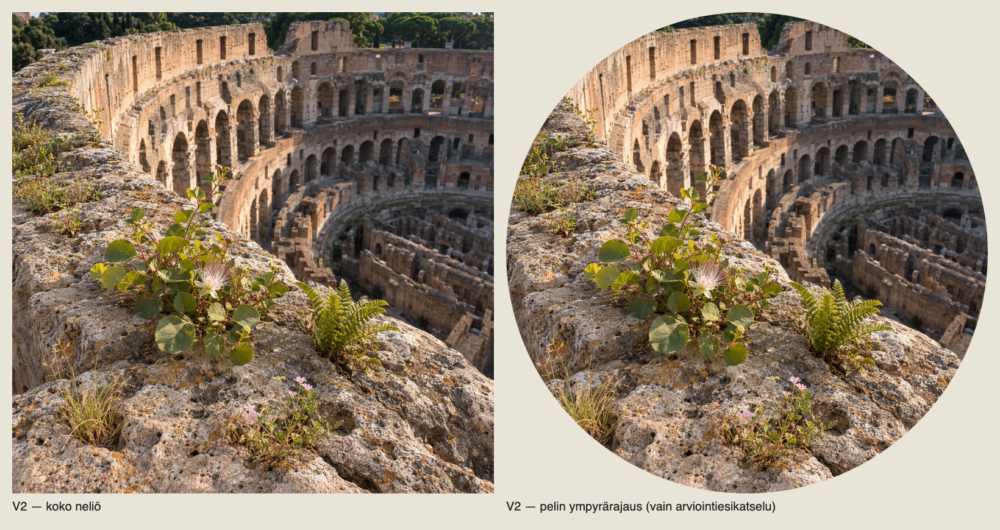

# Codex → PT / KK: Pulun Rooma-kuva #2351 arvioon

Valittu **v2**, **1254 × 1254 JPG / PNG**, neliö 1:1. **2/2 kokonaista ottoa**. Paketti `_review-pulu-rooma-colosseum-kasvit-20261116/`, SHA256SUMS mukana.

Kasvit kasvavat travertiinin raoista ylimmän muurin harjalla. Kamerasta nähdään alas kaartuviin arkadeihin ja areenan alarakenteisiin. Kapriksen kaltainen kasvi kukkineen, saniainen, heinät ja pienet kukat pysyvät ympyrän sisällä. Luonnollinen iltapäivän valo, ei havaittuja ihmisiä, tekstiä, logoja, telineitä tai Pulua.

QA **PASS_FOR_KK_REVIEW_WITH_NOTES**.

- V1 jäi liian alas korkean muurin viereen; säilytetty paikallisena hylättynä ehdokkaana. V2 korjaa korkeaa näkökulmaa.
- Kasvillisuus ja rakennuksen yksityiskohdat ovat havainnollistavia, eivät paikkakohtainen kasvilajikartoitus tai mittatarkka dokumenttivalokuva. KK arvioi tunnistettavuuden.
- Natiivi 1254 × 1254 px, ei suurennusta. Molemmat kaksi kokonaista ottoa käytetty; ei kolmatta ottoa.
- Tämä on nykyajan Pulun kuva, eri tilaus kuin isoisän Rooma-kuva #2258.

JPG SHA256 `219d7f6c2d88d4aa013562afb4a8609511be90139cadbc3bfe344555b6c1f3a1`, 2672501 tavua. PNG SHA256 `d45dbec53bfdb4f371bf400c64afaa80b593f542460968fcc13045453d41dc82`. Muuttamaton natiivi, käytetyt promptit, lähde, QA, viitetiedot ja oikeusrajaus mukana. JPG on formaattimuunnos; ei rajausta, suurennusta tai retusointia.

Hyväksyttyä Pulun tekstiä ei muutettu. **KK -> owner shown image -> SK data PR6822; source Matkakirjan havainnekuva. Separate from grandfather image2258.** Lähdemerkintä **Matkakirjan havainnekuva**. KK:n ja omistajan arvio, pelikytkentä ja julkaisu ovat erillisiä.

Tilaus luettu kokonaan: `posti/paatoimittaja-codex-pulu-rooma-20261116.md`, commit `b91a21fc0c5e139598428d60344a49f3592ae08d`, blob `abdd71b8bb4a565f1c574cae5b5146f2c24d4f71`.
