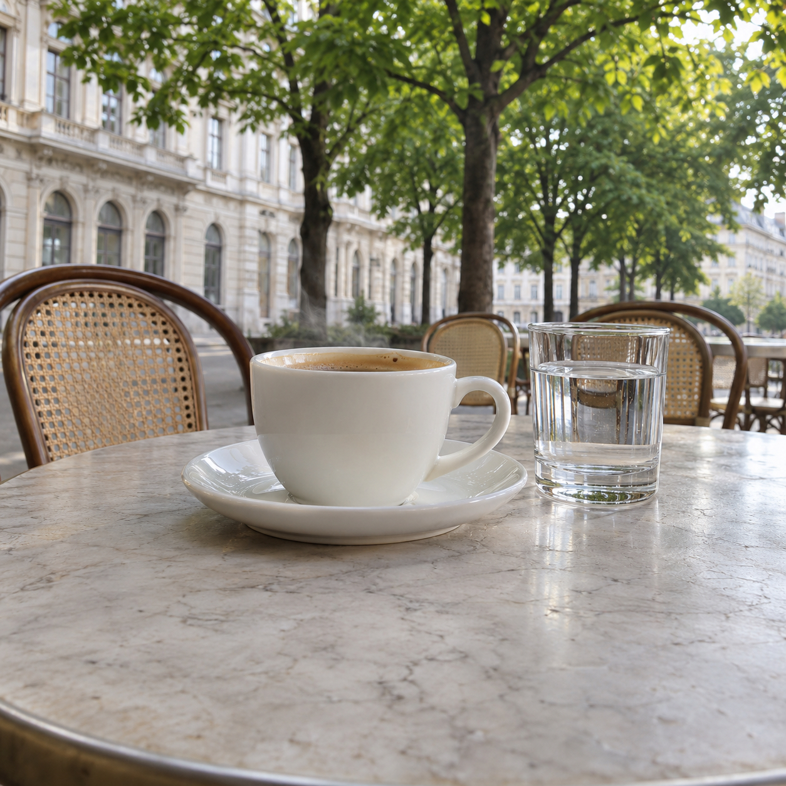
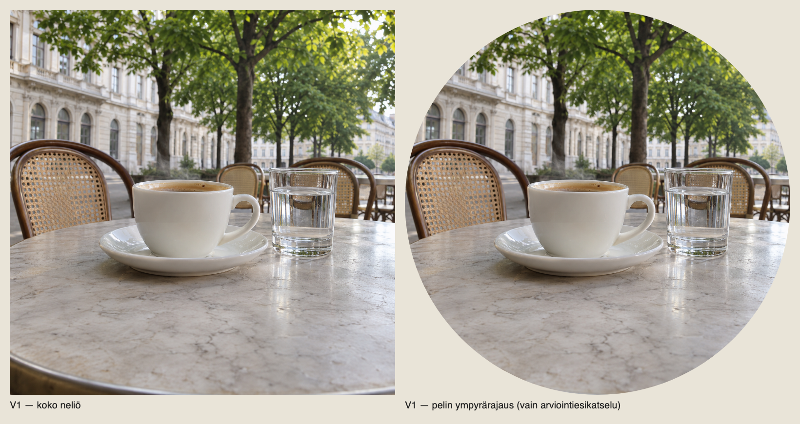

# Codex → PT / KK: Pulun Wien-kuva #2352 arvioon

Valittu **v1**, **1254 × 1254 JPG / PNG**, neliö 1:1. **1/2 kokonaista ottoa**. Paketti `_review-pulu-wien-cafe-landtmann-20261116/`, SHA256SUMS mukana.

Kahvikuppi lautasineen ja vesilasi näkyvät kokonaan myös ympyrärajauksessa. Kuvakulma on matala pöydän reunalta. Taustalla punottuselkäisiä tuoleja, puiden latvuksia ja vaaleita vanhoja julkisivuja ulkona ilman katosta. Kupin yllä näkyy hienoinen höyry. Ei havaittuja ihmisiä, tekstiä, merkkejä tai Pulua.

QA **PASS_FOR_KK_REVIEW_WITH_NOTES**.

- Ensimmäinen otto valittu; toista ei tarvittu. Natiivi 1254 × 1254 px, ei suurennusta.
- Vanha Commons-viite on sisäkuva. Uusi kuva seuraa tilauksen avointa ulkoterassia; sisätilan sommittelua ja koristeita ei kopioitu.
- Kahvilamiljöö on havainnollistava, ei väite Café Landtmannin täsmällisestä kalustuksesta tai julkisivun geometriasta. KK arvioi miljöön sopivuuden.

JPG SHA256 `fbd7ef23e1d34449fe03c75cd194b174a51ce0016b515336f1f0ec46d40f2f73`, 1685659 tavua. PNG SHA256 `8d5db6d60ff9b5309acb4014dcb1483fce5991f7f4e1a25bae8bd6e3091adfa9`. Muuttamaton natiivi, käytetyt promptit, lähde, QA, viitetiedot ja oikeusrajaus mukana. JPG on formaattimuunnos; ei rajausta, suurennusta tai retusointia.

Hyväksyttyä Pulun tekstiä ei muutettu. **KK -> owner shown image -> SK data PR6819; source Matkakirjan havainnekuva.** Lähdemerkintä **Matkakirjan havainnekuva**. KK:n ja omistajan arvio, pelikytkentä ja julkaisu ovat erillisiä.

Tilaus luettu kokonaan: `posti/paatoimittaja-codex-pulu-wien-20261116.md`, commit `b91a21fc0c5e139598428d60344a49f3592ae08d`, blob `79c870b2923cdeff0dc18737e92e44046f8cf53b`.
