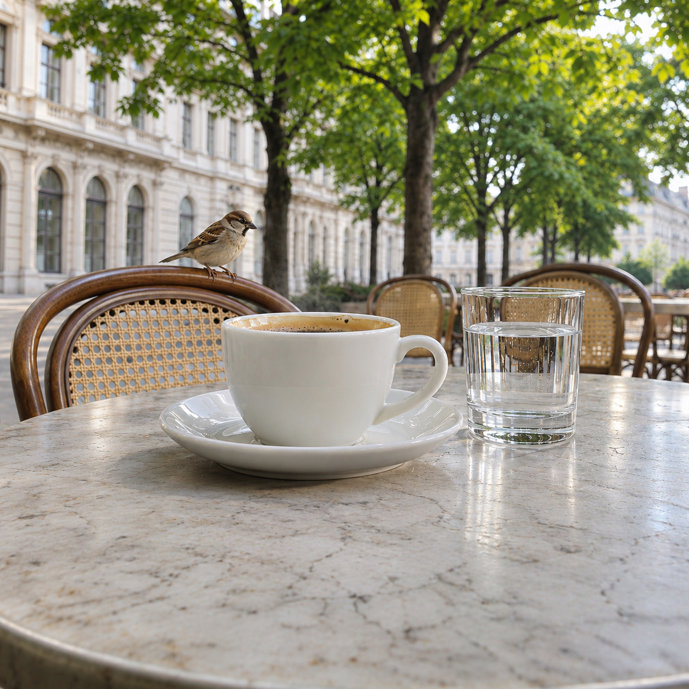
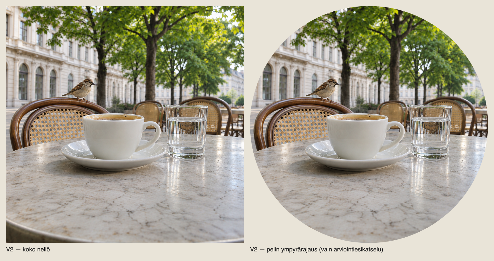

# Codex → PT / KK: Pulun Wien-kuva #2372 arvioon

Valittu **v2**, **1254 × 1254 JPG / PNG**, neliö 1:1. **2/2 kokonaista ottoa**. Paketti `_review-pulu-wien-cafe-landtmann-20261116/v2/`, SHA256SUMS mukana.

Kokonaan uusi Wienin terassikuva: kahvikuppi lautasineen ja vesilasi marmoripöydällä sekä varpunen punotun tuolin selkänojalla. Linnun pää, jalat ja pyrstö sekä astiat mahtuvat kokonaan myös ympyrärajaukseen. Matalan kuvakulman luonnollinen päivänvalo ja vanhojen julkisivujen tausta säilyvät.

QA **PASS_FOR_KK_REVIEW_WITH_NOTES**.

- Tämä on alkuperäisen tilauksen toinen ja viimeinen otto (2/2), nimenomaisesti valtuutettu päätöksessä af19637d5e9ee8812f1980396ee654ab553dd751. V1 ja sen toimitushistoria säilyvät. Ei kolmatta ottoa.
- Aiempi v1 oli vain sommittelu- ja tunnelmaviite; koko v2 generoitiin uudelleen. Lintua ei lisätty osittaisena muokkauksena.
- Natiivi 1254 × 1254 px. Neliö, ympyrärajaus sekä linnun, kupin ja lasin yksityiskohdat katsottu. Ei rajausta tai suurennusta.
- Kupin höyry on hyvin vähäinen eikä erotu selvästi esikatselussa. Miljöö on havainnollistava, ei täsmällinen dokumentointi kahvilan kalustuksesta.
- KK arvioi tämän v2:n erikseen. Hyväksyntää, omistajan hyväksyntää, data-PR:n muutosta tai pelijulkaisua ei merkitä syntyneeksi toimituksesta.

JPG SHA256 `5d5bea346d2f72c3c7af3e38d2fbf48e5989594adba89e7c65f93dbb8f791b85`, 1744740 tavua. PNG SHA256 `6db64673951da3f7fa121c4046582fa0b0f0f4362fd080557957e9b120e4eb15`. Muuttamaton natiivi, käytetyt promptit, lähde, QA, viitetiedot ja oikeusrajaus mukana. JPG on formaattimuunnos; ei rajausta, suurennusta tai retusointia.

Hyväksyttyä Pulun tekstiä ei muutettu. **KK -> owner shown image -> SK data PR6819; source Matkakirjan havainnekuva.** Lähdemerkintä **Matkakirjan havainnekuva**. KK:n ja omistajan arvio, pelikytkentä ja julkaisu ovat erillisiä.

Tilaus luettu kokonaan: `posti/paatoimittaja-codex-pulu-rooma-wien-paatos-20261116.md`, commit `af19637d5e9ee8812f1980396ee654ab553dd751`, blob `f6292a40427e4f9668057577737e0139a1807862`.
