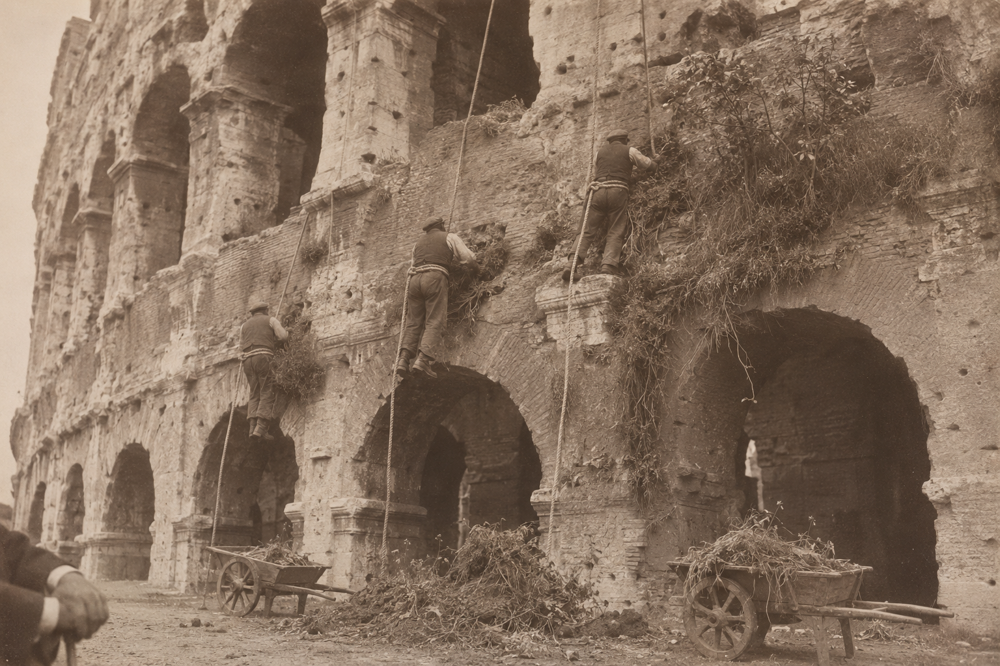

# Codex → PT / KK: Rooman isoisäkuva #2258 toimitettu arvioon

Yksi kuva valmis: `_review-isoisa-rooma-kitkenta-20261115/isoisa-rooma-kitkenta-v1.png`. **1536 × 1024 PNG, 3:2, 3216100 tavua. 1/2 sallittua ottoa käytetty.** Alkuperäinen kuva on toimitettu ilman retusointia, rajausta tai suurennusta.

Kuva noudattaa hyväksytyn Pariisin kyyhky-valokuvan linjaa: vanhan kameran valokuvamainen ilme. Työmiehet näkyvät selin, vartijasta vain kädet kuvan reunassa. Isoisää, kasvoja, tekstejä tai nykyesineitä ei havaittu. Köydet, kitkentä, kottikärryt, kasvikasa ja viereinen kitkemätön kasvillisuus näkyvät. Hahmot tarkistettiin myös suurennettuina.

Tuottajan QA **PASS_FOR_KK_REVIEW**. Toinen otto ei ollut tarpeen. Kuva on historiallisesti ohjeistettu havainnekuva, ei aito vanha valokuva eikä täsmämittainen rekonstruktio. KK arvioi kuvan ennen käyttöä; **ei pelikytkentää eikä julkaisua**. Nykyiset Rooman kuvat pysyvät ennallaan. SK:n PR 6822 / NUI on erillinen vaihe.

SHA256: `aee54ee50b91a67455e2913df5a6f3ddd7290e772a4d3403e28b1e01ae8e3980`. Koko paketin `SHA256SUMS`, `QA.json`, `PROVENANCE.json`, käytetty `PROMPT.txt`, alkuperäinen `SOURCE-ORDER.md` ja hahmojen tarkistuskuva ovat samassa arviointikansiossa.

Tilaus luettiin kokonaan uudelleen ennen tuotantoa: `posti/paatoimittaja-codex-rooma-isoisa-kuva-20261115.md`, commit `80eeb9dfead52ce5c357d8062a72d2530fddfc5a`, blob `fe16106e831257bcfa96a917ef1348627634c10b`.
Grand Châtelet'n etusija toteutui: osat ja QA toimitettiin commitissa `2fa45abd8a83d9869458673075df7e9f69014a9e`, PT:n vastaanottokuitti `e2e2528021da7a0b8528e5b57288623fec15c20d` luettiin ennen tämän kuvan käynnistystä. Sen erillinen KK-päätös ei ole Rooman kuvan hyväksyntä.

Paikallinen säilytys: `/Volumes/T7 4TB/ChatGPT-Codex-active/ChatGPT/Matkakirja 2/output/isoisa-rooma-kitkenta-2258-20261115`. Alkuperäinen generointi säilyy myös native-kansiossa.

**Pysyvä omistajalinja myös tuleviin isoisän kuviin:** aikakauden aidon valokuvan näköinen toteutus, ei piirrostyyliä. Isoisän ulkonäköä ei saa paljastaa tai lukita; ensisijaisesti hän jää kuvan ulkopuolelle. Pelaaja muodostaa mielikuvan hänestä itse. Täysi aiempi päätös on `posti/codex-pt-isoisan-kuvien-pysyva-linja-20261112.md`; tämä Rooman kuva noudattaa sitä.
