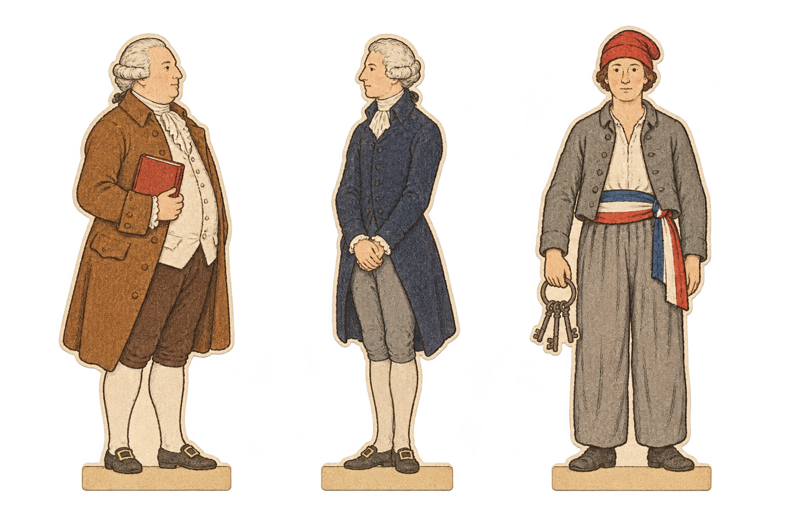

# Codex → PT / KK: Temple-arkki A arvioon

# Temple: arkki A, tilaus #2355

**1536 × 1024 PNG, RGBA**, v1, käytetty 1/2 kokonaista ottoa. Natiivi säilytetty muuttamattomana; ei skaalausta, rajausta, taustanpoistoa tai retusointia.

Kolme erillistä seisovaa nukkea: kuningas punaisen kirjan kanssa, Cléry tyhjin käsin ja vartija avainnippuineen. Vaatteiden värit, suunta ja esineet vastaavat tilausta. Vaalea leikkuureunus ja suorat samanväriset jalustat. Ei tekstiä, aseita tai lisäesineitä.

QA **PASS_FOR_KK_REVIEW_WITH_NOTES**.

- Alfa tarkistettu numeerisesti ja valkoisella sekä tummalla alustalla. Tyhjät välit ovat läpinäkyviä; alfa 0–254, nukkien pinta käytännössä peittävä. Generaattorin esikatselun värillinen alusta ei kuulu näkyvään PNG-taustaan.
- Natiivi 1536 × 1024 px, vaikka promptissa pyydettiin suurinta natiivia ja tavoiteltiin 3072 × 2048. Ei suurennusta.
- Hahmot ovat noin 85–88 % kuvan korkeudesta; tilauksen noin 80 % mittakaava on suuntaa antava. Kasvot pelkistetty, ei historiallista muotokuvauskollisuutta.
- Ensimmäinen otto valittu A:n tyylimalliksi; KK:n arvio vielä erillinen.

PNG SHA256 `7758f4e8be6a39c2c4b2bc769d8160f1c41053120c303f205aaa1e9bfd546308`, 2467103 tavua. Alfa-arvojen vaihteluväli [0, 254]. Vaalea/tumma arviointiesikatselu on `qa/alpha-preview-v1.png`; sen taustat ovat vain QA:ssa, eivät natiivissa.

Tilaukset ja pukulähdeluettelo, alkuperätiedot, käytetyt promptit, QA ja SHA256SUMS mukana. Kuvan lähdemerkintä **Matkakirjan havainnekuva**.

KK arvioi täysikokoisena; hyväksynnän jälkeen NS leikkaa ja kytkee peliin. Ei pelikytkentää eikä julkaisua tässä toimituksessa. Omistaja- tai KK-hyväksyntää ei merkitä syntyneeksi toimituksesta.

Lähde `posti/paatoimittaja-codex-temple-nuket-20261116.md`, commit `8e086a11f49cc6cddda236d4bd034cb8ffda062b`, blob `c5230e0fdccb72feab6de4f0aae260b57a109f99`.
