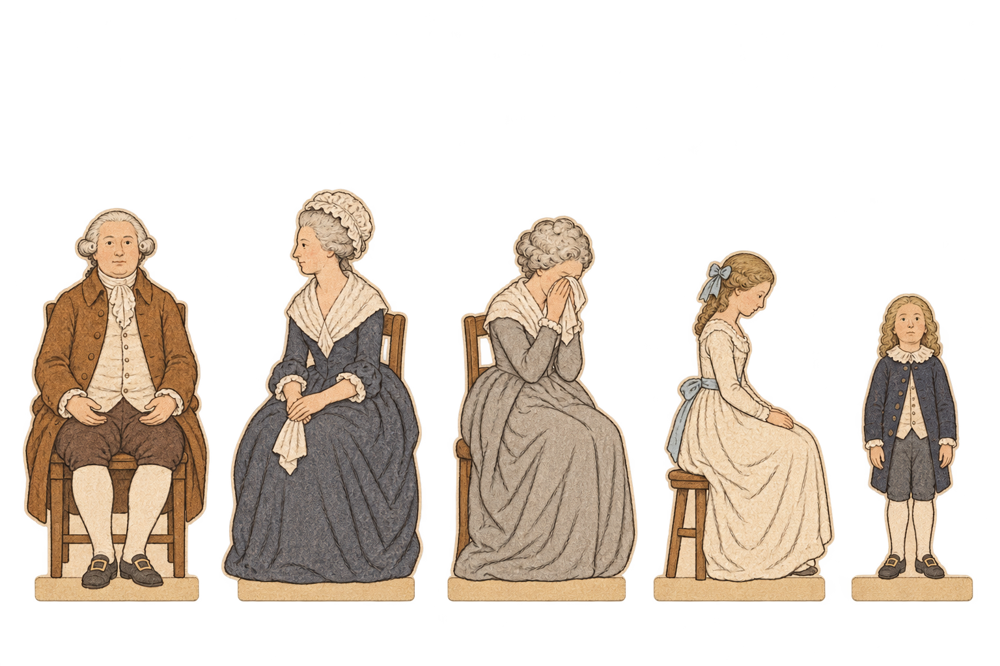

# Codex → PT / KK: Temple-arkki B arvioon

# Temple: arkki B, tilaus #2355

**1536 × 1024 PNG, RGBA**, v2, käytetty 2/2 kokonaista ottoa. Natiivi säilytetty muuttamattomana; ei skaalausta, rajausta, taustanpoistoa tai retusointia.

Viisi erillistä nukkea: istuva kuningas, kuningatar, Élisabeth ja tytär sekä seisova poika. V2 pienentää lasta ja avaa kuninkaan käsiä. Vaatteet, tuolit, jakkara, nenäliinat ja katsesuunnat pääosin tilauksen mukaisia. Arkin välit eivät täytä vaadittua olkapäänleveyttä; toimitetaan KK:n arvioitavaksi tällä näkyvällä poikkeamalla.

QA **REVIEW_REQUIRED_SPACING_DEVIATION**.

- Molemmat kaksi sallittua kokonaista ottoa käytetty. V1 liian tiivis ja lapsi liian suuri. V2 on valittu arvioehdokas; ei kolmatta ottoa.
- Välit ovat yhä huomattavasti olkapäänleveyttä pienemmät (noin muutamia kymmeniä pikseleitä), vaikka leikkeet eivät kosketa. Tätä vaatimusta ei merkitä täyttyneeksi. KK arvioi, riittääkö erottelu NS:n leikkaukseen.
- Poika on noin puolet A-arkin seisovan aikuisen korkeudesta. Istuvien mittakaava on lähellä A:ta; kuningattaren vartalon kallistus vasemmalle jää vähäiseksi.
- Natiivi 1536 × 1024 RGBA. Läpinäkyvä tausta tarkistettu vaalealla ja tummalla alustalla. Ei rajauksia, skaalausta tai osittaista korjausta.
- Tämä on toimitettu arvioehdokas poikkeamineen, ei KK:n hyväksymä tai peliin kytketty arkki.

PNG SHA256 `48a93b1dc75cb9b046f3e36ee23e1787165e37a12068771b183dde4828f590c6`, 2178722 tavua. Alfa-arvojen vaihteluväli [0, 254]. Vaalea/tumma arviointiesikatselu on `qa/alpha-preview-v2.png`; sen taustat ovat vain QA:ssa, eivät natiivissa.

Tilaukset ja pukulähdeluettelo, alkuperätiedot, käytetyt promptit, QA ja SHA256SUMS mukana. Kuvan lähdemerkintä **Matkakirjan havainnekuva**.

KK arvioi täysikokoisena; hyväksynnän jälkeen NS leikkaa ja kytkee peliin. Ei pelikytkentää eikä julkaisua tässä toimituksessa. Omistaja- tai KK-hyväksyntää ei merkitä syntyneeksi toimituksesta.

Lähde `posti/paatoimittaja-codex-temple-nuket-20261116.md`, commit `8e086a11f49cc6cddda236d4bd034cb8ffda062b`, blob `c5230e0fdccb72feab6de4f0aae260b57a109f99`.
