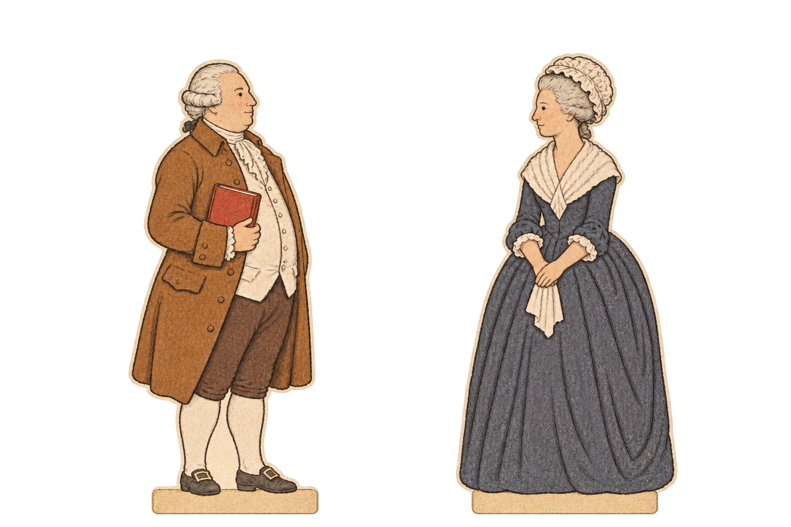

# Codex → PT / KK: Temple-arkki D arvioon

# Temple: arkki D, tilaus #2358

**1536 × 1024 PNG, RGBA**, v2, käytetty 2/2 kokonaista ottoa. Natiivi säilytetty muuttamattomana; ei skaalausta, rajausta, taustanpoistoa tai retusointia.

Kaksi erillistä seisovaa päähenkilöä: kuningas A1:n ruskeassa takissa punainen kirja kädessään ja kuningatar siniharmaassa leningissä valkoisen nenäliinan kanssa. Hahmot kääntyvät toisiinsa päin. Kasvot, puvut, musteviiva ja jalustat seuraavat A/B-mallia.

QA **PASS_FOR_KK_REVIEW_WITH_NOTES**.

- Toinen otto valittu. Ensimmäisen oton hahmot olivat liian suuria ja nimikylttien ylätila niukka. V2:ssa korkeus noin 86–87 % ja ylätila noin 10–11 %, lähteen A-hyväksynnän 86 % mittakaavaa lähellä.
- Kuningas on A1:n mukainen uudelleen piirretty hahmo, ei pikselintarkka suurennos. Puvun yksityiskohtiin tulee pieniä eroja; kasvot pysyvät pelkistettyinä.
- Natiivi 1536 × 1024 px. Alfa ja aukot tarkistettu sekä valkoisella että tummalla alustalla. Ei retusointia, skaalausta eikä rajausta.
- A:n hyväksyntä 9a24bdf0232d802b83ed7cece1fc9609dd89f02d koskee tyylimallia; D:n KK-hyväksyntä, omistajahyväksyntä ja pelikytkentä vielä erillisiä.

PNG SHA256 `0c6ade209770f017692c0003d15e38e4b6d7fb14a22708b651f445c33a37fcd5`, 2087519 tavua. Alfa-arvojen vaihteluväli [0, 254]. Vaalea/tumma arviointiesikatselu on `qa/alpha-preview-v2.png`; sen taustat ovat vain QA:ssa, eivät natiivissa.

Tilaukset ja pukulähdeluettelo, alkuperätiedot, käytetyt promptit, QA ja SHA256SUMS mukana. Kuvan lähdemerkintä **Matkakirjan havainnekuva**.

KK arvioi täysikokoisena; hyväksynnän jälkeen NS leikkaa ja kytkee peliin. Ei pelikytkentää eikä julkaisua tässä toimituksessa. Omistaja- tai KK-hyväksyntää ei merkitä syntyneeksi toimituksesta.

Lähde `posti/paatoimittaja-codex-temple-nuket-lisays-DE-20261116.md`, commit `e45b9ad0161a4a15a450eeab8a0796abd7a8f5c9`, blob `697a0b41832fe444b3a46071e6374e0edc188d0f`.
