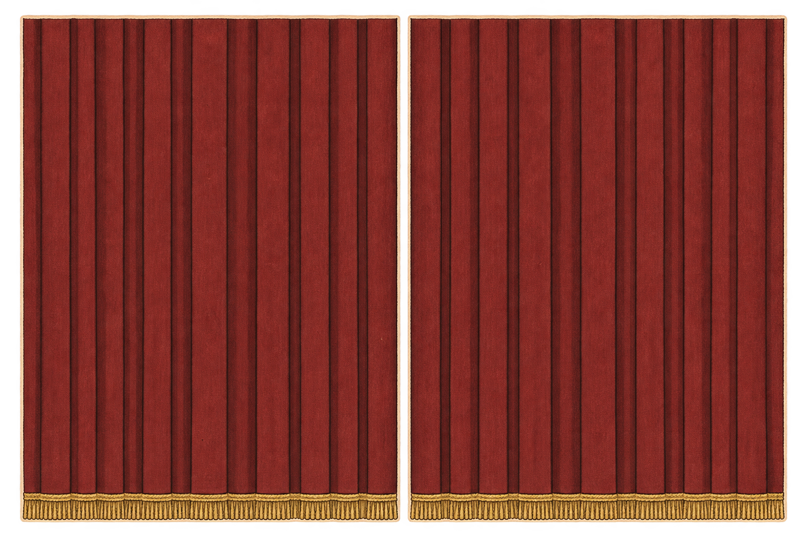

# Codex → PT / KK: Temple-arkki E arvioon

# Temple: arkki E, tilaus #2359

**1536 × 1024 PNG, RGBA**, v1, käytetty 1/2 kokonaista ottoa. Natiivi säilytetty muuttamattomana; ei skaalausta, rajausta, taustanpoistoa tai retusointia.

Kaksi erillistä tummanpunaista esiripun puoliskoa, suorina suljettuun asentoon, välissä läpinäkyvä rako. Pystysuuntaiset poimut, kullanvärinen hapsunauha alareunassa, paperiteatterin muste ja laakea väritys. Ei valokeilaa, näyttämön lattiaa tai hahmoja.

QA **PASS_FOR_KK_REVIEW_WITH_NOTES**.

- Ensimmäinen otto valittu; 1/2 kutsua käytetty. Toinen otto ei käynnisty automaattisesti.
- Valaistus on tasainen; poimujen tumma/vaalea vaihtelu on maalattua muotoa, ei erillistä näyttämövaloa.
- Poimurytmi sopii venytyksen ja toiston kokeiluun. Pikselintarkkaa saumatonta vaakatoistoa ei ole varmennettu, ja vaalea leikkausreunus näkyy puoliskojen reunoissa. NS/KK arvioi toistotavan pelissä.
- Natiivi 1536 × 1024 px; RGBA-tausta ja keskirako tarkistettu vaalealla ja tummalla alustalla. Ei skaalausta, rajausta tai alfan muokkausta.
- KK-hyväksyntä, omistajahyväksyntä, pelin liike/valokeila ja julkaisu ovat erillisiä.

PNG SHA256 `85cfbe5bfef66d3e49a1cbb746bd77ee570bfd28eb98dcd067b34f9a37f9b115`, 3062624 tavua. Alfa-arvojen vaihteluväli [0, 254]. Vaalea/tumma arviointiesikatselu on `qa/alpha-preview-v1.png`; sen taustat ovat vain QA:ssa, eivät natiivissa.

Tilaukset ja pukulähdeluettelo, alkuperätiedot, käytetyt promptit, QA ja SHA256SUMS mukana. Kuvan lähdemerkintä **Matkakirjan havainnekuva**.

KK arvioi täysikokoisena; hyväksynnän jälkeen NS leikkaa ja kytkee peliin. Ei pelikytkentää eikä julkaisua tässä toimituksessa. Omistaja- tai KK-hyväksyntää ei merkitä syntyneeksi toimituksesta.

Lähde `posti/paatoimittaja-codex-temple-nuket-lisays-DE-20261116.md`, commit `e45b9ad0161a4a15a450eeab8a0796abd7a8f5c9`, blob `697a0b41832fe444b3a46071e6374e0edc188d0f`.
