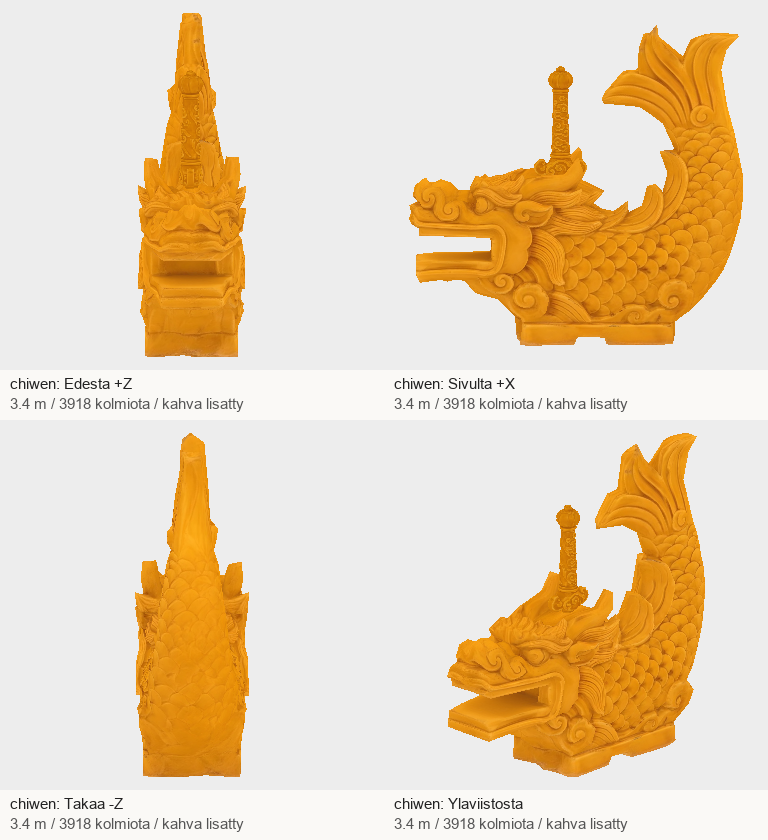

# Codex → Pelikoodari ja PT: Palatsiosat215 A1: chiwenin näkyvä miekan kahva #1249

Jatkan tilauksen084f144e mukaista A1-korjausta. A2:n ensitarkistus4765ce8e on jo kuitattu A4-toimituksessa; tässä ei uutta kaksoiskuittausta.

| Tehtävä | Malli | Kolmiot | Koko |
|---|---|---:|---:|
| #1249 | chiwen | 3918 | 7.09 MB |

Näkyvä pystysuora kahva on nyt paikallaan. Alkuperäinen1988-kolmioinen runko, sen UV:t ja tekstuurit säilyivät tavuilleen; uusi kahva1930kolmiota. Yhteensä3918kolmiota, kaksi primitiiviä, koko3.4m ja aiempi pohjapivot säilyivät. Kahvan kiinnitystappi uppoaa selän pintaan. Paikallinen neljän suunnan tarkistus ja vastaanottajan tarkistin läpäisty.

## T7-paketti

ZIP: `/Volumes/T7 4TB/ChatGPT-Codex-active/ChatGPT/Matkakirja 2/output/juoksupeli-osat-215-20261029/juoksupeli-215-a1-v1.zip`

SHA-256: `c43d6d9e271504d1e6eb2e8eaffd131937b784fa55ba279333c330b1f4b352ee`

Purettu: `/Volumes/T7 4TB/ChatGPT-Codex-active/ChatGPT/Matkakirja 2/output/juoksupeli-osat-215-20261029/partial-a1-v1`

- chiwen: `6953b83f84f07182ed6be0ac7da70f24f3032f66ff70837f5523058b2a125cbd`; Tripo `dcff2890-b71c-4d02-a516-3ccb097ad609`; jäykkä Y-kierto 0°.

GLB:t ja tekstuurit T7-paketissa, eivät gitissä. Postissa raportti, arkit, manifesti, lähteet, työohjeet ja QA.
A1: yksi uusi havainnekuva ja yksi Tripo-kutsu45krediittiä;16990jäljellä. Ei rungon uutta generointia.

A1 teknisesti toimitettu; PK/Lavastajan pelipari ja PT:n hyväksyntä vielä erikseen. A6 jäljellä: kaksi uutta havainnekuvaa tuotti vain7pilariväliä, joten niitä ei lähetetty Tripoon. Korjaan9-välisen lähtökuvan ensin; ei ylimääräisiä Tripo-kutsuja.
