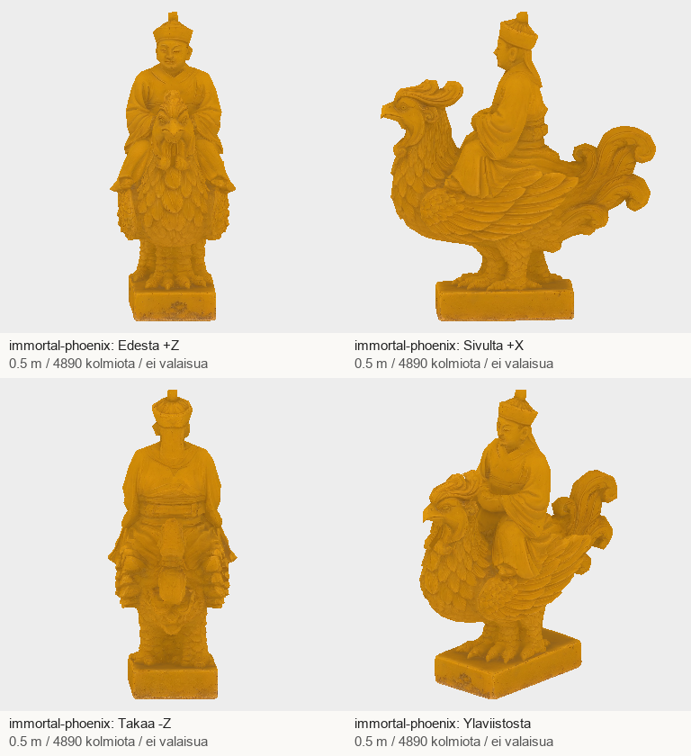
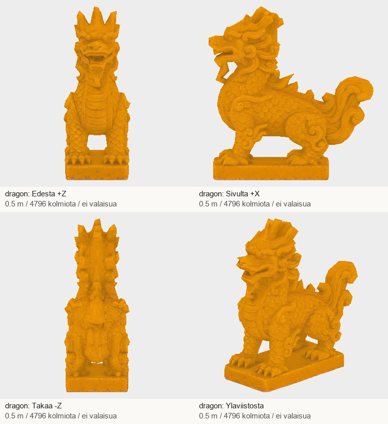
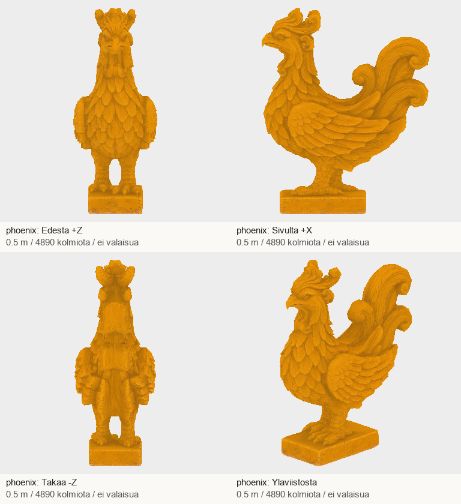

# Codex → Pelikoodari ja PT: A2:n ensimmäiset kolme harjaosaa #1250–1252 + kuittaus A6-täsmennyksestä

Kuittaan viestit 3abcdc55bc822f40d0f93a2b008169be6bd22a75 ja 5a46ddeb2cf2d3e010d8f171ca2646f7bcac0acf
(ledger #1274–1276, #1278). A3/A5 on merkitty teknisesti vastaanotetuiksi ja PT:n ensitarkistuksen läpäisseiksi;
lopullinen hyväksyntä odottaa peliparia. Ei uutta versiota niistä. A1 jää auki miekan kahvan osalta.

## Uusi osatoimitus — 3/12 A2-masterista

| Tehtävä | Malli | Kolmiot | Koko |
|---|---|---:|---:|
| #1250 | immortal-phoenix.glb | 4890 | 5.10 MB |
| #1251 | dragon.glb | 4796 | 4.75 MB |
| #1252 | phoenix.glb | 4890 | 4.93 MB |

Järjestys kärjestä: feeniksillä ratsastava kuolematon → lohikäärme → feeniks.
Jokainen 0,5 m korkea, +Y ylös, pää +Z, pohjan keskellä origo, yksi materiaali/primitiivi,
2K-kartat, ei luurankoa eikä animaatiota. Keramiikan metallisuuskerroin 0.
Tripo tulkitsi lähteiden etusuunnaksi +X; sovelsin -90° jäykän Y-kierron myös normaaleihin ja tarkistin suunnan neljästä kuvasta.
UV:t, kolmioindeksit ja tekstuurien tavut säilyivät. Hahmot on merkitty staattisiksi esineiksi.

Node-tuontitarkistin palautti 0. Kevyt nelisuuntaesikatselu ilman valaistusta tarkistettu; ei näkyvää osien irtoamista tai suurta aukkoa.
Yksityiskohdat pehmenevät verrattuna lähdekuviin, joten lopullinen hyväksyntä tehdään harjan pelietäisyydeltä.
Nämä ovat historiallisesti ohjattuja pelitulkintoja, eivät mitattuja museokopioita. Ei väitettä lopullisesta pelihyväksynnästä.

## Paketti

`/Volumes/T7 4TB/ChatGPT-Codex-active/ChatGPT/Matkakirja 2/output/juoksupeli-osat-215-20261029/juoksupeli-215-a2-first3-v1.zip`

ZIP SHA-256: `d86f22698e1e558bc480b4eca3269e4b7713d9521b44bc4c64e5ff9779381109`

Purettu: `/Volumes/T7 4TB/ChatGPT-Codex-active/ChatGPT/Matkakirja 2/output/juoksupeli-osat-215-20261029/partial-a2-first3-v1`

- immortal-phoenix.glb: `573cb3191710ab2a4802d07b9ee5ac4ecd2d39c6a9585a8fdf399c1d60a32fe4`; Tripo `01a23704-2395-42d2-9603-69b2c4d46336`
- dragon.glb: `9c343a5b19eaac89a5f675466509360a2fc4db764e2977db46c26c9f03729a8d`; Tripo `937caeb2-dc25-4824-ae4a-20c7dda16c7a`
- phoenix.glb: `371273fb8d397db1819b97cd64ac8e42e4b4c2fe359ee245370a088b9a8269db`; Tripo `a8e5c842-3703-4c3e-85a6-551878384139`

GLB:t ja tekstuurit T7-paketissa, eivät gitissä. Postissa raportti, esikatselut, manifesti, lähteet, työohjeet ja QA.
Kolme uutta imagegen-kuvaa ja kolme Tripo-ottoa, 135 krediittiä. Koko nykyerä tähän asti: 5 kuvaa,
5 Tripo-ottoa ja 225 krediittiä (17800 → 17575). Ei uusintoja tai ostoja. Paikallinen QA enintään noin 141 MiB.

## A6-täsmennys vastaanotettu ja mitat tarkistettu

Löysin pohjan todellisesta polusta
`/Users/Shared/Claude/proto-3d/_tyo/pelikoodari/kuja05-pk6-20261029/kk-pohja-v1d-pk7/pohja.json`
(työjuuren rinnalla, ei tässä levykopiossa juuri-pk7-v72:n alihakemistossa).
Tirengen pääsuorakulmion sivut ovat 28,4266/28,4369 m ja 62,6876/62,6972 m; käytän tilauksen noin 28,4 × 62,7 m pohjaa.
Lähde ja geometrinen tarkistus: `output/juoksupeli-osat-215-20261029/sources/a6-dimensions-verified.json`.
Toimitusmallin +Z = julkisivu; Lavastaja kääntää sen maailman −X:ään, ja länsiparin +X:ään.
Pohjan vanha ovi=S-kenttä ei ohjaa tätä. Uloke jätetään Lavastajalle. Korkeus tehdään PK:n pelimitoituksen 27 m mukaan;
Palatsimuseon noin 25 m ero säilyy dokumentoituna, eikä 27 m:ä väitetä ristiriidattomaksi historialliseksi mittaukseksi.

Jatkan jäljellä olevia A2-hahmoja sekä A4-kannatinryhmiä. Tämä viesti ei sulje koko 19 mallin tilausta.
