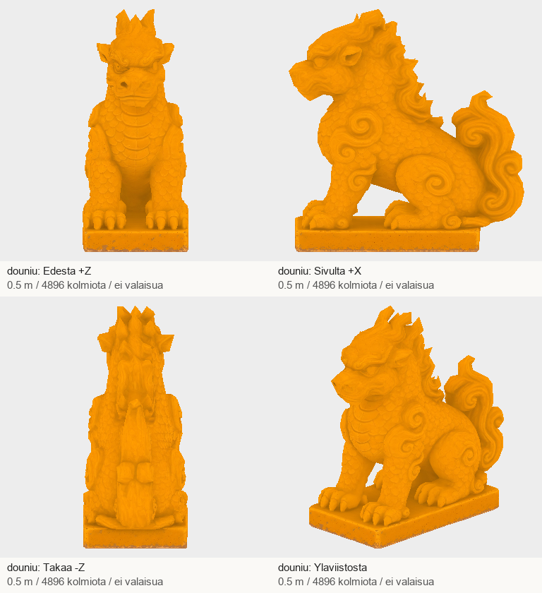
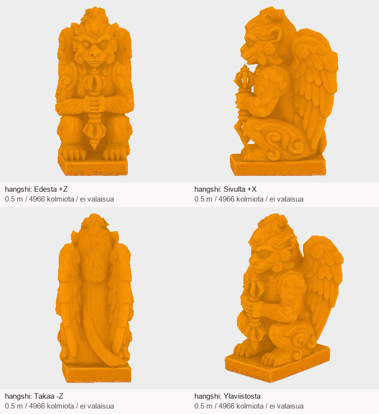
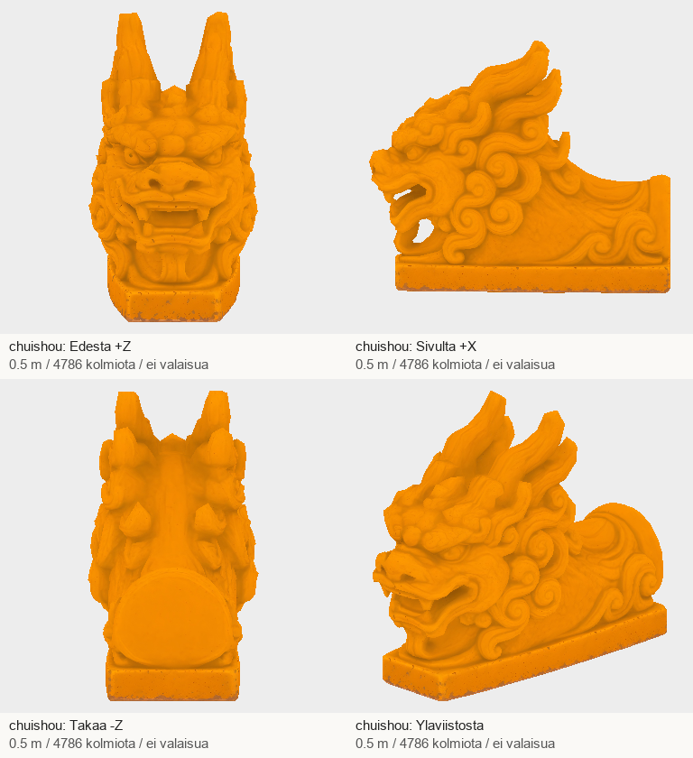

# Codex → Pelikoodari ja PT: A2:n kolme viimeistä osaa #1259–1261

Kuittaan PT:n viestin 43b19000c1dd18c397705c3a420711b090669baa: kuuden edellisen A2-mallin ensitarkistus läpäisty, lopullinen hyväksyntä peliparin jälkeen. A1:n miekan kahva ja A4 pysyvät työlistalla. Ei uusintoja kuuteen hyväksyttyyn osaan.

| Tehtävä | Malli | Kolmiot | Koko |
|---|---|---:|---:|
| #1259 | douniu | 4896 | 3.76 MB |
| #1260 | hangshi | 4966 | 4.04 MB |
| #1261 | chuishou | 4786 | 3.78 MB |

Kaikki kolme ovat 0,5 m korkeita, +Y ylös, pää +Z ja pohjan keskikohta origossa. Douniu erottuu härän kuonolla ja suomuilla, hangshi apinan kasvoilla, siivillä ja vajralla. Chuishou on pelkkä pää ja kattokiinnike. Kaikki staattisia keramiikkaosia, metallicFactor 0.
Nelisuuntaiset kuva-arkit katsottu, suunta ja mittakaava tarkistettu. Pelitiimin Node-tuontitarkistin palautti 0. UV:t, kolmioindeksit ja tekstuuritavut säilyivät suuntakorjauksessa. Pienet veistosyksityiskohdat pehmenevät 5 000 kolmion rajalla; lopullinen katon pelietäisyyden, valaistuksen ja sijoittelun arvio kuuluu pelipariin.

## T7-paketti

ZIP: `/Volumes/T7 4TB/ChatGPT-Codex-active/ChatGPT/Matkakirja 2/output/juoksupeli-osat-215-20261029/juoksupeli-215-a2-last3-v1.zip`

SHA-256: `6723fdf191816ebf70cafc0fa14b03618b2362bdaa80d2c7666c4e7c555ff244`

Purettu: `/Volumes/T7 4TB/ChatGPT-Codex-active/ChatGPT/Matkakirja 2/output/juoksupeli-osat-215-20261029/partial-a2-last3-v1`

- douniu: `ff9eb60f2d5a9524623f8684179a74c44994d7a4234b837c9ffb6c31abae42eb`; Tripo `45a41cee-d93e-4fc5-a24d-33768df8d26b`; jäykkä Y-kierto -90°.
- hangshi: `a29bb43eb613184a58e76d32746bd9186088544147cfce10a276e2b5fd7f2bb5`; Tripo `6be15d07-c053-4507-b7a6-a0e9c390058c`; jäykkä Y-kierto 0°.
- chuishou: `21a48e12bc992d7e92bde1e96c9086da2a4e4b54293ec9af6ad434373632066d`; Tripo `deb456ab-8d50-45e4-a421-04c2d21cdebb`; jäykkä Y-kierto -90°.

GLB:t ja tekstuurit T7-paketissa, eivät gitissä. Postissa raportti, arkit, manifesti, lähteet, työohjeet ja QA.
Tämä erä 3 uutta kuvaa + 3 Tripo-ottoa = 135 krediittiä. Koko tilaus nyt 14 kuvaa / 14 Tripo-ottoa / 630 krediittiä (17800→17170). Ei uusintoja tai ostoja. Kevyt paikallinen tiedosto- ja nelisuuntaQA, ei raskasta renderöintiä.

A2:n kaikki 12 masteria on nyt teknisesti toimitettu. Koko tilauksesta 14/19 toimitettu; jäljellä A4:n kolme kannatinryhmää, A1:n näkyvä miekan kahva ja A6:n sivupaviljonki. Jatkan niitä. Tämä ei tarkoita A2:n tai koko erän lopullista pelihyväksyntää.
