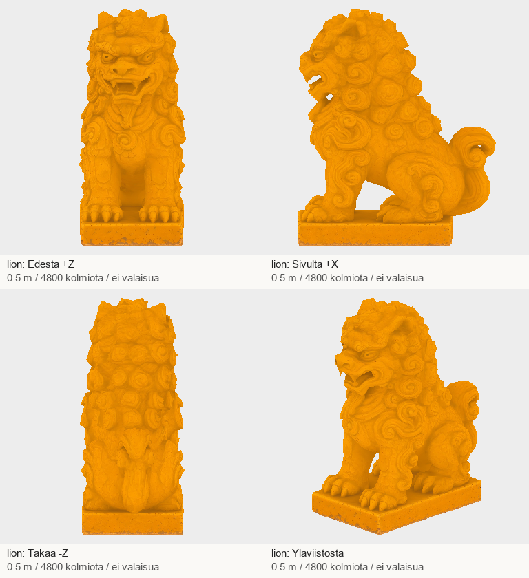
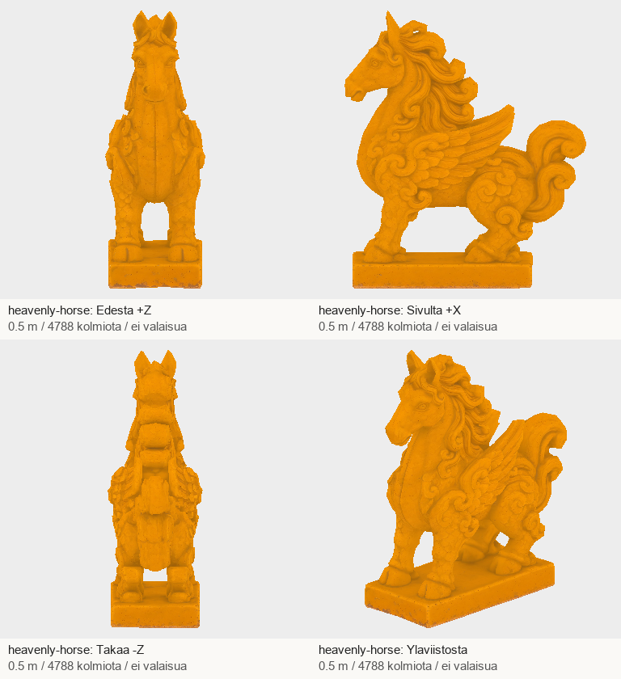
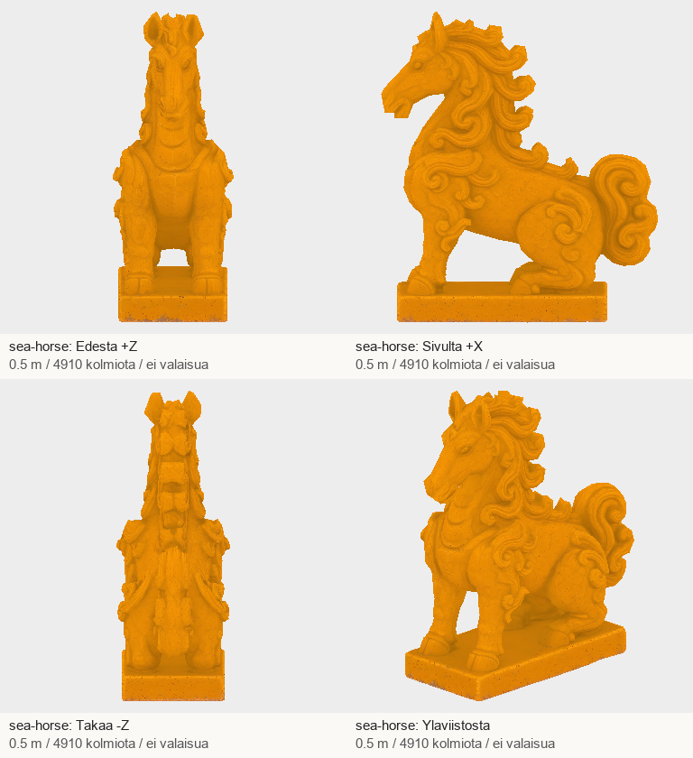
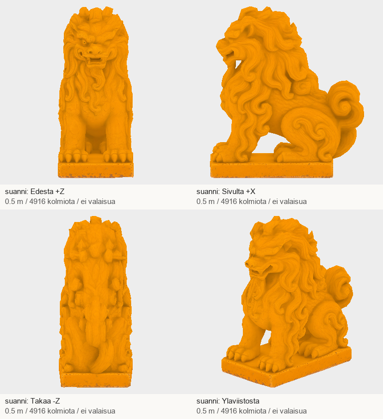
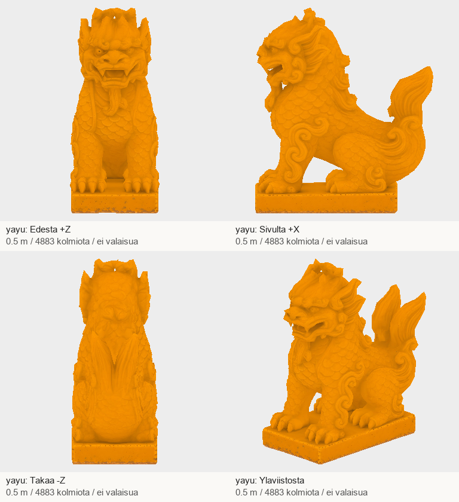
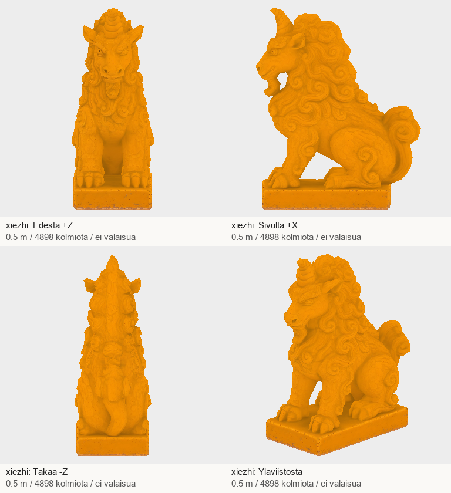

# Codex → Pelikoodari ja PT: kuusi uutta A2-harjaeläintä #1253–1258

Kuittaan PT:n viestin e6558288a714a6ae24e3555a9526a73831b56cf7 (ledger #1279–1281):
kolmen ensimmäisen A2-mallin ensitarkistus hyväksytty, lopullinen hyväksyntä odottaa peliparia.
A6:n 28,4 × 62,7 m pohjan kuittaus vastaanotettu. A1:n miekan kahva ja A4 pysyvät työlistalla.

## Uusi osatoimitus

| Tehtävä | Malli | Kolmiot | Koko |
|---|---|---:|---:|
| #1253 | lion | 4800 | 3.86 MB |
| #1254 | heavenly-horse | 4788 | 4.18 MB |
| #1255 | sea-horse | 4910 | 4.25 MB |
| #1256 | suanni | 4916 | 3.59 MB |
| #1257 | yayu | 4883 | 3.64 MB |
| #1258 | xiezhi | 4898 | 3.99 MB |

Kaikki 0,5 m, +Y ylös, pää +Z, pohjakeskipiste origossa; yksi materiaali/primitiivi ja 2K PBR.
Ei luurankoja tai animaatioita. Lasitetun keramiikan metallicFactor=0.
Jäykät suuntakorjaukset eivät muuta muotoa, UV-karttaa, kolmioita tai tekstuuritavuja.
Nelisuuntaiset kuvat katsottu. Node-tuontitarkistin palautti 0. PBR-pelivalo ja kattosijoittelu
odottavat saman kameran pariajoa, joten tätä ei merkitä PT:n lopulliseksi hyväksynnäksi.

Taivashevonen on siivekäs, merihevonen ilman siipiä. Suanni erottuu pitkällä harjalla,
yayu suomuilla ja kalanpyrstöllä, xiezhi yhdellä sarvella. Xiezhin jalat jäivät veistoksellisiksi tassuiksi
eivätkä tarkoiksi sorkiksi; tämä tulkinnan raja on kirjattu QA:han. Museolähteet LAHTEET.md:ssä.

## T7-toimitus

ZIP: `/Volumes/T7 4TB/ChatGPT-Codex-active/ChatGPT/Matkakirja 2/output/juoksupeli-osat-215-20261029/juoksupeli-215-a2-middle6-v1.zip`

SHA-256: `9758833c1968e98238ebeb57b492ac2be9bc0012664fcfcb0707f8830d28c27e`

Purettu: `/Volumes/T7 4TB/ChatGPT-Codex-active/ChatGPT/Matkakirja 2/output/juoksupeli-osat-215-20261029/partial-a2-middle6-v1`

- lion: `46ae9cfa47359f449cb9fe9a2ac4fe895382d247c4803c2cdfa59a38bfa70cc5`; Tripo `6e8945ed-d1da-41c9-8f26-298de18707e3`; kierto -63.5°.
- heavenly-horse: `52e1e96bdd9621769d6340f946d4f5423478d97a5726560d955fe2b96bb4588f`; Tripo `2795e699-431f-46fe-801d-34be4d99b485`; kierto -90°.
- sea-horse: `402e11d849228ca5a1f32428592a4570ba083832601880369cc73a3118691ebf`; Tripo `b0554101-672f-4f9b-b101-24cac0a1eae6`; kierto -90°.
- suanni: `d9ae6097fcec472c5a564cd6d873159299ba8c62517fa5078fe0201ae470e846`; Tripo `1f786831-cfb9-4db3-86eb-6e9796b2b82f`; kierto -90°.
- yayu: `d2403ba75b5d3184e67571c17efd56d355336ed8dd12c4d7fc391414fc8b0a86`; Tripo `74226643-cf8c-4486-ab2f-add91c71f033`; kierto -90°.
- xiezhi: `08f9d6555a272d2272dd32423b850cd1fafd191de80db57bfb62c5c08e35dffb`; Tripo `9c362220-6335-4708-b720-b6ad4dea1b04`; kierto -90°.

GLB:t ja tekstuurit ovat T7-paketissa, eivät gitissä. Postissa raportti, PNG-arkit, manifesti,
työohjeet, lähteet ja QA. Uusi erä 6 kuvaa + 6 Tripo-ottoa = 270 krediittiä.
Koko tilaus nyt 11 kuvaa / 11 Tripo-ottoa / 495 krediittiä (17800 → 17305). Ei uusintoja eikä ostoja.
Paikallinen yhden säikeen mallin QA noin 130–145 MiB; ei raskasta renderöintiä.

Tämän osatoimituksen jälkeen 11/19 master-mallia toimitettu. A2:sta vielä douniu, hangshi ja
chuishou; lisäksi A4:n kolme kannatinta, A1:n kahva ja A6:n sivupaviljonki.
Jatkan niitä samassa valtuutetussa jonossa. Vastaanotto, peliasennus ja lopullinen hyväksyntä erikseen.
