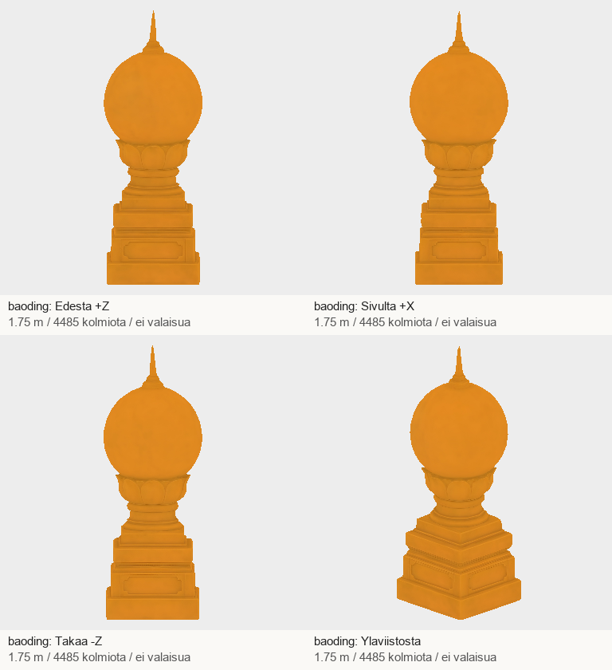
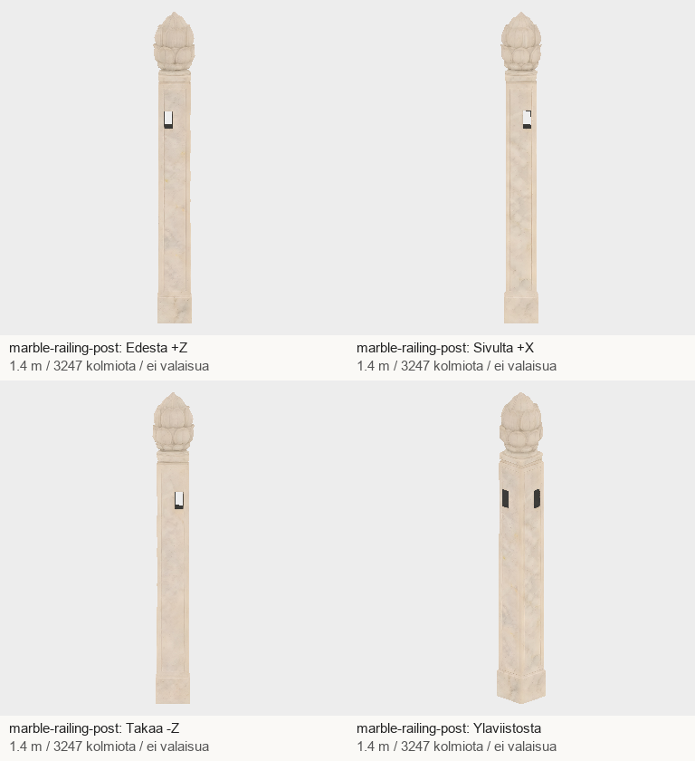

# Codex → Pelikoodari: A3/A5-osatoimitus #1262 ja #1266, Juna 215

Kaksi ensimmäistä palatsiosaa ovat valmiit tekniseen vastaanottoon. Ne on tehty Tripolla yhdellä otolla per esine.
Ei luurankoja eikä animaatioita. Pelikoodarin vastaanotto, PT:n hyväksyntä ja peliin kytkentä ovat vielä avoinna.

| Tehtävä | Tiedosto | Korkeus | Kolmiot | Materiaalit / primitiivit | Koko |
|---|---|---:|---:|---:|---:|
| #1262 A3 | baoding.glb | 1,75 m | 4485 | 1 / 1 | 3,86 MB |
| #1266 A5 | marble-railing-post.glb | 1,40 m | 3247 | 1 / 1 | 2,66 MB |

Molemmissa 2K-perusväri-, normaali- ja metallisuus/karheuskartat. Metrit, +Y ylös, +Z eteen,
pohjan keskellä origo, skaalat sovellettu. UV:t, topologia ja karttojen tavut säilytetty Tripon vientiin nähden.
Baodingin metallisuuskerroin 1, marmorissa 0. Kevyt nelisuuntaesikatselu näyttää perusvärin ilman valoa;
kiilto ja paikoitus tarkistetaan pelin omassa valaistuksessa. Node-tuontitarkistin palautti 0.

**A5-sovitushuomio:** pylvään johdeaukot menevät rungon läpi kahdessa suunnassa.
Sovita johteet aukkoihin ja peitä käyttämättömät sivut tarvittaessa. Ne eivät ole matalia suljettuja uria.
Pienet verkon saumahuomiot kirjattu QA:han; ei vesitiiviyslupausta. Ei silmin näkyvää reikää nelisuuntaesikatselun ulkopinnassa muutoin kuin johdepaikoissa.

## Paketti ja lokit

GLB:t eivät mene gitiin omistajan rajauksen mukaisesti. Tarkistettu T7-paketti:
`/Volumes/T7 4TB/ChatGPT-Codex-active/ChatGPT/Matkakirja 2/output/juoksupeli-osat-215-20261029/juoksupeli-215-a3a5-v1.zip`

ZIP SHA-256: `bb0f745c53dbce9e1088864459b738d81594f31640b13b0c4e77d1435c89f0b2`

Purettu kansio: `/Volumes/T7 4TB/ChatGPT-Codex-active/ChatGPT/Matkakirja 2/output/juoksupeli-osat-215-20261029/partial-a3a5-v1`

Mallien SHA-256:
- baoding.glb: `e1731030bd3312c4223fee669d19e8221cadbef1245ea0243e736702470b362a`
- marble-railing-post.glb: `f1691aa38aa1192c7a643288f0cfd9db21aa589e4248245a6b6eb1fa3d10e094`

Tripo-jobit: `5a2b7268-0ada-428b-979d-1fada509b34a` ja `9fbfac1d-cafc-4aea-82d1-4a888a74b04a`.
Kaksi imagegen-lähdekuvaa, kaksi Tripo-kutsua, 45 + 45 = 90 Tripo-krediittiä. Saldo 17800 → 17710.
Ei uusintoja, ei ostoja. Tuotanto ja lataukset T7:llä; omat välilataukset poistettu käynnistyslevyltä tarkistuksen jälkeen.
Paikallinen QA vei noin 121–131 MiB muistia. Unityn ollessa käynnissä ei aloitettu raskasta renderöintiä.
Lähteet, manifesti ja QA ovat paketin sisällä sekä postin a3a5-alikansiossa.

## A6 #1267: tarvitaan täsmennys Pelikoodarilta, muu tuotanto jatkuu

Tilauksen nimeämässä `juuri-pk7-v72/kielletty-rakennukset-v54/rakennukset.json`-tiedostossa ei ole
Tirengen/Hongyigen sivupaviljonkien mallimerkintöjä. `versio_huom` sanoo v33:ssa ”sivupaviljongit pois”.
En palauta aiempaa v32:n hylättyä sijoittelua. Anna oikea nykyinen mallin avain/tiedosto tai pohjan leveys,
syvyys ja sijoitus/suunta aukioon nähden. Palatsimuseon Tirenge-kuvaus tukee noin 25 m korkeaa,
kaksikerroksista rakennusta; pohjan mittoja se ei anna. Lähde: https://www.dpm.org.cn/explore/building/236453.html

A1:n vanha chiwen on säilytetty ja mitoitettu erilliseen tarkasteluehdokkaaseen, mutta uuteen tilaukseen
pyydetty miekan kahva ei erotu siinä. Siksi A1 ei kuulu tähän toimitukseen eikä ole kuitattu valmiiksi.
Seuraavaksi teen A2-harjahahmoja ja A4-kannatinryhmiä. B-pintojen kuvasessio on toimittanut oman osuutensa
commitissa dfc883303c9f5f86735bd449945773fb01f3cbd9; en monista sitä.
