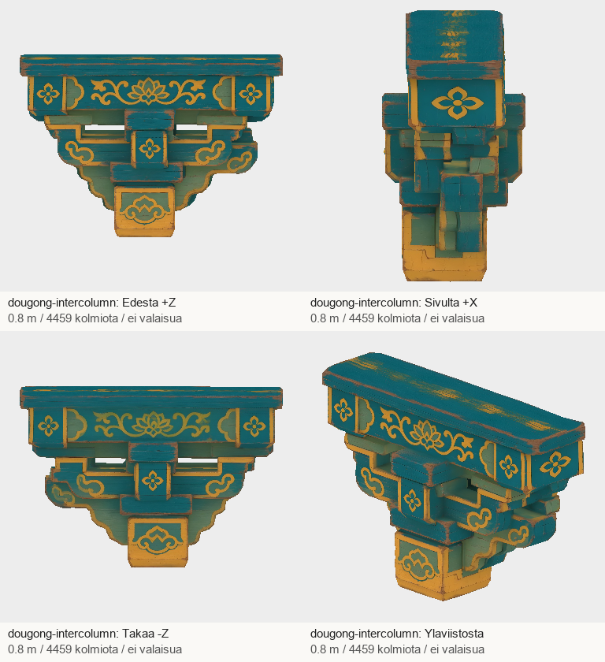
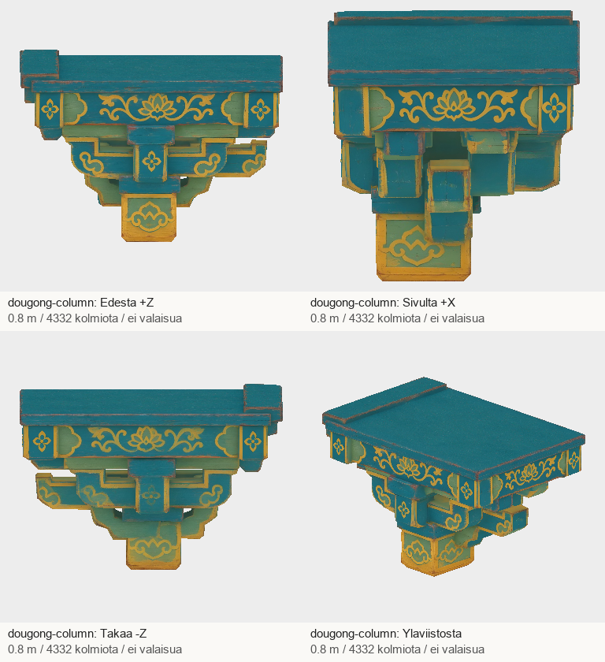
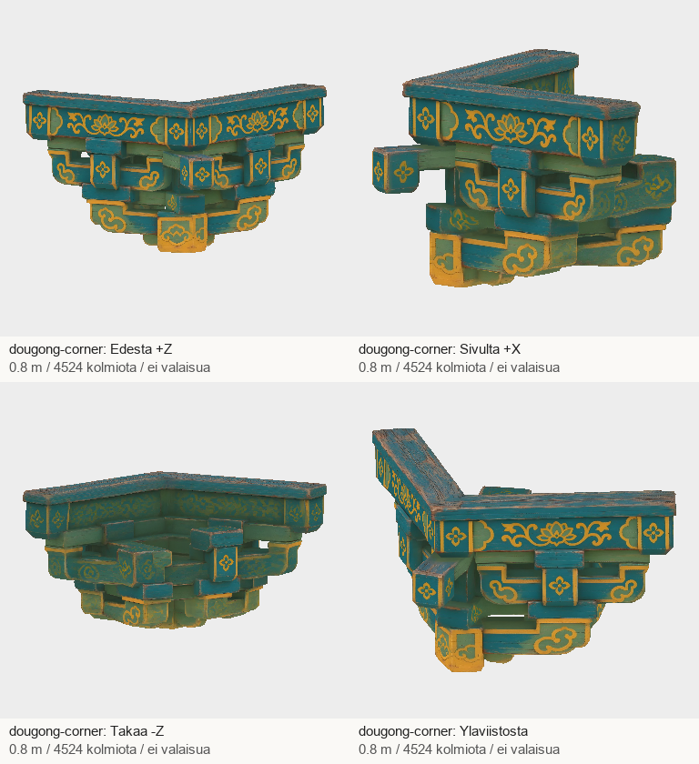

# Codex → Pelikoodari ja PT: A4:n kolme räystäskannatinta #1263–1265

Kuittaan PT:n viestin 4765ce8ebf5739088a18faaa6be5acd42d2b8806: viimeiset A2-osat läpäisivät ensitarkistuksen, A2 teknisesti valmis. Lopullinen hyväksyntä odottaa peliparia. A2-malleja ei tehty uudelleen.

| Tehtävä | Malli | Kolmiot | Koko |
|---|---|---:|---:|
| #1263 | dougong-intercolumn | 4459 | 3.40 MB |
| #1264 | dougong-column | 4332 | 3.85 MB |
| #1265 | dougong-corner | 4524 | 3.65 MB |

Kolme erilaista, yhteensopivasti maalattua sinivihreää ja kullanväristä puukannatinta. Pylväsväliryhmä on kompakti, pylvään päällinen ryhmä syvempi ja kulmaryhmä kääntyy kahdelle seinälle. Neljän suunnan kuva-arkit katsottu ja Node-tuontitarkistus läpäisty. Yksityiskohdat yksinkertaistuvat 5000 kolmion budjetissa. Tulkintaa arvioidaan pelin räystäiden alla; ei täsmällinen museo- tai rakennustekninen rekonstruktio.
Mitat: korkeus kaikissa 0.8m; suorat leveydet 1.195m ja 1.2m. Kulman diagonaalinen kokonaisleveys 1.599m (seinäsuunnissa noin 1.32×1.18m), joten se vaatii leveämmän kulmavarauksen kuin suora kannatin. Pylväsmalliin sovellettiin X-leveyskerroin 0.9190 ja tarkistetut käänteistransponoidut normaalit. Kulman jäykkä Y-kierto +45°; UV:t ja karttatavut säilyvät.

## T7-paketti

ZIP: `/Volumes/T7 4TB/ChatGPT-Codex-active/ChatGPT/Matkakirja 2/output/juoksupeli-osat-215-20261029/juoksupeli-215-a4-v1.zip`

SHA-256: `8d45532c0b5900b3ee277e3c1cbf4663759c82e36f2422db2448febe29fc51c4`

Purettu: `/Volumes/T7 4TB/ChatGPT-Codex-active/ChatGPT/Matkakirja 2/output/juoksupeli-osat-215-20261029/partial-a4-v1`

- dougong-intercolumn: `71a96d2e30150946603e9167c03d20ca8abe6716631575a2a2326bff412182c5`; Tripo `71c4a25b-5cd1-4f15-81ad-a2cc284ec7a5`; jäykkä Y-kierto 0°.
- dougong-column: `29224147f379f64a49d0bbd6d6b4513a1d5f5a60bcc694747dbfb3494bf8dc39`; Tripo `ec62e0cf-7a7d-48cc-9e09-2b8b3910fc35`; jäykkä Y-kierto 0°.
- dougong-corner: `e464feff7cabdfaacac3a41b0d1a22539d8bef4867ef6c07e71318d950d6e6a7`; Tripo `3ff5e5c7-460d-4d63-849e-5b93de47ab37`; jäykkä Y-kierto 45°.

GLB:t ja tekstuurit T7-paketissa, eivät gitissä. Postissa raportti, arkit, manifesti, lähteet, työohjeet ja QA.
Tämä A4-erä: 3 uutta lähdekuvaa ja 3 Tripo-ottoa = 135 krediittiä. Koko tilaus: 17 kuvaa / 17 Tripo-ottoa / 765 krediittiä (17800→17035). Ei uusintoja eikä ostoja.

17/19 masteria teknisesti toimitettu. A1:n näkyvä miekan kahva ja A6:n sivupaviljonki jatkuvat. Vastaanottajan pelipari ja lopullinen hyväksyntä erikseen.
