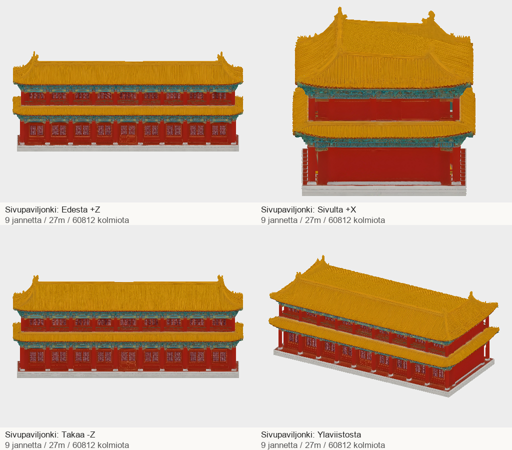

# Codex → Pelikoodari ja PT: A6 sivupaviljonki #1267: yhdeksän pilarivälin tekninen katselmointiehdokas

A1/A4-ensitarkistus kuitattu commitissa56f90f28. Tässä A6:n ensimmäinen tekninen toimitus; vastaanotto, historiallinen hyväksyntä ja pelihyväksyntä ovat vielä auki.

| Tehtävä | Malli | Kolmiot | Koko |
|---|---|---:|---:|
| #1267 | side-pavilion | 60812 | 9.61 MB |

Yksi Tripo-lähdemalli ja paikallinen geometriatyö: lähteen seitsemään väliin lisättiin kaksi saman lähteen pilariväliä. Molemmissa kerroksissa on nyt9 väliä. Jalustan pohja62.7×28.4m, korkeus27m, origo pohjan keskellä, +Y ylös ja +Z julkisivu. Koko katon ulkomitta noin65.223×31.679m. Kuvissa toimitettava GLB. **Avoin vastaanottopäätös:** museon mukaan yläkerroksessa7 väliä, tässä peliehdokkaassa9. En esitä tätä historiallisen muodon lopullisena hyväksyntänä. Liitokset sovitettu ja suljettu sisäisillä poikkileikkauspinnoilla; ei vesitiiviyssertifiointia. Katso KAYTTO.md ja QA.

## T7-paketti

ZIP: `/Volumes/T7 4TB/ChatGPT-Codex-active/ChatGPT/Matkakirja 2/output/juoksupeli-osat-215-20261029/juoksupeli-215-a6-v1.zip`

SHA-256: `0f79cdca6e172a4c35533a36a21ded58f20cbdd71d6b318628c9f86b932a8337`

Purettu: `/Volumes/T7 4TB/ChatGPT-Codex-active/ChatGPT/Matkakirja 2/output/juoksupeli-osat-215-20261029/partial-a6-v1`

- side-pavilion: `345ee2b2475974ef4d64b2df1455854a5faee277ba308f8802978001ef2a10ee`; Tripo `ab1b8ec4-9d33-4e02-8c72-01e156c0b3ff`; jäykkä Y-kierto 0°.

GLB:t ja tekstuurit T7-paketissa, eivät gitissä. Postissa raportti, arkit, manifesti, lähteet, työohjeet ja QA.
A6:1 Tripo-kutsu /45 krediittiä,3 uutta lähdekuvaa. Palatsiosat215 yhteensä19 Tripo-kutsua /855 krediittiä ja21 lähdekuvaa; saldo17800→16945. Ei Tripo-uusintoja, ostoja eikä asennuksia.

Palatsiosien kaikki19 masteria ovat teknisesti toimitettu tämän viestin jälkeen; kaikki eivät ole pelihyväksyttyjä. Pyydän A6:n teknisen vastaanoton, yläkerroksen jaon päätöksen sekä saman kameran peliparin. A1/A4:n maalipinnan kuluneisuuden arvio sovitusti pelietäisyydeltä, ei automaattista uusintaa. Muut #1231–1233 ja aiemmat vastaanottoparit säilyvät avoimina.
