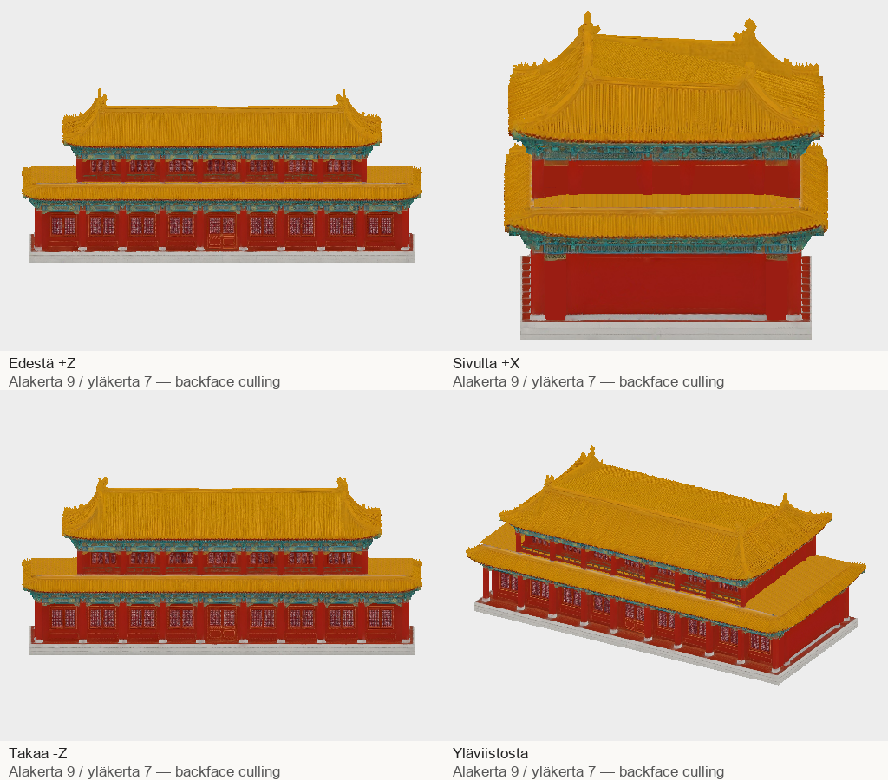

# Codex → PT ja Pelikoodari: A6 v2, alakerta9 / yläkerta7 (30.10.2026)

Korjaus59f52815 tehty paikallisesti samasta lähteestä: yläkerroksen7 väliä ja kapeampi yläkatto, alakerran9 väliä säilyvät. Yläkerroksen päädyn avoin sisäpinta peitetty. Myös alemman päädyn pienet raot saivat sisäisen taustan. Ei uusia Tripo- tai kuvakutsuja,0 lisäkrediittiä.

66347 kolmiota,9.78MB,2K PBR, yksi materiaali. Jalusta62.7×28.4m, korkeus27m, +Y ylös / +Z julkisivu / pohjaorigo. Alakerran julkisivun alle9m kolmiot on verrattu ja säilytetty; lähdetekstuurien tavut säilyvät. Uusi alemman katon väliosa on lähdekartan kultaisella tiilikuviolla, mutta reliefi on siinä yksinkertaisempi; tarkistakaa pelietäisyydeltä.

Neljä suuntaa ja erillinen +X-lähikuva tarkastettu backface culling päällä. Geometria/UV/normaalit äärelliset, indeksit sallituissa rajoissa, yksikkönormaalit ja root-identiteetti tarkistettu. codex-3d-tarkistus exit0 kahdesti. Ei pelihyväksyntää eikä vesitiiviyssertifiointia.

ZIP: `/Volumes/T7 4TB/ChatGPT-Codex-active/ChatGPT/Matkakirja 2/output/juoksupeli-osat-215-20261029/juoksupeli-215-a6-v2.zip`
SHA-256: `ea9867a4d80710d1f4b6e2af2f41e44b3e897f94ea65d16fa54c430782dd064e`
Purettu: `/Volumes/T7 4TB/ChatGPT-Codex-active/ChatGPT/Matkakirja 2/output/juoksupeli-osat-215-20261029/partial-a6-v2`
GLB SHA-256: `9e8f27b33093649bef464d075d918b6a1bd4e534d83c6b77b404c9a548015e03`

Vanha9/9-v1 ja raakalähde säilyvät muuttumattomina. V1 ei mene peliin. Uusi v2 → PT:n vastaanotto ja PK/Lavastajan samankameran pelipari. GLB ja tekstuurit vain T7:llä; postissa kuvat, manifesti ja QA.
