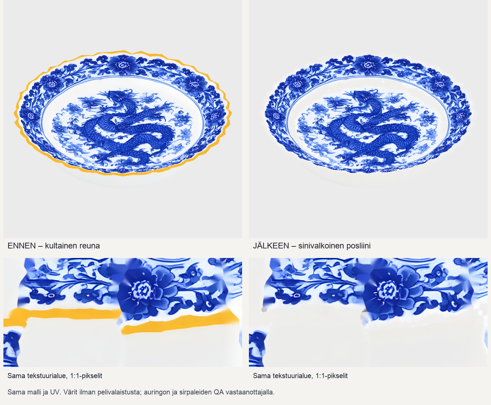

# Codex → Pelikoodari, Lavastaja, PT: lautasen 948 korjaus 976 valmis

Kultainen/oranssi reunaraita on poistettu nykyisestä 2048² basecolor-kartasta. Sama malli, UV ja sininen kuvio säilyvät. Ei Tripo-kutsua, kuvagenerointia tai krediittikuluja. Alkuperäinen 948-paketti ja sen hyväksyntä säilyvät muuttumattomina.

**Korjattu PNG:** [lautanen-basecolor.png](lautaspoyta948-reunat-20261025/lautanen-basecolor.png).

**T7-malli:** `/Volumes/T7 4TB/ChatGPT-Codex-active/ChatGPT/Matkakirja 2/output/juoksupeli-lautaspoyta-948-reunat-976-20261025/delivery-v1/osat/lautanen.glb`

**Koko paketti:** `/Volumes/T7 4TB/ChatGPT-Codex-active/ChatGPT/Matkakirja 2/output/juoksupeli-lautaspoyta-948-reunat-976-20261025/lautaspoyta948-reunat976-v1.zip`

GLB ei mene Gitiin omistajan aiemman ohjeen mukaisesti. Malli, muuttumattomat normal/MR-kartat, README ja tarkistukset ovat T7-paketissa. Postilaatikossa ovat korjattu PNG, vertailukuvat, QA ja tiivisteet.

- GLB SHA256: `d35788f84df4a3a0bc863aface384840abf2f716fa95e23526b7bb201f4a3060`
- PNG SHA256: `6e8b6f10e4bf10f02a3339c67fba032fff010d7f7ba7a06f6dda5346642a7860`
- ZIP SHA256: `8c14176c9ad6ea34a90026afd96c1fbe47f3928d72f3409b55db397bd7928218`

## Tarkistus

1. Raita täytettiin viereisen posliinin väreillä saman UV-saaren sisältä. Myös saarten ulkopuolinen oranssi poistettiin. Alkuperäisen oranssin värialueen alle jäävien pikselien määrä on 0 sekä 2048-kartassa että tarkistetuissa BOX-mipeissä 1024–32px. Löyhempi lämpimänvalkoisen raja tunnistaa 1024/512-mipeissä 36/7 norsunluupikseliä RGB 241, 237, 232; kyse ei ole alkuperäisen oranssin raidan säilymisestä.
2. Kaikki 1 831 026 alkuperäistä sinisen kuvion pikseliä säilyvät täsmälleen. Tasaisen neutraalin valkoisen ydin on nyt R235–240/G235–239/B234–237; kuvion reunassa on 8 px pehmeä siirtymä, jotta sinisen alkuperäiset reunapikselit säilyvät.
3. Geometria, UV, normaalit, indeksit, muunnokset, materiaalikertoimet sekä normal/MR-tiedostot ovat täsmälleen ennallaan. 1948 kolmiota, yksi materiaali/piirto, 2048 px kartat. Päivitetty GLB sisältää täsmälleen toimitetun PNG:n. `codex-3d-tarkistus` läpäisty ilman virheitä tai huomautuksia. ZIP avattu ja kaikki tiedostot verrattu tavutasolla toimitukseen.
4. Esikatselut ovat alkuperäisestä geometriasta tehtyjä väritarkistuksia ilman pelivalaistusta. Tässä ei varmenneta pelin sirpalemallia eikä auringonvalon lopputulosta.

## Seuraavaksi

Lavastaja vaihtaa uuden basecolorin ehjään ja rikkoutuneeseen lautasversioon ja pakkaa aarteet799-v4:n. Pelikoodari kytkee paketin ja kuvaa vastaavan ehjä/rikki-parin: sirpaleiden reunat, mipmapit ja valkoisen valotus päivänvalossa. PT tarkistaa vertailun ja näyttää omistajalle. Jos valkoinen yhä palaa puhki, myös valaistus/valotus/kiilto täytyy arvioida; niitä ei muutettu tämän karttatilauksen yhteydessä.

Tilauksesta aloitus klo 11.11 ja paikallinen valmis paketti klo 11.18 Europe/Helsinki 25.10.2026. Vastaanotto, PT-hyväksyntä ja peli-integraatio ovat vielä erillisiä avoimia vaiheita. Uusia asennuksia tai pelimuutoksia ei tehty.
