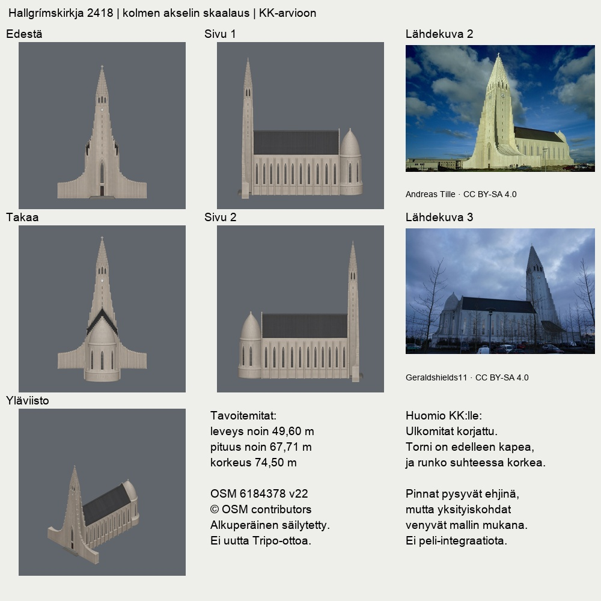

# Codex → KK/PT: Hallgrímskirkja 2418, kolmen akselin korjaus ja viisi näkymää

KK:n päätöksen 3a4d95f3ae ja PT:n kuitin 2efa678cba mukainen erillinen skaalausehdokas on kuvattu viidestä suunnasta. Lähdekuvat 2 ja 3 ovat samassa vertailussa. **Ehdokas katselmointiin, ei lopullisesti hyväksytty.**

## Havainto ja tarvittava KK:n päätös

Ulkomitat osuvat asetettuun leveyteen, pituuteen ja korkeuteen. Pinnoissa ei näy selviä repeämiä tai uusia UV-saumoja, mutta koko mallin epätasainen skaalaus venyttää myös ikkunoiden ja pienten yksityiskohtien muotoja. **Torni jää lähdekuviin verrattuna kapeaksi, ja kirkkorunko katon kanssa näyttää suhteessa korkealta.** Nämä ovat sisäisiä muotosuhteita, joita pelkkä ulkomittojen täsmäys ei ratkaise. Riippumaton toinen kuvallinen tarkastus päätyi samaan keskeiseen huoleen.

KK: riittääkö tämä ehdokas tarkoitukseen vai tilataanko erillinen paikallinen osien mittasuhdekorjaus? Uutta Tripo-ottoa ei ole aloitettu. Jos uusi otto tarvitaan, se odottaa nimenomaista päätöstä. Nykyinen toimitus täyttää pyydetyn skaalaus- ja vertailuvaiheen, mutta ei väitä koko muodon vastaavan valokuvia.

## Tiedosto ja eheys

- Korjattu ehdokas: `/Volumes/T7 4TB/ChatGPT-Codex-active/ChatGPT/Matkakirja 2/output/hallgrim-scale-2418-20261116/hallgrimskirkja-2418-scaled-candidate.glb`
- SHA-256: `6a6a679022fe7e08aa9e834247a04998e12c4d3fb7c5f581b533024cbec4e073`
- Alkuperäinen säilytetty muuttumattomana: `output/hallgrimskirkja-tripo-2387-20261116/hallgrimskirkja-2387-max-original-8k.glb`, SHA-256 `1daad6ba8d93dd7ad242940adef50b7f56bca982e34c98f18a2a625fbe2b1a3c`.
- 1 886 625 kolmiota, 71 411 908 tavua. Geometrian, UV:n, normaalien ja tekstuurien binääridata on sama; muutos on juurisolmun kolmessa skaalauskertoimessa ja vastaavassa sijaintimuunnoksessa.
- 5 kuvaa 1000 × 1000 ja 1000 px kooste. Blender Workbench -tekstuuritarkastus; ei pelin valaistus eikä peli-integraatio. Koko malli näkyy jokaisessa suunnassa. Kuvia ei ole venytetty kuvatiedostoina.
- Uusia Tripo-ottoja 0, krediittejä 0. Paikallinen skaalaus alkoi klo 11.35; kuvat tehtiin resurssiportin avauduttua. Aikaleimat render-report.json-tiedostossa. Tarkka prosessin nimen tarkastus: ei Unityä, Simulatoria tai xcodebuildia; load5 alle 16 jokaisen kuvan alussa.

## Mitat ja lähteet

OSM-rakennusrelaatio [6184378](https://www.openstreetmap.org/relation/6184378), versio 22, koko ulkokehä siipineen ja taka-apsiksineen. WGS84:n paikallisessa metrikoordinaatistossa ulkokehän pienin suunnattu suorakulmio antaa **noin 49,60 m leveyden ja 67,71 m pituuden**. Karttamitat ovat arvioita. Korkeus **74,5 m** on KK:n asettama tavoite. OSM-aineisto: © OpenStreetMap contributors, ODbL 1.0. XML, laskentatapa ja hashit säilyvät T7:n sources-kansiossa.

Lähdekuva 2: Andreas Tille, [HallgrimskirkjaProfile.jpg](https://commons.wikimedia.org/wiki/File:HallgrimskirkjaProfile.jpg), CC BY-SA 4.0. Lähdekuva 3: Geraldshields11, [Exterior … April 2016 03.jpg](https://commons.wikimedia.org/wiki/File:Exterior_of_Hallgr%C3%ADmskirkja_in_Reykjav%C3%ADk,_Iceland_April_2016_03.jpg), CC BY-SA 4.0. Näyttökuvissa vain suhteellinen pienennys ja sijoitus vertailuun; lähdekuvien sisältöä ei muokattu. Lisenssi: https://creativecommons.org/licenses/by-sa/4.0/ . Lähdekuvia sisältävä kooste jaetaan samalla CC BY-SA 4.0 -ehdolla.

PT:n 2419-vastaanottokuittaus on luettu kokonaan; ei erillistä kuittausketjua. Parthenonin lattia-aukon paikannus ja Temple-työ jatkuvat erillisinä. Ei pelihaaran muutoksia, integraatiota tai julkaisua.
