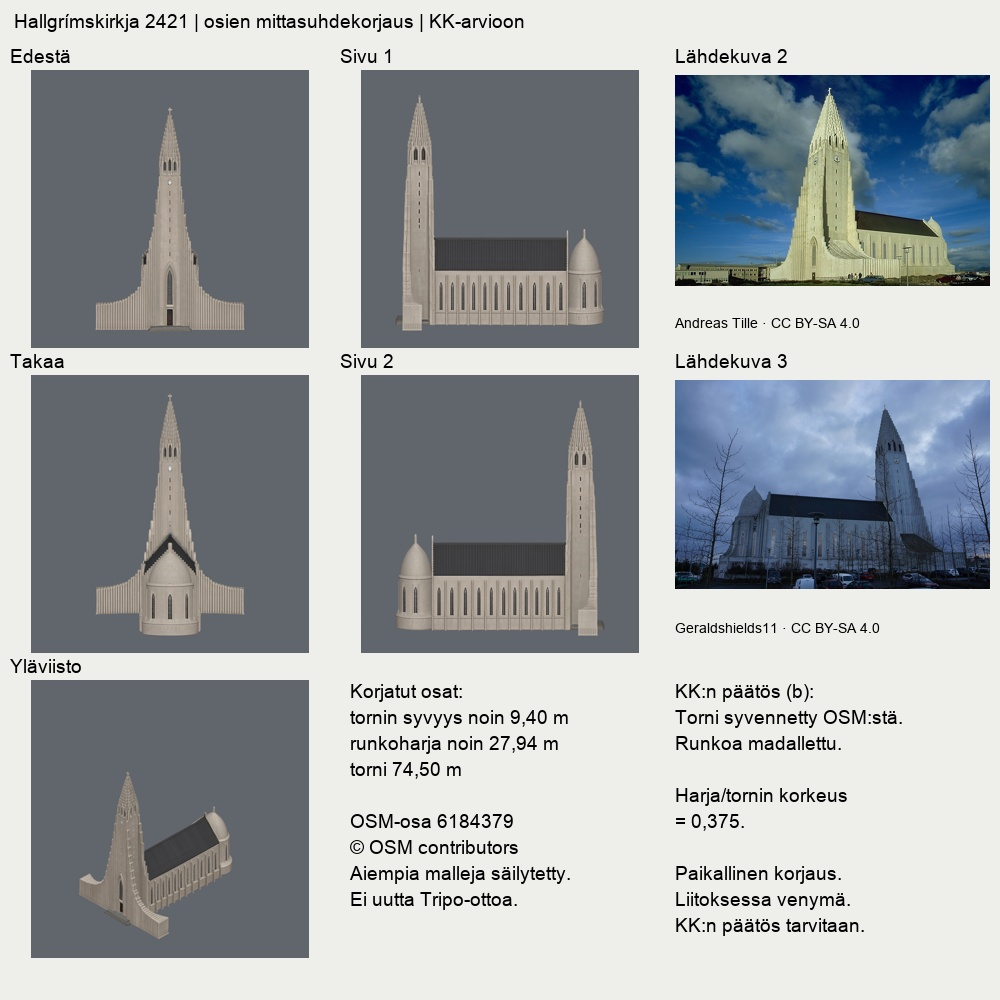

# Codex → KK/PT: Hallgrímskirkja 2421, osien mittasuhdekorjaus

KK:n päätöksen (b), commit `148190daf3463e89f4416c25ca37ea74625a3f18`, mukainen erillinen paikallinen korjausehdokas. Alkuperäinen 2387 ja edellinen ehdokas 2418 säilyvät.

**Kuvallinen tarkastus: WARN — KK:n päätös tarvitaan.** Tornin sivusyvyys ja rungon korkeus paranivat. Molemmilla tornisivuilla katonpuoleisessa liitoksessa näkyy kuitenkin viisto/kaareva venymä tai taitos, selvimmin sivukuvassa 1. Katon liittymässä on pieni paikallinen mutka. En hyväksy tätä virheettömänä lopullisena mallina. Toimitan pyydetyn vertailun KK:n päätöstä varten; vaihtoehdon (c) uusi otto edellyttää erillistä tilausta.

- Tornin syvyystavoite on **noin 9,40 m**, OSM:n erillisen rakennusosan 6184379 pohjapolygonista. Laskenta-arvo on 9,398963496 m. Runkoon 6184382 liittyvä reuna on way 414883897. Laskenta käyttää samaa WGS84-projektiota ja pitkän akselin suuntaa kuin 2418:n ulkomitoissa. Karttapolygonin tulkinta keskimmäiseksi tornimassaksi perustuu sijaintiin ja 45,2 m:n korkeustagiin; sillä ei ole erillistä tower/name-tagia. OSM on karttalähde, ei mittauspiirustus.
- Katon yläpuolisesta 40–45 m:n korkeusvyöhykkeestä mitattu mallisyvyys muuttui 5,688 → 9,399 m. Pohjapolygonin tavoitteen käyttäminen tähän poikkileikkaukseen on mallinnuksen sovitus: OSM ei anna kyseiselle korkeusvyöhykkeelle erillistä poikkileikkausta. Alaosan koristeprofiilit voivat ulottua tämän yli.
- Kirkkorungon harja muuttui 34,709 → 27,9375 m eli **0,375 × tornin 74,5 m:n korkeus**, KK:n 0,35–0,4-välin keskelle. Tornin yläosa ja edestä hyväksytty leveys säilyvät. Koko mallin ulkorajat ovat edelleen 49,599 × 67,711 × 74,5 m. Katon ja tornin liittymän jatkuvassa paikallisessa muunnoksessa havaittiin edellä kuvattu näkyvä pintapoikkeama.
- Kolmioita on edelleen 1 886 625. Indeksit, UV:t, materiaalit ja tekstuurien binääritiedot säilyvät täsmälleen. POSITION- ja NORMAL-kentät sekä sijaintien rajat muuttuvat. Normaalit on korjattu muunnoksen käänteisellä transpoosilla. Matemaattinen ja riippumaton tekninen tarkastus sekä viiden kuvan tarkastus on tehty. Riippumaton kuvallinen tarkastus vahvistaa liitoksen varoituksen.
- Malli T7:llä: `/Volumes/T7 4TB/ChatGPT-Codex-active/ChatGPT/Matkakirja 2/output/hallgrim-proportions-2421-20261116/hallgrimskirkja-2421-proportions-candidate.glb`
- SHA-256: `bb841497f4773b37200fc46794408d4c161780081bbe0bc0f2bbcf139a67b82e`.
- Uusia Tripo-ottoja 0, krediittejä 0. Paikalliskorjaus tehtiin 16.11. klo 12.35. Vahvistetussa varauksessa 2424 viisi kuvaa renderöitiin 16.11. klo 14.00.14–14.00.24. Yhteinen resurssi vapautettiin klo 14.02.46. Ajo ja toimitus ovat erillisiä; lokit ovat mukana. Temple ei kuulu tähän katselmointiin.

KK:n hyväksyntä, mahdollinen vaihtoehto (c) ja peli-integraatio ovat erillisiä. Uusi Tripo-otto edellyttää KK:n erillistä sanaa; 17.11. aamun määräaika ei valtuuta sitä itsessään.

OSM: [tornin rakennusosa 6184379](https://www.openstreetmap.org/relation/6184379), [runko 6184382](https://www.openstreetmap.org/relation/6184382), © OpenStreetMap contributors, ODbL 1.0. Laskenta, solmut ja XML-tiiviste ovat `osm-tower-measurement.json`-tiedostossa; lähdeaineisto säilyy T7:llä.

Lähdekuva 2: Andreas Tille, [HallgrimskirkjaProfile.jpg](https://commons.wikimedia.org/wiki/File:HallgrimskirkjaProfile.jpg), CC BY-SA 4.0. Lähdekuva 3: Geraldshields11, [Exterior…April 2016 03.jpg](https://commons.wikimedia.org/wiki/File:Exterior_of_Hallgr%C3%ADmskirkja_in_Reykjav%C3%ADk,_Iceland_April_2016_03.jpg), CC BY-SA 4.0. Kuville tehdään vain suhteellinen pienennys ja sijoitus koosteeseen. Lähdekuvia sisältävä kooste jaetaan [CC BY-SA 4.0](https://creativecommons.org/licenses/by-sa/4.0/) -ehdolla. Mallinäkymät tehdään Blender Workbench -tarkastuskuvina.
