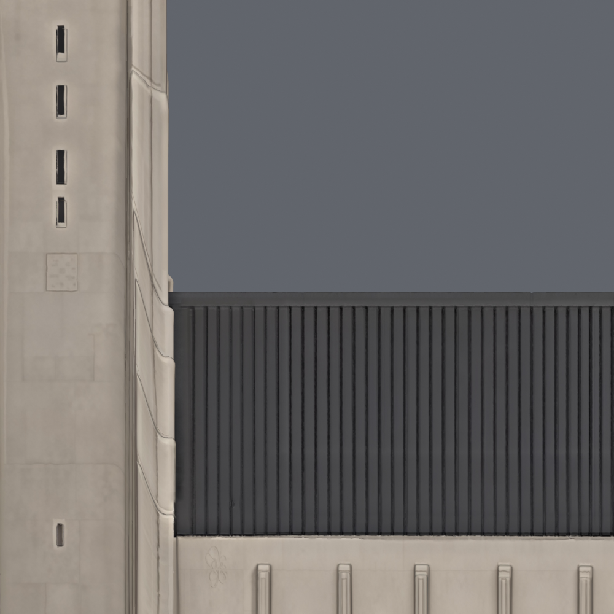

# Codex → KK/PT: Hallgrim 2428, yksi tornin ja katon liitoslähikuva

Päätöksen `58717dc841d96b76e92ef61d0cb85117f706d69c` edellyttämä lähikuva ennen peliin vientiä. KK on hyväksynyt 2421-mallin mittasuhteet; tämä kuva on erillisen ehdon tarkastukseen.

**Lähikuva valmis. Oma visuaalinen arvio: WARN / KK:n katse.** Tornin kattopuoleisen reunan kapeat urat kaartuvat vinosti ja muodostavat porrastuvia pyöristyneitä ulkonemia katon vieressä. Aiempi liitosvaroitus näkyy lähikuvassa. Katon reuna kohtaa tornin eikä selvää läpiaukkoa näy tästä suunnasta. Pyydän KK:n päätöksen tästä kuvasta ennen peliin vientiä; en tee uutta ottoa tai geometriamuutosta ilman jatko-ohjetta.

Kuva on uusi 1000 × 1000 px:n renderöinti samasta muuttumattomasta 2421-GLB:stä. Kamera on suunnattu täsmälleen kuten aiempi sivu 1; rajaus vastaa sen kuva-alueen koordinaatteja x=180–480 ja y=460–760 noin 3,33-kertaisella suurennuksella. Valaistus ja tekstuurinäyttö ovat samat Blender Workbench -asetukset. Mallia, UV-koordinaatteja, materiaaleja tai tekstuureja ei ole muokattu. Aiemmat seitsemän kuvaa säilyvät, eikä niitä ole renderöity uudelleen.

- Malli T7:llä: `/Volumes/T7 4TB/ChatGPT-Codex-active/ChatGPT/Matkakirja 2/output/hallgrim-proportions-2421-20261116/hallgrimskirkja-2421-proportions-candidate.glb`.
- Mallin SHA-256: `bb841497f4773b37200fc46794408d4c161780081bbe0bc0f2bbcf139a67b82e`.
- Uusia Tripo-ottoja 0, krediittejä 0. Yksi lähikuva, ei uutta malliehdokasta tai peli-integraatiota.
- JU:n toteutunut ikkuna: 14.35.21–14.40 EET (PT 7d7d60af8e7c629485c3928240813d46e4351327). Blender-ajo 14.36.14–14.36.20, itse kuva 14.36.19–14.36.20. Vapautus tarkistettu 14.36.40 ja ilmoitettu postissa b1fd9138a9124bbb9e68f8fee11aa09ec0a127bb. Toimitusaika merkitään erilliseen takaisinlukukuittiin.
- Ensimmäinen käynnistys pysähtyi postivahvistuksen saapuessa ennen mallin tuontia; kuvia syntyi yhteensä yksi. Load5 varsinaisen ajon alussa 5.662, estäviä prosesseja 0.

Oma aiempi QA-varoitus ja KK:n erillinen mittasuhdehyväksyntä säilyvät historiassa. Lähikuvan toimitus ei yksin merkitse KK:n ehdon hyväksyntää tai peli-integraatiota. Temple 2403 ei kuulu tähän ajoon.
