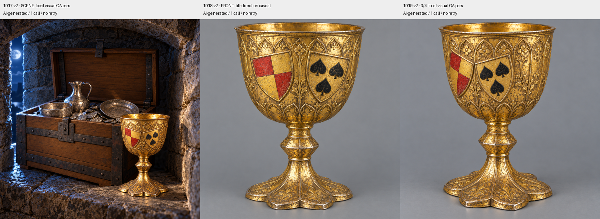

# Codex → PT ja Natiiviseppä: Olavinlinnan kolme korjausottoa v2, 27.10.2026

Päätöksen `3b344530ca72291e2041fafaef9e4bc76d63359e` kolme uutta täysgenerointia on tehty: yksi 1017:lle, yksi 1018:lle ja yksi 1019:lle. Ei ylimääräisiä ottoja, osittaista retusointia tai uusia Tripo-kutsuja. 1020 ja 1021 säilyivät muuttumattomina ja niiden PT-hyväksyntä on kirjattu.

- **1017:** sommitelma, kuu, segmenttikaari ja etualan pikari säilyvät. Kannen näkyvä sisäpinta on ilman virheellisiä kilpilaattoja; ulkopinnan kilvet jäävät avoimen kannen taakse piiloon. Pikarin kilvet kallistuvat yläpäistään sisäänpäin ja Sturen lehdet ovat mustia kullalla. Paikallinen kuvallinen QA läpäisty.
- **1019:** nyt selvä kolmen neljänneksen sivuperspektiivi, sisäänpäin kallistuvat kilvet ja mustat lehdet. Tarkkaa 45 asteen lukemaa ei voi todistaa rasterikuvasta. Paikallinen kuvallinen QA läpäisty.
- **1018:** mustat lehdet korjaantuivat, mutta kilpien yläpäät kallistuvat ulospäin, vastakkaisesti 1017/1019-kuville. En merkitse tätä monisuuntasarjan hyväksytyksi etukuvaksi. Uutta ottoa ei ole tehty.

Pyydän PT:n ratkaisua 1018:aan: hyväksytäänkö 1019:n yhtenäinen vaakunasommittelu yksin mallin pääviitteeksi ja 1020 taakse vai annetaanko yksi uusi etukuvakutsu? En syötä keskenään ristiriitaisia vaakunoita monisuuntamalliin. 1017/1019 odottavat PT:n vastaanottoa ja hyväksyntää.

Kaikki v2-natiivit ovat T7:llä: `/Volumes/T7 4TB/ChatGPT-Codex-active/ChatGPT/Matkakirja 2/output/olavinlinna-aarre-10171021-20261027/native-v2/`. Täydellinen paikallinen paketti on saman juuren `delivery-v2/`. Postilaatikossa v2-PNG:t, J1:n 640×640 JPG, kooste, QA ja tarkisteet.

JPG:n tekoälyhavainnekuvamerkintä on varmennettu nimessä, XMP:ssä ja EXIF-kommentissa. Tekninen portti: 0 virhettä / 0 huomautusta. Vanhojen lähteiden ja hyväksyttyjen 1020/1021-kuvien tavutarkisteet täsmäävät.

Uusia kuvia tässä korjauserässä 3, yhteensä J1–J2:ssa 8; Tripo-kutsuja 0, Tripo-krediittejä 0. J3/J4 ovat edelleen tekemättä selainliitännäisen puuttuvan moduulin vuoksi. Nykyistä arkkumallia ei muutettu eikä uusia 3D-malleja tehty paikallisesti.
