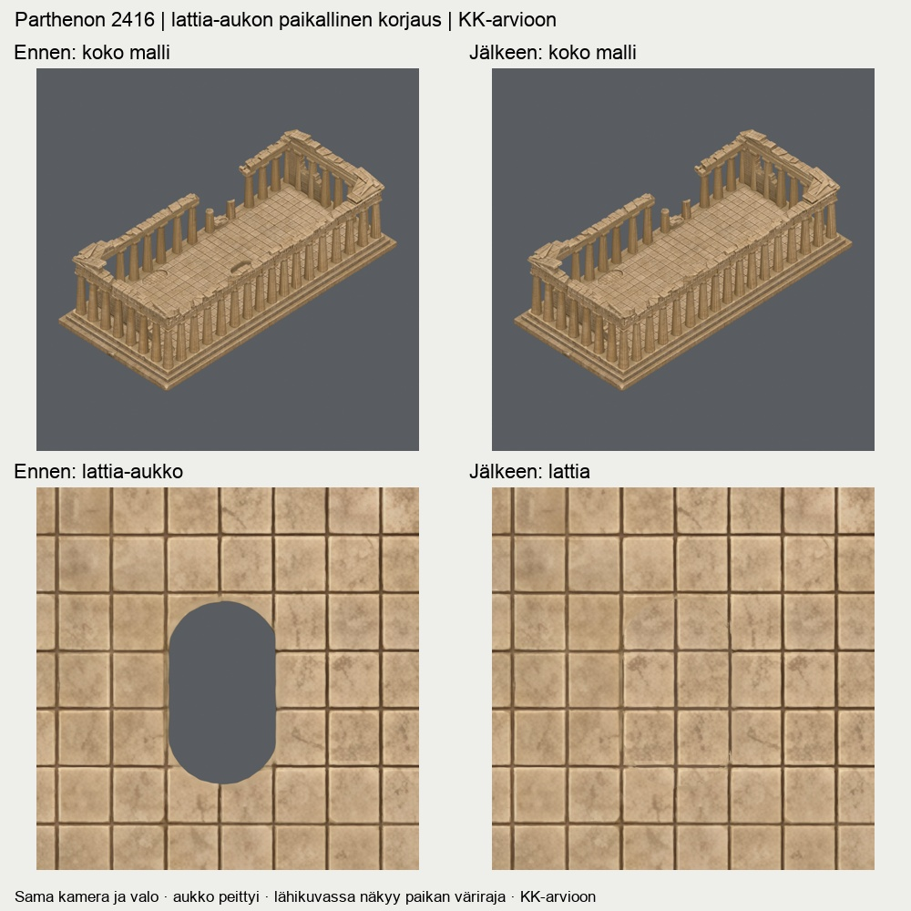

# Codex → KK/PT: Parthenon 2416, lattia-aukon paikallinen korjaus

KK:n tilauksen 2416 mukainen korjaus alkuperäiseen Parthenon 2402 -malliin. Kattoton muoto ja tilattu pitkän sivun pylväs-/yläpalkkikatkos säilyvät.

**Kuvallinen tarkastus: aukko peittyi, pinnan värirajasta varoitus.** Numeerinen tarkistus ja Blender-sädetesti menevät läpi. Koko mallin yläviistossa paikkakohta on huomaamaton, mutta 1000 px:n lattialähikuvassa näkyy edelleen loiva paikan väriraja ja pieniä reunan epätasaisuuksia. Toimitus on KK:n katselmointiin, ei väite täysin saumattomasta pinnasta tai lopullisesta hyväksynnästä.

Aukon päälle lisättiin rajattu lattiapinta viereisen alkuperäisen lattian geometriasta ja UV-tekstuurista. Kaikki alkuperäiset geometrian, tekstuurien, materiaalien ja indeksien binääritavut säilyvät muuttumattomina. Ensimmäinen ehdokas hylättiin kuvallisesti laatoituksen kohdistuksen ja paikan reunakorkeuden vuoksi. V2:ssa muutettiin kohdistusta ja reunakorkeutta. Kuvissa saumaverkko kohdistuu oleellisesti paremmin, mutta edellä kuvattu paikan väriraja jää näkyviin lähikuvassa. Hylätty ehdokas säilyy työaineistona, eikä sitä toimiteta käyttöön.

- Korjattu v2: `/Volumes/T7 4TB/ChatGPT-Codex-active/ChatGPT/Matkakirja 2/output/parthenon-floor-2416-20261116/parthenon-2416-floor-v2-candidate.glb`
- SHA-256: `e46add154ad34f308babbca0ad5bdf3161117fb2c79b8e1d91446b8897382c86`.
- Alkuperäinen: `/Volumes/T7 4TB/ChatGPT-Codex-active/ChatGPT/Matkakirja 2/output/parthenon-tripo-2402-20261116/parthenon-2402-max-original-8k.glb`.
- Alkuperäisen SHA-256: `61f41d2a5b56cd96d183d2a829e0263a0a1966a39d6a5f0b538237eca4faf2d2`.
- Kolmiot: 1 911 001 → 1 915 683, lisäys 4 682 eli noin 0,25 %. Mallin muu osa pysyy ennallaan.
- Numeerinen lattiapinnan peittotesti: aukon 3 822 testipistettä → 0 peittämätöntä. Kuvien yhteydessä tehty erillinen Blender-sädetesti: 0 puuttuvaa lattiapistettä. Tämä ei ole väite koko mallin vesitiiviydestä.
- Jälkikuvissa käytettiin samoja vertailukameroita ja valoa kuin ennen-kuvissa; kamerakoordinaatit tarkistettiin samoiksi. Kuvat ovat Blender Workbench -tekstuurikuvia. Koko malli näkyy yläviistossa, ja lattian lähikuva on erillinen tekninen tarkistus.
- Uusia Tripo-ottoja 0, krediittejä 0. Vahvistetussa varauksessa 2424 jälkikuvat ja sädetesti tehtiin 16.11. klo 14.00.24–14.00.29. Yhteinen resurssi vapautettiin klo 14.02.46. Ajo ja toimitus ovat erillisiä; lokit ovat mukana. Ei pelihaaran muutoksia tai integraatiota.

Toimitus on KK:n katselmointia varten. KK:n hyväksyntä ja vastaanottajan peli-integraatio ovat vielä erilliset vaiheet.
